```{r}
#| label: setup
#| include: false

# Load packages.
suppressPackageStartupMessages({
  library(knitr)
})
```

<!-- The introduction should not have a level-1 heading such as
Introduction. -->

Understanding cognition requires acknowledging that some cognitive
processes operate outside conscious awareness [@Hassin2013Yes;
@Kihlstrom1987Cognitive; @Merikle2001Perception]. Yet, demonstrating
that a process is truly unconscious remains one of experimental
psychology's greatest challenges [@Holender1986Semantic;
@Newell2014Unconscious; @Shanks2021Challenge; @Stockart2025Studying].
The difficulty is not simply to show that a stimulus or a regularity
influences behavior, but to demonstrate that it does so in the absence
of awareness.

Most research on unconscious processing can be broadly categorised into
two types of paradigms. In experiments on unconscious *stimulus*
processing, researchers are often interested in testing whether
individual *stimuli* (or a critical feature of it) can influence
behavior without conscious awareness of those stimuli. To this end, they
often employ procedures that limit the conscious availability of the
relevant information, such as masking or brief stimulus presentations,
and examine whether this information can nevertheless influence
performance [@Kim2005Psychophysical; @Kouider2007Levels]. In other
cases, stimuli are perfectly visible, but they are expected to influence
behavior in ways that participants cannot detect or describe. For
instance, in experiments of implicit *learning*, researchers are
typically interested in investigating whether learned *regularities* or
stimulus contingencies acquired across many trials can influence
behavior without conscious awareness of those regularities, although the
stimuli are clearly visible [@Frensch2003Implicit;
@Perruchet2006Implicit; @Shanks2010Learning]. Thus, although these
paradigms differ in the nature of the relevant information and how it is
presented, both types of paradigms typically combine a measure of the
*influence* of this information on behavior [hereon called "influence
measure", but also known as indirect or implicit\; @Reingold1988Using;
@Shanks1994Characteristics] with a measure of *awareness* of such
information (hereon called "awareness measure", but also known as
direct[^direct] or explicit). Although the procedures used to measure
influence and awareness can vary considerably across studies [e.g.,
@Stockart2025Studying], claims of unconscious processing ultimately rely
on establishing a dissociation between these two measures.

[^direct]: Despite its popularity, we prefer to avoid the
    direct/indirect terminology, as it may be confusing for readers
    unfamiliar with it. Although the terms "direct" and "indirect" refer
    to measures of *processing*, they can be misleading. Using "direct
    measures of awareness" may wrongly suggest that awareness is
    measured directly, implying that the other also measures awareness,
    but indirectly. Similarly, using "indirect measures of influence"
    may wrongly suggest that influence is measured indirectly, when in
    fact influence is measured directly (what is measured indirectly is
    *processing*).

## Three Hypotheses of Unconscious Processing

Much of the evidence for unconscious processing has been organized
around three key hypotheses[^posthoc] [@Shanks2021Challenge]. The first,
and perhaps the most common, is the *group-level dissociation
hypothesis*, traditionally formulated as a *simple dissociation*: the
relevant information influences behavior despite the absence of
detectable awareness. Conventionally, this hypothesis has been tested by
conducting two separate tests at the group level, showing a
statistically significant influence on behavior alongside a
nonsignificant effect on awareness [@Cheesman1984Priming]. In a seminal
study, for instance, @Dehaene1998Imaging found that masked number primes
influenced responses to congruent targets by speeding them an average of
24 ms, although participants could not discriminate the primes
significantly better than chance, concluding that semantic priming can
operate in the absence of awareness. Beyond this specific example, this
kind of evidence has been used to claim unconscious processing in
disparate literatures, such as reward-driven motivation
[@Pessiglione2007How] or face perception [@Finkbeiner2009Role;
@Wojcik2019Unconscious], as well as in lie detection
[@tenBrinke2014Some], response inhibition [@vanGaal2010Unconscious],
fear conditioning [@Ohman1998Emotional], relational memory
[@Reber2012Unconscious], and visual statistical learning as measured by
processes such as distractor suppression [@WangTheeuwes2018How] or
contextual cuing [@Chun1998Contextual; @Jiang2013Rapid], among others
[@Anderson2021Past].

[^posthoc]: Actually, there is a fourth hypothesis that is typically
    tested using an analytical strategy known as *post hoc selection*
    (i.e., to test whether the influence is above-chance after selecting
    only trials or participants with no awareness). We do not consider
    this approach in the present article, because it has no
    straightforward solution from the model here presented---unlike the
    other hypotheses---, and because post hoc selection has been
    criticized not only methodologically [@Rothkirch2022Pervasive;
    @Shanks2017RegressiveResearch; @Yaron2024Progressing], but also
    conceptually [@Schmidt2026Unconscious].

The second is the *correlation (or regression slope) hypothesis*, which
predicts that individual differences in the influence-task effect should
not correlate with awareness across participants. Researchers test this
hypothesis by computing, for each participant, a measure of influence
(e.g., a difference score) and an awareness score, and then correlating
these scores across participants. A nonsignificant correlation is often
taken as evidence that the measure of influence is driven by a process
operating independently of awareness. For example,
@Salvador2018Unconscious found that the effect of briefly flashed cues
on memory suppression was unrelated to participants' ability to
discriminate against those cues, even though discrimination was above
chance at the group level, suggesting that memory suppression can be
triggered by unconscious cues. Similar null correlations have been taken
as evidence of unconscious processing in literatures such as response
inhibition [@Chiu2014Unconsciously], syntactic priming
[@Berkovitch2019Subliminal], affective priming [@Wentura2025Affective],
contextual cuing [@Colagiuri2016Contextual; @Geyer2010Contextual],
working memory [@FrancoMartinez2026Replicating; @soto2011working]
statistical, sequence, and language learning [@Batterink2015Implicit;
@Paciorek2015Semantic; @Sanchez2010Performing], and evaluative and
classical conditioning [@Dickinson2007Flavor; @Jensen2015Classical].

The third is the *intercept hypothesis*, which posits that the
influence-task effect should be different from zero when awareness is
assumed to be absent. To test this hypothesis, researchers use the same
participant-level scores as in the correlation hypothesis, but regress
the influence-task effect on awareness [@Greenwald1995Activation]. The
intercept of this regression is the expected influence-task effect for a
hypothetical participant with no awareness, so a significant intercept
is typically interpreted as evidence that the effect persists in the
absence of awareness. @Berkovitch2019Subliminal, for instance, concluded
from a significant intercept that syntactic priming remained significant
in participants with null sensitivity to the primes. A significant
intercept has also been reported as evidence of unconscious processing
in literatures such as Pavlovian conditioning
[@Greenwald2017Unconscious; @Raes2011Interoceptive], semantic priming
[@Bruno2020Faster; @Daltrozzo2011Subliminal; @Draine1998Replicable],
relational memory [@Nickel2015Relational], attention and motion
prediction [@Goldstein2020Predictions; @Lin2013Visible], and motivation
and cognitive control [@Pas2014Effort; @Reuss2015Adjustments;
@Wokke2011Flexible].

Taken at face value, these findings suggest that a wide range of
cognitive processes can operate outside conscious awareness. However, as
several authors have pointed out, the methods traditionally used to test
these hypotheses suffer from well-known problems that can systematically
bias the evidence in favor of unconscious processing, casting doubt on
the validity of such conclusions [@FrancoMartinez2025Measurement;
@Klauer1998Unbiased; @Malejka2021Correlation; @Meyen2022Advancing;
@Meyen2024NoEvidence; @Miller2000Measurement; @Newell2014Unconscious;
@Reingold1988Using; @Rothkirch2022Pervasive; @Schmidt2006Criteria;
@Shanks2017RegressiveResearch; @Shanks2021Challenge;
@Shanks1994Characteristics; @Vadillo2016Underpowered;
@Vadillo2020Unconscious; @Vadillo2022Raising;
@Vadillo2025ReliabilityMultiverse].

In the following sections, we first examine the methodological
challenges of the conventional analyses to test the three hypotheses.
Next, we introduce a multilevel SDT model that addresses all these
challenges within a single statistical framework. Then, we present two
simulation studies to review the performance of the multilevel SDT
model. Finally, we reanalyze three published studies on unconscious
conditioning, contextual cuing, and masked affective priming using the
open-source R package `{uSDT}` [@ReySaez2026uSDT], which we developed to
make these analyses straightforward for applied researchers and which is
publicly available on CRAN.

# Challenges to Infer Unconscious Processing

## Challenges for the Group-Level Dissociation Hypothesis

When researchers attempt to establish a *simple dissociation*, that is,
a significant effect in the influence task alongside with a
nonsignificant effect in the awareness task, two methodological
challenges arise. First, inferring a null effect based on a
nonsignificant result commits the well-known fallacy of *accepting the
null hypothesis* [@Dienes2014Using; @Nickerson2000Null]. As Carl Sagan
[-@Sagan1977Dragons, p. 7] noted, "absence of evidence is not evidence
of absence". Thus, establishing a simple dissociation requires evidence
that awareness is genuinely absent, not simply failing to detect that it
is present.

Relatedly, the second challenge concerns statistical power. The
probability of detecting a true effect depends, among other factors, on
sample size, the number of trials, and the amount of measurement error.
In practice, experiments on unconscious processing often collect
substantially more trials in the influence task than in the awareness
task. Although in some studies awareness tasks may collect hundreds of
trials [e.g., @Greenwald1995Activation; @Greenwald2017Unconscious], in
most cases awareness is measured with only a few dozen
[@Vadillo2016Underpowered] or even a single trial [@Jiang2015Task;
@WangTheeuwes2018How]. @fig-trial-asymmetry illustrates how the number
of trials can, by design, favor detecting a true effect in the influence
task compared to the awareness task (e.g., lower statistical power),
even when assuming that the true effect is the same in both tasks.

```{r}
#| label: fig-trial-asymmetry
#| fig-cap: "Probability of Detecting a Significant Effect as a Function
#|   of the Number of Trials"
#| apa-note: >-
#|   Power of a one-sample *t* test ($\alpha$ = .05) for 30
#|   participants. Both tasks are assumed to have the same true effect
#|   size, expressed in terms of signal-detection sensitivity
#|   ($d^\prime$), which provides a common metric for comparing effects
#|   across different measures, as we explain below. Shaded bands mark
#|   typical numbers of trials in each task; the dotted line marks 80%
#|   power.
#| out-width: "90%"
#| fig-align: center
#| echo: false

# Include the figure made in "R scripts/Manuscript figures/manuscript_figures.R".
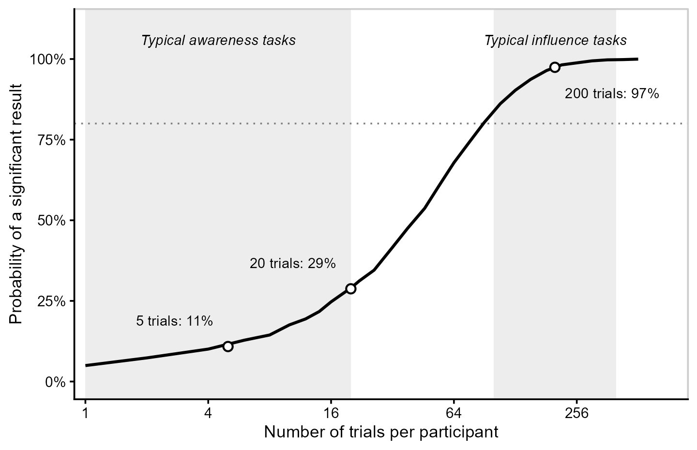
```

Moreover, both influence and awareness measures often suffer from
substantial measurement error, particularly when estimated from a
limited number of trials [@Vadillo2022Raising;
@HernandezGutierrez2025Conscious]. This error further reduces the
precision of the estimated effects and, consequently, the statistical
power to detect them. Combined with the differences in the number of
trials, this may leave awareness tasks with considerably less
statistical power than influence tasks.

This imbalance increases the probability of finding a significant
influence effect alongside a nonsignificant awareness effect, even when
participants have some conscious sensitivity to the relevant
information. Indeed, meta-analyses of hundreds of participants across
studies have found above-chance awareness in paradigms where individual
studies frequently failed to detect it [@Vadillo2016Underpowered;
@Vadillo2020Unconscious; @HernandezGutierrez2025Conscious]. In other
words, the traditional approach may produce apparent simple
dissociations merely because awareness is often measured less precisely
almost by design.

Regardless of these methodological challenges, what is perhaps less
obvious is that this simple dissociation is often misinterpreted as
evidence that the influence task is more *sensitive* to the relevant
information than can be consciously reported in the awareness task
[@Meyen2022Advancing; @Meyen2024NoEvidence]. However, as
@Gelman2006Difference [p. 328] famously noted, "the difference between
'significant' and 'not significant' is not itself statistically
significant". Establishing that the influence task is more sensitive
requires directly comparing the sensitivities of both tasks. This
alternative criterion, known as a *sensitivity
dissociation*[^group-level], has long been advocated as a way to move
beyond the traditional requirement of demonstrating null awareness
[@Reingold1988Using; @Schmidt2006Criteria].[^same-metrics]

[^group-level]: We use the term *group-level dissociation hypothesis* to
    refer collectively to *simple* and *sensitivity dissociations*,
    which represent two distinct criteria for establishing a
    dissociation between influence and awareness [@Schmidt2006Criteria].

[^same-metrics]: However, greater sensitivity in the influence task does
    not, by itself, establish unconscious processing. This
    interpretation relies on the assumption that the awareness task is
    at least as sensitive to consciously available information as the
    influence task. If this assumption holds, any additional sensitivity
    in the influence task cannot be explained by conscious information
    alone. To make this assumption more plausible, @Reingold1988Using
    recommended that the two tasks be as similar as possible, differing
    mainly in whether participants are explicitly asked to discriminate
    the relevant information.

Unfortunately, testing a *sensitivity dissociation* is not
straightforward because influence and awareness effects are rarely
measured in terms that allow to compare them in a common sensitivity
metric [@Meyen2022Advancing; @Reingold1988Using; @Schmidt2006Criteria].
Although one task may already be expressed in terms of signal detection
theory [SDT\; @GreenSwets1966] sensitivity ($d^\prime$), the other (or
both) may instead be expressed as accuracy or response times (RTs)
difference. The problem is that these measures differ not only in their
scales but also in what they quantify. Sensitivity, as measured in
typical awareness tasks, captures how well participants can use
information available for explicit reporting to discriminate between
experimental conditions. Applying the same logic, a measure of
sensitivity in RTs should discriminate between experimental conditions,
so if we observed a RT from a single trial without knowing which
condition produced it, how accurately could we identify that condition?

Consider two participants who achieve the same accuracy in an awareness
task. Participant 1 tends to respond "present" when the stimulus is
actually present and "absent" when it is absent. Participant 2, however,
responds "present" much more often, even when no stimulus was shown. If
present trials are more frequent than absent trials, both participants
can achieve the same accuracy, even though Participant 1 is better at
distinguishing between the two conditions. In other words, Participant
1's responses tell us more about whether the stimulus was actually
present, and thus their awareness sensitivity is higher than that for
Participant 2. This is precisely what sensitivity $d^\prime$ captures by
taking both hits and false alarms into account.

The same might be applied to RTs. Now, imagine two participants who show
the same mean RT difference of 50 ms between experimental conditions
(@fig-same-rt-effect).[^rt-normality] For Participant 1, RTs are clearly
different between conditions (due to small SD of 25 ms in each
condition; Panel A), so knowing how long they took to respond would
easily allow us to identify the condition. For Participant 2, however,
RTs are much more similar across conditions (due to larger SD of 125 ms
in each condition; Panel B), making it difficult to identify the
condition from a single response. This difference is reflected in their
sensitivities. Under the equal-variance SDT model, $d^\prime$ can be
expressed as the difference between conditions in units of the
participant's own RT variability. Thus, for Participant 1, a 50-ms
difference corresponds to 2.00 SDs (50/25 = 2.00; Panel C), whereas for
Participant 2 the same 50-ms difference corresponds to only 0.40 SD
(50/125 = 0.40; Panel D).

[^rt-normality]: For illustrative purposes, the RT distributions in
    @fig-same-rt-effect are assumed to be normal with equal variances
    across conditions. Although empirical RT distributions are typically
    right-skewed, the same reasoning applies to asymmetric
    distributions, such as the lognormal.

In other words, Participant 1's RTs contain more information about which
condition was presented, and thus their influence-task sensitivity is
higher than that of Participant 2. Moreover, even a measure with small
sensitivity can produce a highly significant mean RT difference at the
group level when enough trials are collected [@Meyen2022Advancing].
Thus, comparing mean RT differences or accuracies is not equivalent to
comparing sensitivities. To establish that the influence task is more
sensitive than the awareness task, both must be evaluated using a common
sensitivity metric. In fact, when findings traditionally interpreted as
evidence of unconscious processing are reexamined using sensitivity
comparisons, the evidence supporting these interpretations is often
substantially weakened [@Meyen2022Advancing; @Meyen2024NoEvidence;
@schnepf2022neural; @zerweck2021number].

```{r}
#| label: fig-same-rt-effect
#| fig-cap: "Same RT Mean Difference, Different Sensitivities"
#| fig-align: center
#| apa-note: >-
#|   RT distributions of two hypothetical participants with identical
#|   mean priming effects (50 ms) but different within-condition
#|   variability (*SD* = 25 vs. 125 ms). The top row shows RTs in
#|   milliseconds. In the bottom row, RTs from both conditions are
#|   standardized as $z = (\mathrm{RT} - \mu_C)/\sigma$, where $\mu_C$
#|   is the mean congruent RT and $\sigma$ is the common
#|   within-condition *SD*. The resulting distributions have means of 0
#|   (congruent) and $(\mu_I - \mu_C)/\sigma = d^\prime$ (incongruent),
#|   where $\mu_I$ is the mean incongruent RT.
#| out-width: "100%"
#| echo: false

# Include the figure made in "R scripts/Manuscript figures/manuscript_figures.R".
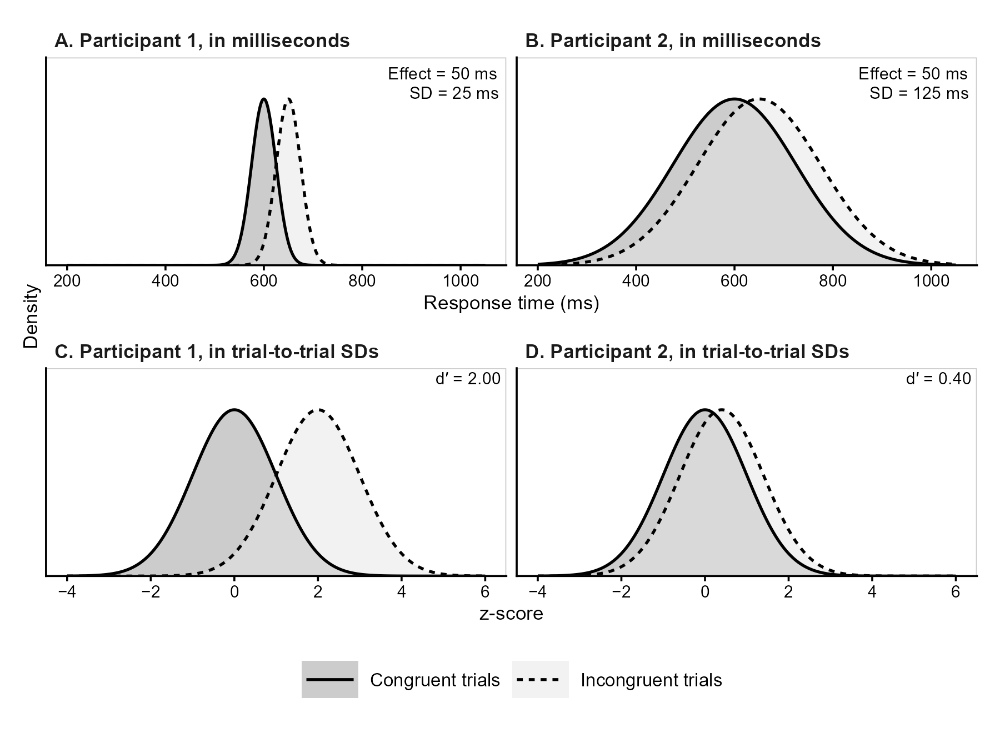
```

## Challenges for the Correlation and Intercept Hypotheses

The correlation and intercept hypotheses are also affected by
measurement error, but with an important difference. Whereas measurement
error primarily reduces the precision of group-level estimates
(affecting significance but not biasing the mean value), it can also
systematically bias estimates of the relationships between tasks (i.e.,
correlation and regression parameters). This problem arises from the
two-step approach commonly used to test these hypotheses. First,
researchers compute a single score for each participant and task, such
as a mean RT difference or a $d^\prime$. Second, these scores are used
in correlation or regression analyses, treating them as if they were
measured without error. However, as discussed above, participant-level
scores estimated from a finite number of trials inevitably contain
measurement error[^scores], which can be substantial in experimental
tasks [@Enkavi2019LargeScale; @Hedge2018Reliability;
@Yaron2024Progressing].

[^scores]: This artifact applies to any score computed separately for
    each participant, whether a mean, a difference between means, a
    proportion of correct responses, a $d^\prime$, or parameters of a
    cognitive computational model, such as the drift rate of the drift
    diffusion model [@Ratcliff2008Diffusion].

The magnitude of this problem has already been illustrated empirically
[@Yaron2024Progressing]. In the two experiments of
@Salvador2018Unconscious, the split-half reliability of the memory
suppression effect was only .26 and $-$.04, respectively, compared with
.59 and .72 for the awareness measure [@Malejka2021Correlation]. In
contextual cuing, with the median number of awareness trials used in the
literature, the expected reliabilities of two-alternative forced-choice
and old/new recognition tests are only .12 and .16, respectively
[@Vadillo2022Raising]. Similarly, @HernandezGutierrez2025Conscious found
that the reliability of the priming effect was below .10 in four of the
five masked syntactic priming experiments of @Berkovitch2019Subliminal,
whereas the reliability of the awareness measure ranged from .03 to .48.
Concerningly, much of the observed between-participant variability in
many of these experiments seems to reflect measurement error rather than
true individual differences.

Ignoring this error has two important consequences. First, it attenuates
the estimated correlation between influence and awareness
[@spearman1904proof], making the two measures empirically appear more
independent than they actually are. Second, measurement error in
awareness can inflate the regression intercept, making the influence
effect empirically appear positive even when the true effect at zero
awareness is null [@Klauer1998Unbiased; @Miller2000Measurement]. This
is, in fact, just a consequence of regression to the mean: participants
whose awareness is underestimated by chance may appear unaware, while
their influence scores tend to remain closer to the group mean, which is
typically above zero [@Shanks2017RegressiveResearch;
@Shanks2021Challenge]. @Vadillo2022Raising illustrated both consequences
using a model in which contextual cuing and recognition depended on a
single latent variable and were therefore perfectly correlated at the
latent level. Given the trial-by-trial variability in the observed data,
the model predicted correlations of only .15 to .30 between the observed
scores, alongside positive regression intercepts. Thus, conventional
analyses may suggest unconscious processing even when both tasks depend
entirely on the same underlying process.

To illustrate these problems, consider a population in which
awareness-task sensitivity is higher than influence-task sensitivity
($\mu_I - \mu_A = -0.15$), the two are strongly correlated
($\rho = .78$), and the regression intercept is zero
([@fig-three-scenarios]A). Thus, none of the three parameters supports
an inference of unconscious processing. [@fig-three-scenarios]D shows
the true sensitivities of 40 participants sampled from this population,
as if each had completed an infinite number of trials.

```{r}
#| label: fig-three-scenarios
#| fig-cap: "Effects of Measurement Error on Correlations and Regression
#|   Intercepts"
#| apa-note: >-
#|   Simulated population with correlated true sensitivities and a zero
#|   regression intercept. Top row: population distributions, with
#|   darker contours indicating greater density and shaded regions
#|   encompassing 95% of the population. Bottom row: the same 40
#|   participants, with sensitivities measured without error (left) or
#|   estimated from 80 (middle) and 20 (right) trials per task, yielding
#|   reliabilities of approximately .70 and .35, respectively. Solid
#|   lines show regressions of influence on awareness sensitivity;
#|   dashed lines show the true population regression. Open circles
#|   indicate intercepts (error bars: 95% CIs). Upper-right values show
#|   intercepts and correlations, with 95% CIs for sample estimates.
#| out-width: "100%"
#| echo: false

# Include the figure made in "R scripts/Manuscript figures/manuscript_figures.R".
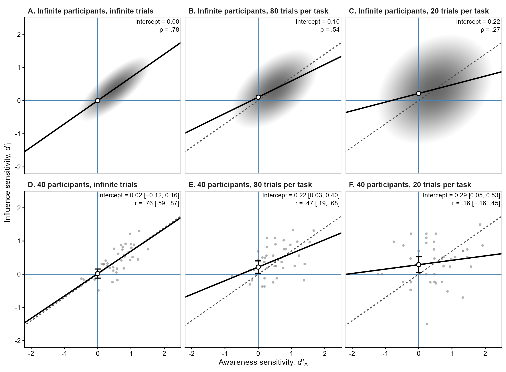
```

However, when sensitivities are estimated from a finite number of trials
using the conventional two-step approach, measurement error distorts
both correlations and regression intercepts. With 80 trials per task
[reliability $\approx$ .70, a value sometimes considered acceptable in
the psychometric literature\; @nunnally1978psychometric], the population
correlation decreases to .54 and the intercept increases to .10
([@fig-three-scenarios]B). With only 20 trials (reliability $\approx$
.35), the correlation drops to .27 and the intercept increases to .22
([@fig-three-scenarios]C). Crucially, for the same 40 participants, the
intercept becomes significantly positive with both 80 trials (0.22, 95%
CI [0.03, 0.40]; [@fig-three-scenarios]E) and 20 trials (0.29, 95% CI
[0.05, 0.53]; [@fig-three-scenarios]F), incorrectly suggesting that
influence persists in the absence of awareness. Note that these biases
cannot be simply fixed by collecting larger sample sizes; with few
trials, having more participants would only dangerously increase the
confidence in biased estimations.[^h1-sample].

[^h1-sample]: Meanwhile, the estimated group-level dissociation, not
    shown in the figure, was significantly negative with infinite trials
    ($-0.16$, 95% CI [$-0.26$, $-0.05$]), but became nonsignificant with
    both 80 trials ($-0.08$, 95% CI [$-0.25$, 0.09]) and 20 trials
    ($-0.12$, 95% CI [$-0.41$, 0.16]), despite the awareness task being
    more sensitive in the underlying population.

Finally, as illustrated above, the correlation hypothesis faces the same
inferential challenge discussed earlier for simple dissociations. A
nonsignificant correlation does not establish the genuine absence of a
relationship between influence and awareness. Instead, researchers need
methods that both address the impact of measurement error and can
distinguish evidence for a null or negligible correlation from
inconclusive results, such as Bayesian hypothesis testing
[@Dienes2014Using; @Wagenmakers2007Practical] or equivalence testing
[@Lakens2017Equivalence].

## Addressing All Challenges in a Single Approach

Several solutions have been proposed within both frequentist [e.g.,
@Fuller1987Measurement; @HunterSchmidt2015; @Klauer1998Unbiased;
@Lublinsky2026Increasing; @Meyen2022Advancing; @spearman1904proof] and
Bayesian [e.g., @Dienes2014Using; @Goldstein2022Accurately;
@Malejka2021Correlation; @Matzke2017Bayesian; @rouder2019psychometrics]
frameworks, but they typically address only one of these limitations in
isolation. Applied researchers are therefore left with a patchwork of
complex techniques that differ in their assumptions, require advanced
modeling knowledge, and often lack accessible software implementations.

In this article, we propose a single-step approach to address these
challenges, based on a multilevel extension of SDT [@DeCarlo2010]. The
`{uSDT}` package integrates the necessary procedures into a single
function call, allowing researchers to test the unconscious processing
hypotheses while addressing the common challenges: First, researchers'
measures of influence and awareness can be expressed on a common
sensitivity scale ($d^\prime$), using the approach of
@Meyen2022Advancing when necessary. Second, by jointly modeling
trial-level responses, the model accounts for measurement error and
different numbers of trials across tasks, allowing researchers to
estimate the differences and relationships between their true
sensitivities. Third, the `{uSDT}` package supports both Bayesian
hypothesis testing and frequentist equivalence testing, allowing
researchers to evaluate evidence for null or negligible effects rather
than relying on nonsignificant results. Furthermore, unlike previous
solutions to the problems outlined above, this framework requires
minimal familiarity with linear mixed modeling, which is already very
popular and well-known for most experimental psychologists

### Comparing the Sensitivity of Influence and Awareness Tasks

As discussed in the Introduction, the group-level dissociation
hypothesis concerns whether the influence task is more sensitive to the
relevant information than the awareness task. A meaningful comparison
therefore requires two things: expressing sensitivity in both tasks on a
common scale and collecting enough information from each task to achieve
adequate statistical power to detect a difference between them.

We already explained why comparing the sensitivities of influence and
awareness tasks requires both measures to be expressed on a common SDT
scale ($d^\prime$). When tasks involve binary discrimination
responses---such as identifying whether a stimulus was present or
absent---, sensitivity can be estimated directly from the trial-level
responses using SDT. However, when performance is measured using
response times (RTs), an additional step is necessary because
differences in mean RTs do not directly quantify sensitivity.

To overcome this challenge, we use the approach proposed by
@Meyen2022Advancing, which allows us to convert RTs into a measure of
sensitivity similar to that of the awareness task. Specifically, each
participant's median RT[^median] is used as a threshold to classify
trials according to their experimental condition. For example, in a
priming task where congruent trials are expected to produce faster
responses, RTs below the median (i.e., fast responses) are classified as
"congruent" and those above it (i.e., slow responses) as "incongruent".
Comparing these classifications with the actual experimental conditions
quantifies the kind of classifications that participants are asked to
perform in typical awareness tasks, and provides the binary responses
needed for any conventional SDT analysis. Under the appropriate
assumptions, this procedure allows influence and awareness sensitivities
to be estimated on the same scale. Our multilevel model then jointly
analyzes these trial-level classifications, estimating the sensitivities
and their relationships.

[^median]: The median classifier is optimal when RT distributions are
    normal or lognormal with a common dispersion parameter and different
    location parameters across conditions, and both conditions have
    equal numbers of trials [see @Meyen2022Advancing, Supplemental
    Materials B]. Note, however, that using the median as the
    classification threshold implicitly fixes the response criterion to
    zero in the influence task. This restriction can be relaxed by
    data-driven approaches that estimate the optimal classification
    threshold from training data and evaluate its performance on
    held-out trials [@Franz2015NoEvidence].

### Accounting for Measurement Error to Estimate True Sensitivities

Even when both tasks are expressed on the same sensitivity scale,
individual sensitivity estimates remain subject to measurement error.
Imagine using a scale to compare the weights of two objects. If each
object is weighed only once, the observed difference may reflect their
actual weights, random fluctuations in the measurements, or both. By
weighing each object repeatedly, we can see how much the readings vary
even when the underlying weight remains unchanged. The same principle
applies to experimental tasks: observed differences between participants
may reflect genuine differences in sensitivity, random variation across
trials, or both. By modeling individual trial responses, multilevel
models can account for this latter source of variability when estimating
individual sensitivities and how they vary across participants
[@Haines2025; @rouder2019psychometrics].

To understand this distinction, consider that each participant has an
underlying sensitivity in both the influence ($I$) and awareness ($A$)
tasks, denoted by $d^\prime_{iI}$ and $d^\prime_{iA}$, respectively, for
participant $i$. As illustrated in @fig-three-scenarios, these *true
sensitivities* represent the values that would be obtained from an
infinite number of trials, eliminating trial noise. Across participants,
these sensitivities may differ in their average values, their
variability, and the extent to which they are related. We can
characterize these differences using five population parameters: two
mean sensitivities ($\mu_I$ and $\mu_A$), two between-participant
standard deviations ($\sigma_I$ and $\sigma_A$), and their correlation
($\rho$). Assuming a bivariate normal distribution, as is common in
hierarchical models [@DeCarlo2010; @raudenbush2002hierarchical;
@rouder2019psychometrics], these parameters can be expressed as follows:
$$
\begin{bmatrix}
d^\prime_{iA}\\
d^\prime_{iI}
\end{bmatrix}
\sim \mathrm{MVNormal}\left(
\boldsymbol{\mu} =
\begin{bmatrix}
\mu_A\\
\mu_I
\end{bmatrix},\;
\mathbf{\Sigma} =
\begin{bmatrix}
\sigma_A^2 & \rho \cdot \sigma_A \cdot \sigma_I\\
\rho \cdot \sigma_A \cdot \sigma_I & \sigma_I^2
\end{bmatrix}
\right)
$$ {#eq-01}

These five parameters contain all the information needed to evaluate our
three hypotheses. The *group-level dissociation hypothesis* concerns the
difference in mean sensitivity between tasks ($\mu_I - \mu_A$), the
*correlation hypothesis* concerns the association between true
sensitivities ($\rho$), and the *intercept hypothesis* concerns the
expected influence sensitivity when awareness sensitivity is zero. Under
the assumed bivariate normal distribution, this last quantity
corresponds to the regression intercept ($\beta_0$) of true influence
sensitivity on true awareness sensitivity:
$$
\beta_0 = \mu_I - \rho\cdot\frac{\sigma_I}{\sigma_A}\cdot\mu_A
$$ {#eq-02}

By estimating these population parameters directly from trial-level
responses, the multilevel SDT model allows researchers to evaluate all
three hypotheses while accounting for measurement error. It also
accommodates differing numbers of trials across tasks and participants,
and allows researchers to quantify the reliability of their measures. In
the next section, we introduce the multilevel SDT model used to estimate
these parameters directly from trial-level responses.

# A Multilevel Signal Detection Theory Model

Multilevel models [also known as *hierarchical* or *mixed-effects*
models, @raudenbush2002hierarchical] are already familiar in
experimental psychology, in part due to accessible tutorials and
practical guidelines written for experimental psychologists
[@Baayen2008; @Barr2013; @hoffman2007multilevel; @Meteyard2020;
@brysbaert2025how; @singmann2020introduction]. Their main advantage is
that they naturally accommodate the hierarchical structure of
experimental data: trial responses (level 1) nested within participants
(level 2). Within this framework, trial-to-trial variability within
participants (i.e., measurement error) is modeled separately from
variability in participant-specific parameters (i.e., true individual
differences). In this sense, multilevel models can be conceptualized as
psychometric models in experimental psychology, and have been used to
estimate correlations corrected for measurement error across tasks
[@rouder2023; @rouder2019psychometrics], as well as test–retest
reliability [@Haines2025; @rouder2019psychometrics]. Building on this
foundation, we introduce a multilevel SDT model that jointly analyzes
trial-level responses from the awareness and influence tasks. We begin
by assuming that both tasks are expressed on a common sensitivity scale,
either directly or by applying the transformation proposed by
@Meyen2022Advancing to the influence measure, where all responses,
either discrete or continuous (such as RTs), will be transformed first
into "classifications" following the standard logic of SDT.

## Model Formulation

Let $y_{ij\ell}$ denote the observed response of participant $i$ in task
$j$ on trial $\ell$, coded as 1 for one response category and 0 for the
other. For example, in a typical priming experiment, participants' RTs
may be used to classify trials as congruent (1) or incongruent (0), or
displays as repeated (1) or new (0) in the case of a contextual cuing
experiment, as we illustrate below. We assume that each response follows
a Bernoulli distribution:
$$
y_{ij\ell} \sim \mathrm{Bernoulli}(\pi_{ij\ell}),
$$ {#eq-03}
where $\pi_{ij\ell}$ is the probability of a response coded as 1 on that
trial. This probability is modeled using a probit regression:
$$
\Phi^{-1}(\pi_{ij\ell}) = d^\prime_{ij}\cdot x_{ij\ell} - c_{ij},
$$ {#eq-04}
where $\Phi^{-1}$ is the inverse standard normal cumulative distribution
function (i.e., the "probit" link function), $x_{ij\ell}$ represents the
experimental condition (coded as 0.5 for signal trials and $-0.5$ for
noise trials), and $d^\prime_{ij}$ and $c_{ij}$ are the participant- and
task-specific sensitivity and response criterion, respectively. We
further assume that these participant- and task-specific parameters
jointly follow a multivariate normal distribution:
$$
\begin{bmatrix}
\boldsymbol{d}'_i\\
\boldsymbol{c}_i
\end{bmatrix}
\sim \mathrm{MVNormal}\left(
\boldsymbol{\mu} =
\begin{bmatrix}
\boldsymbol{\mu}_{d^\prime}\\
\boldsymbol{\mu}_c
\end{bmatrix},
\quad
\mathbf{\Sigma} =
\begin{bmatrix}
\mathbf{\Sigma}_{d^\prime} & \mathbf{\Sigma}_{d^\prime c}\\
\mathbf{\Sigma}_{cd^\prime} & \mathbf{\Sigma}_c
\end{bmatrix}
\right).
$$ {#eq-05}

Here, $\boldsymbol{d}'_i = (d'_{iA}, d'_{iI})^\top$ contains participant
$i$'s sensitivities in the awareness ($A$) and influence ($I$) tasks,
while $\boldsymbol{c}_i = (c_{iA}, c_{iI})^\top$ contains the
corresponding response criteria. The vectors
$\boldsymbol{\mu}_{d^\prime}$ and $\boldsymbol{\mu}_c$ contain the
population means of these parameters, known as *fixed effects* in
multilevel terminology. Individual participants can deviate from these
means, and these deviations are the *random effects*. The matrix
$\mathbf{\Sigma}$ describes how much these random effects vary across
participants and how they covary. Its upper-left block,
$\mathbf{\Sigma}_{d^\prime}$, contains the variances of true
sensitivities and their covariance across tasks, while
$\mathbf{\Sigma}_c$ describes the corresponding variances and covariance
of response criteria. Finally, the off-diagonal blocks,
$\mathbf{\Sigma}_{d^\prime c} = \mathbf{\Sigma}_{cd^\prime}^\top$,
describe how sensitivities and response criteria covary, both within and
across tasks.

Notice that $\boldsymbol{\mu}_{d^\prime}$ and
$\mathbf{\Sigma}_{d^\prime}$ are exactly the mean vector and covariance
matrix of true sensitivities introduced in @eq-01. This means that the
five population parameters defining our three hypotheses are estimated
directly by the multilevel SDT model itself. Because these parameters
are estimated jointly from trial-level responses, the model accounts for
measurement error without requiring separate estimates of individual
sensitivities or their reliability. All three hypotheses can therefore
be tested using the model's parameters, avoiding the distortions
introduced by the conventional two-step approach.

## Participant-Specific Sensitivities

As shown in @eq-04, the participant-specific sensitivities,
$d^\prime_{ij}$, are themselves parameters of the multilevel model. As
discussed earlier, these parameters can be understood as *true*
sensitivities, in the sense that they represent the values that would be
recovered from infinite trials, assuming the model is correctly
specified. However, this does not mean that the model can recover these
values perfectly from a finite number of trials.

Consider a participant whose observed sensitivity is unusually high
after completing only a few trials, so this estimate is highly
uncertain. Multilevel models address this uncertainty by estimating
individual sensitivities using both the participant's responses and the
information shared with the rest of the group, represented by the
multivariate normal distribution in @eq-05. The resulting estimates
represent a compromise between these two sources of information: the
less reliable a participant's observed sensitivity, the more their
estimated sensitivity is pulled toward the group mean.
@fig-multilevel-estimates shows the estimates of the multilevel model
for the two samples discussed in the section "Challenges for the
Correlation and Intercept Hypotheses", in which each participant
completed 80 (Panel A) or 20 (Panel B) trials per task.

```{r}
#| label: fig-multilevel-estimates
#| fig-cap: "Participant-Specific Sensitivities Estimated by the
#|   Multilevel Model"
#| apa-note: >-
#|   The samples of 40 participants with 80 (Panel A) and 20 (Panel B)
#|   trials per task from the section Challenges for the Correlation and
#|   Intercept Hypotheses, reanalyzed using the multilevel SDT model.
#|   Gray points show observed sensitivities from the two-step approach;
#|   black points show multilevel estimates, with segments connecting
#|   each participant's scores. Solid lines show the model-implied
#|   regressions of influence on awareness sensitivity; dashed lines
#|   show the true population regression. Open circles indicate
#|   estimated intercepts (95% CIs). Upper-right values report the
#|   estimated intercept and correlation between true sensitivities
#|   ($\hat{\rho}$), both with 95% CIs.
#| out-width: "100%"
#| echo: false

# Include the figure made in "R scripts/Manuscript figures/manuscript_figures.R".
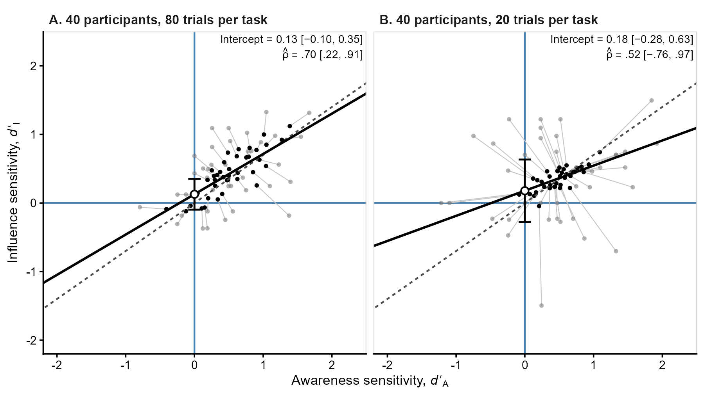
```

This mechanism, known as *partial pooling* or *shrinkage*
[@james1961estimation], is particularly useful from a psychometric
perspective because random measurement error does not systematically
affect the group mean. In fact, this same principle is captured by a
century-old psychometric equation for estimating true scores: Kelley's
regression formula [@kelley1927interpretation, p. 178],
$$
\widetilde{d}^\prime_{ij} =
R_j\cdot \widehat{d}^\prime_{ij} + (1-R_j)\cdot\mu_j,
$$ {#eq-06}
where $\widehat{d}^\prime_{ij}$ is the observed sensitivity of
participant $i$ in task $j$, $R_j$ is the reliability of that task, and
$\mu_j$ is its population mean sensitivity ($\mu_I$ or $\mu_A$ in
@eq-01). When reliability is perfect ($R_{j} = 1$), the estimate equals
the observed sensitivity. When reliability is zero ($R_{j} = 0$), the
observed score provides no information about individual differences, and
the best estimate is the group mean. When reliability falls between 0
and 1, Kelley's formula produces precisely the partial pooling described
above. Multilevel models build on this same idea, but extend it to
multiple variables that may be correlated with one another
[@raudenbush2002hierarchical].

As model-based sensitivities are estimates of true participants'
sensitivities, it may be tempting to use them in subsequent analyses,
such as correlations or regressions. However, accurately estimating each
participant's true sensitivity is not the same as accurately estimating
how sensitivities vary and relate to one another across participants. To
improve these predictions, partial pooling exploits the classical
bias–variance tradeoff [@yarkoni2017choosing], introducing some bias
toward the population mean in exchange for reduced estimation variance
[@efron1975data; @james1961estimation]. A perhaps surprising consequence
is that, if we calculated the sample variance of these individual
estimates, we would generally obtain a smaller value than the
corresponding variance in @eq-05 estimated by the multilevel model
[@louis1984estimating; @skrondal2004generalized]. The same applies to
covariances, which will generally differ from those estimated in
$\mathbf{\Sigma}_{d^\prime}$. Although both sets of quantities may
appear to describe the same individual differences, the former describe
the variability of individual predictions, whereas the latter describe
the variability of true sensitivities in the population. Correlations
and regression coefficients calculated from these predictions can
therefore yield biased estimates of population relationships
[@devlieger2016hypothesis; @skrondal2001regression].[^slope]

[^slope]: Consider a simplified example in which true awareness- and
    influence-task sensitivities have a correlation of $\rho = .50$ and
    SDs of $\sigma_A = 1$ and $\sigma_I = 2$, giving a population
    regression slope of $\beta = \rho \cdot \sigma_I / \sigma_A = 1$.
    Suppose awareness-task sensitivity is measured with perfect
    reliability, so its true scores can be obtained directly.
    Influence-task sensitivity, however, has a reliability of .64 and
    must be estimated. If we predict these sensitivities using
    univariate shrinkage, as illustrated by Kelley's formula (@eq-06),
    the resulting predictions have an SD of 1.6 and a correlation of .40
    with awareness-task sensitivity. Regressing these predictions on
    awareness-task sensitivity gives a slope of 0.64 instead of 1. In
    our joint multilevel model, shrinkage also uses information from
    correlated parameters, making its consequences for regression slopes
    more complex.

For population-level inference, we should instead use the parameters
estimated directly by the multilevel model. The correlation between true
sensitivities can be obtained from $\mathbf{\Sigma}_{d^\prime}$, while
the regression intercept can be calculated from the population
parameters, as shown in @eq-02. Other individual-difference questions
can often be addressed by extending the model to include additional
covariates or outcomes, allowing the relationships of interest to be
estimated while accounting for measurement error.

<!-- Skrondal & Rabe-Hesketh (2004), p. 245, sec. 7.8.2:  -->
<!-- estimate model parameters directly, not from imputed latent
scores. -->
<!-- Skrondal & Rabe-Hesketh (2004), p. 232, eqs. 7.8-7.9:  -->
<!-- EB prediction variances smaller than prior variances due to
shrinkage. -->

However, accounting for measurement error does not eliminate uncertainty
when few trials are available. Even when both tasks are expressed on a
common sensitivity scale, differences in the number of trials can still
affect statistical power. As illustrated in @fig-power-trials-direct,
collecting too few trials in one of the tasks can make genuine
differences in sensitivity between tasks difficult to detect (and the
multilevel SDT model cannot fix this, as we say in Spain: "Where there's
no sprout, there's no spud."). Thus, a meaningful sensitivity comparison
requires not only comparable measures, but also sufficient information
from both tasks. To address this limitation, the `{uSDT}` package also
allows researchers to evaluate statistical power when planning the
sample and trial size of their experiments.

```{r}
#| label: fig-power-trials-direct
#| fig-cap: "Power to Detect Sensitivity Differences as a Function of
#|   Awareness-Task Number of Trials"
#| apa-note: >-
#|   Power of the difference between mean sensitivities in the
#|   multilevel SDT model ($\alpha$ = .05), computed with the
#|   `usdt_power()` function of `{uSDT}` for a sample of 40
#|   participants. True mean sensitivities were 0.30 (awareness) and
#|   0.15 (influence), with between-participant SDs of 0.15 and a
#|   population correlation of zero between tasks. Trials per condition
#|   ranged from 3 to 100 (awareness) and were fixed at 150 (influence).
#|   The open circle marks the minimum number of awareness-task trials
#|   required to reach 80% power (dotted line)
#| out-width: "80%"
#| fig-align: center
#| echo: false

# Include the figure made in "R scripts/Power simulation/power_trials_direct.R".
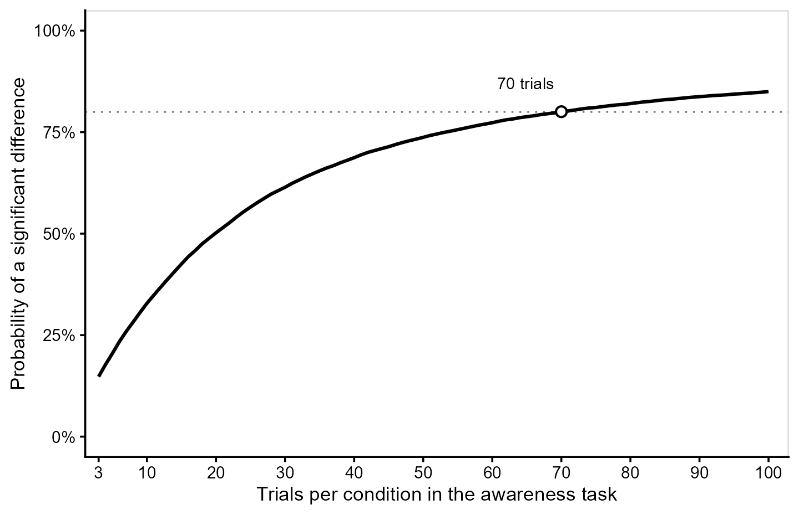
```

## Bayesian Extension

The multilevel SDT model described above can also be estimated within a
Bayesian framework [@Gelman2013Bayesian; @Kruschke2015Doing;
@McElreath2020Statistical; for hierarchical Bayesian SDT models, see
@RouderLu2005; @LeeWagenmakers2013Bayesian]. This extension is
relatively straightforward and is already implemented in the `{uSDT}`
package: the model structure remains unchanged, but prior distributions
are assigned to its parameters. Combining these priors with the observed
trial-level likelihood yields posterior distributions for all model
parameters, including the five population parameters defining our three
hypotheses. These posterior distributions can be used to compute
credible intervals and, with appropriate prior specifications, Bayes
factors to quantify evidence for or against the null hypotheses
[@Dienes2014Using; @Wagenmakers2007Practical].

One important consideration is that specifying priors on the five
population parameters in @eq-01 also implicitly defines a prior on the
regression intercept in @eq-02, since the intercept is a function of
these parameters. This induced prior may not reflect the researcher's
prior expectations when testing the intercept hypothesis using Bayes
factors. When previous empirical evidence informs the priors on these
population parameters, researchers can inspect the resulting prior on
the intercept through prior predictive checking [@Gelman2020Bayesian] to
assess its plausibility. Alternatively, the model can be parameterized
as a latent regression (with the argument `latent = "regression"` in the
`hsdt()` function), allowing a prior to be specified directly on its
intercept. In this parameterization, the intercept replaces the
influence-task mean sensitivity ($\mu_I$), while the remaining four
population parameters keep their own priors. The influence-task mean is
no longer sampled directly, but is derived at each posterior draw by
solving @eq-02 for $\mu_I$. As a result, both the intercept and the
correlation between sensitivities ($\rho$) have priors chosen by the
researcher, whereas the prior on the group-level difference
($\mu_I - \mu_A$) is induced by the others.

The Bayesian framework also allows us to consider a more flexible
version of the model that relaxes the equal-variance assumption of SDT
(with the argument `unequal_variances = TRUE` in the `hsdt()` function).
The model presented in @eq-04 assumes that the underlying signal and
noise distributions have the same variance. Relaxing this assumption
introduces an additional parameter that cannot be identified from binary
responses without further assumptions. However, @Lages2024 showed that
this limitation can be overcome using a Bayesian hierarchical model that
exploits variability in hit and false-alarm rates across participants.
Assuming that sensitivity and response criterion are independent at the
population level (i.e., $\mathbf{\Sigma}_{dc} = \mathbf{0}$), and that
the relative variances of the signal and noise distributions are
approximately constant across participants, the ratio of the variances
of their z-transformed false-alarm and hit rates can be used to estimate
the relative variances of the underlying signal and noise distributions.

## Model Assumptions

The multilevel SDT model makes several assumptions about how responses
are generated and how sensitivities vary across participants. At the
trial level, it assumes normally distributed evidence with equal
variances across stimulus conditions, although our Bayesian extension
relaxes the equal-variance assumption. It also requires that performance
in both tasks can be expressed on a common sensitivity scale. For tasks
based on RTs, this involves converting continuous responses into binary
outcomes, and the choice of conversion may affect the results. At the
participant level, sensitivities and response criteria are assumed to
follow a single multivariate normal distribution.

This last assumption deserves particular attention. A single normal
distribution represents individual differences as continuous variation
within one population. However, some theories propose that aware and
unaware participants constitute qualitatively distinct populations
[@Goldstein2022Accurately; @Lublinsky2026Increasing]. Such an
alternative could be accommodated within our framework using a mixture
SDT model [@LeeWagenmakers2013Bayesian], but would require additional
assumptions about how these populations are defined. For example, should
the unaware population include only participants with exactly zero
awareness-task sensitivity, or also those with sensitivity below a
specified threshold? Furthermore, assigning participants to these
populations would be uncertain when sensitivity is measured imperfectly.
Although mixture models can account for this uncertainty without
requiring definitive classifications, they cannot determine what
constitutes unawareness.

But suppose that aware and unaware participants do constitute distinct
populations. We would still be interested in the relationship between
awareness and influence, particularly their correlation and regression
intercept. Can our multilevel SDT model accurately recover these
parameters when the true population consists of distinct aware and
unaware subpopulations, despite assuming a single multivariate normal
distribution? Simulation Study 2, presented in the next section, was
specifically designed to address this question.

```{r}
#| label: simulation-results
#| include: false

# Load the functions that format the results, and ccc().
source("../R scripts/R functions/manuscript_results.R")
source("../R scripts/R functions/simulation_functions.R")
suppressPackageStartupMessages({
  library(dplyr)
  library(tidyr)
})

# Load the results saved by the scripts in "R scripts/Simulation study", with
# one row per condition and parameter, and one column per measure.
s1 <- readRDS("../Results/Simulation studies/Processed/validation_results_longdata.rds") |>
  pivot_wider(names_from = measure, values_from = value)
s2 <- readRDS("../Results/Simulation studies/Processed/robustness_results_longdata.rds") |>
  pivot_wider(names_from = measure, values_from = value)
load("../Results/Simulation studies/Processed/robustness_reliability.rdata")

# Study 1: failed fits, out of 1,000 replications per condition.
s1_failed <- sum(s1$failed, na.rm = TRUE) * 1000

# Study 1: concordance of the mean estimates with the true values, overall
# and by reliability, and largest bias of the awareness-task mean (fixed at .2).
s1_ccc <- s1 |>
  filter(parameter %in% c("mu_dI", "diff", "sd_dD", "sd_dI", "rho", "intercept")) |>
  summarise(CCC = ccc(truth, mean_est)[["CCC"]], .by = parameter) |>
  tibble::deframe()
s1_ccc_reliab <- s1 |>
  filter(parameter %in% c("diff", "rho", "intercept")) |>
  summarise(CCC = ccc(truth, mean_est)[["CCC"]], .by = c(parameter, reliab))
s1_mu_dD <- max(abs(s1$bias[s1$parameter == "mu_dD"]))

# Study 1: untestable fits with reliability .1 (overall and by sample size)
# and with reliability .5.
s1_unt   <- s1 |> filter(parameter == "fit") |> summarise(untestable = mean(untestable), .by = reliab)
s1_unt_N <- s1 |> filter(parameter == "fit", reliab == .1) |> summarise(untestable = mean(untestable), .by = N)

# Study 1: bias of the correlation with reliability .1 and correlation .8, and
# its largest bias with reliability of .3 or more; lowest coverage of the
# correlation and share of conditions below .925 (correlation .8, reliability
# up to .3); and bias of the intercept with reliability .1 or .2, correlation
# .8, and true intercept 0 (testable fits).
s1_rho_bias     <- mean(s1$bias[s1$parameter == "rho" & s1$reliab == .1 & s1$rho == .8])
s1_rho_bias_max <- max(s1$bias[s1$parameter == "rho" & s1$reliab >= .3])
s1_rho_cov      <- min(s1$coverage[s1$parameter == "rho" & s1$rho == .8 & s1$reliab <= .3])
s1_rho_cov_lib  <- mean(s1$coverage[s1$parameter == "rho" & s1$rho == .8 & s1$reliab <= .3] < .925)
s1_int_bias     <- mean(s1$bias[s1$parameter == "intercept" & s1$reliab == .1 &
                                  s1$rho == .8 & s1$intercept == 0])
s1_int_bias_r2  <- mean(s1$bias[s1$parameter == "intercept" & s1$reliab == .2 &
                                  s1$rho == .8 & s1$intercept == 0])

# Study 1: coverage of the group-level difference.
s1_diff_cov <- s1 |>
  filter(parameter == "diff") |>
  summarise(min = min(coverage), max = max(coverage),
            bradley = mean(coverage >= .925 & coverage <= .975))

# Study 1: Type I error rate of H3 over the testable fits, and conditions
# where it exceeded .075.
s1_t1_int <- s1 |>
  filter(parameter == "intercept", intercept == 0) |>
  summarise(max = max(rejection), n = n(), n_above = sum(rejection > .075),
            bradley = mean(rejection >= .025 & rejection <= .075))
s1_liberal <- s1 |>
  filter(parameter == "intercept", intercept == 0, rejection > .075)

# Study 1: inference with low (R <= .3) and moderate to high (R >= .4)
# reliability. Type I error rates over the testable fits, and power over all
# replications (untestable fits count as not rejected), averaged over sample
# size and trials.
s1_band <- s1 |>
  mutate(band = ifelse(reliab <= .3, "low", "high")) |>
  group_by(band) |>
  summarise(
    unt         = mean(untestable[parameter == "fit"]),
    unt_max     = max(untestable[parameter == "fit"]),
    t1_rho_max  = max(rejection[parameter == "rho" & rho == 0]),
    t1_rho_low  = mean(rejection[parameter == "rho" & rho == 0] < .025),
    t1_int_brad = mean(between(rejection[parameter == "intercept" & intercept == 0], .025, .075)),
    t1_int_low  = mean(rejection[parameter == "intercept" & intercept == 0] < .025),
    t1_int_max  = max(rejection[parameter == "intercept" & intercept == 0])) |>
  tibble::column_to_rownames("band")

# Study 1: power of H2 and H3 over all replications (untestable fits count as
# not rejected) and over the testable fits, by effect size, sample size, and
# reliability, averaged over trials and the other parameter (as in the figure
# of power).
s1_pow <- s1 |>
  filter((parameter == "rho" & rho > 0) | (parameter == "intercept" & intercept > 0)) |>
  mutate(effect = ifelse(parameter == "rho", rho, intercept)) |>
  summarise(power = mean(rejection_all), power_testable = mean(rejection),
            .by = c(parameter, effect, N, reliab))

# Study 2: failed fits, untestable fits, and concordance of the mean estimates.
s2_failed <- sum(s2$failed, na.rm = TRUE) * 1000
s2_unt <- s2 |>
  filter(parameter == "fit") |>
  summarise(mean = mean(untestable), max = max(untestable), .by = DGM) |>
  tibble::column_to_rownames("DGM")
s2_ccc <- s2 |>
  filter(parameter %in% c("rho", "intercept")) |>
  summarise(CCC = ccc(truth, mean_est)[["CCC"]], .by = c(DGM, parameter))

# Study 2: coverage and Type I error rates of H2 and H3 (hsdt intercept).
s2_inf <- s2 |>
  filter(parameter %in% c("rho", "intercept")) |>
  mutate(null = abs(truth) < 1e-10) |>
  summarise(coverage = mean(coverage), t1 = mean(rejection[null]),
            t1_max = max(rejection[null]), .by = c(DGM, parameter))

# Study 2: coverage of the correlation by generating model and trials.
s2_cov_K <- s2 |>
  filter(parameter == "rho") |>
  summarise(coverage = mean(coverage), .by = c(DGM, trials))

# Study 2: gap between the hsdt intercept and alpha in Goldstein's model, and
# rejection rate of H3 when alpha = 0.
s2_gap <- s2 |>
  filter(DGM == "Goldstein", parameter %in% c("intercept", "alpha")) |>
  select(N, trials, prop_unaware, rho, intercept, parameter, truth) |>
  pivot_wider(names_from = parameter, names_prefix = "truth_", values_from = truth) |>
  mutate(gap = truth_intercept - truth_alpha) |>
  slice_max(gap, n = 1, with_ties = FALSE)
s2_fp <- s2 |>
  filter(DGM == "Goldstein", parameter == "alpha", intercept == 0)
s2_fp_max <- s2_fp[which.max(s2_fp$rejection), ]

# Study 2: reliability of the influence task by trials, and range of the
# reliability of the awareness task.
s2_rel_I <- reliab_rob |>
  summarise(indirect = mean(reliab_I), .by = trials) |>
  arrange(trials)
s2_rel_D <- reliab_rob |>
  summarise(direct = mean(reliab_D), .by = c(DGM, prop_unaware, trials)) |>
  pull(direct) |>
  range()
```

# Simulation Studies

We conducted two simulation studies to evaluate the multilevel SDT model
before applying it to empirical data. Simulation Study 1 was a
validation study in which data were generated from our model to assess
parameter recovery and the validity of inferences on all three
hypotheses across a broad range of conditions. Simulation Study 2 was a
robustness study examining whether inferences on the correlation and
intercept remained valid when true sensitivities were generated from the
alternative population models of @Klauer1998Unbiased and
@Goldstein2022Accurately. Both approaches were developed to estimate the
relationship between awareness and influence measures while accounting
for measurement error, but unlike our model both assume two
subpopulations of participants: those with no awareness
($d^\prime_{iA} = 0$) and those with positive awareness-task
sensitivity. Although they formalize these subpopulations differently,
neither population model follows the bivariate normal distribution
assumed by our model. Here, we summarize the simulation designs and main
results, with full methodological details provided in the Supplemental
Material.

## Method

### Design

In Simulation Study 1, true sensitivities were drawn from the bivariate
normal distribution in @eq-01, and trial responses were generated from
@eq-04. We manipulated five factors: sample size ($N$), trials per
condition ($K$), reliability ($R$), correlation between true
sensitivities ($\rho$), and regression intercept ($\beta_0$). To
manipulate reliability for a given number of trials, we derived the
variances of true sensitivities from the target reliability ($R$) and
the sampling variance of $d^\prime$ with $K$ trials per condition
[@Gourevitch1967Significance\; see the Supplemental Material].

In Simulation Study 2, true sensitivities were generated from the
population models of @Klauer1998Unbiased and @Goldstein2022Accurately.
We manipulated six factors: generating model, $N$, $K$, proportion of
unaware participants ($\pi_0$), correlation ($\rho$), and intercept
($\beta_0$). Unlike in Study 1, reliability was not manipulated directly
but depended on $K$ and, for the awareness task, $\pi_0$. Influence-task
reliabilities were `r fmt(s2_rel_I$indirect[1], 2, FALSE)`,
`r fmt(s2_rel_I$indirect[2], 2, FALSE)`, and
`r fmt(s2_rel_I$indirect[3], 2, FALSE)` for $K$ = 10, 30, and 50,
respectively, comparable to $R$ = .2, .5, and .6 in Study 1.
Awareness-task reliability was higher (`r fmt(s2_rel_D[1], 2, FALSE)` to
`r fmt(s2_rel_D[2], 2, FALSE)`) due to greater variability in true
sensitivities (Table S9 of the Supplemental Material). Crossing all
factor levels (@tbl-sim-design) yielded 1,260 and 648 conditions in
Studies 1 and 2, respectively, with 1,000 simulated datasets per
condition.

```{r}
#| label: tbl-sim-design
#| tbl-cap: "Design of the Simulation Studies"
#| apa-note: >-
#|   In Study 1, $\mu_A = 0.2$, and true-sensitivity SDs were derived
#|   from $R$ and $K$. In Study 2, $\sigma_I = 0.3$, and $\rho$ and
#|   $\beta_0$ refer to regressions on awareness-task $d^\prime$
#|   (Klauer) or chance-centered accuracy (Goldstein). In both studies,
#|   awareness-task criteria varied (SD = 0.3), and the influence-task
#|   criterion was fixed at 0.
#| echo: false

# Factors and levels of each study.
design_tbl <- data.frame(
  factor_1 = c("Sample size ($N$)", "Trials per condition ($K$)",
               "Reliability ($R$)", "Correlation ($\\rho$)",
               "Intercept ($\\beta_0$)", ""),
  levels_1 = c("30, 60, 100, 200", "10, 30, 50", ".1, .2, .3, .4, .5, .6, .7",
               "0, .2, .4, .6, .8", "0, .15, .30", ""),
  factor_2 = c("Sample size ($N$)", "Trials per condition ($K$)",
               "Unaware participants ($\\pi_0$)", "Correlation ($\\rho$)",
               "Intercept ($\\beta_0$)", "Generating model"),
  levels_2 = c("30, 100, 200", "10, 30, 50", ".2, .5, .8", "0, .2, .4, .6",
               "0, .15, .30", "Klauer, Goldstein")
)

# Generate LaTeX for the table.
tab <- kable(
  design_tbl, "latex", booktabs = TRUE, escape = FALSE,
  col.names = c("Factor", "Levels", "Factor", "Levels"),
  align = c("l", "l", "l", "l"),
  linesep = ""
)

# Add the headers of each study.
tab <- tab |>
  kableExtra::add_header_above(c("Validation study" = 2, "Robustness study" = 2))

# Print the table, giving back the space that apaquarto removes.
asis_output(paste0(
  "\\vspace{20pt}{\\small\n", tab, "\n}\\vspace{16pt}"
))
```

### Procedure

Both studies were conducted in R version 4.5.0 [@R], using `{SimDesign}`
[@Chalmers2020Writing] to manage the simulation workflow. Each dataset
was analyzed with the frequentist multilevel SDT model implemented in
`{uSDT}` [@ReySaez2026uSDT], fitted by maximum likelihood using `{lme4}`
[@lme4]. We used 95% Wald CIs (computed on the log scale for SDs) and
the three hypothesis tests implemented in `{uSDT}`. Fits with singular
random-effects covariance matrices (e.g., an SD estimated at zero or a
correlation at $\pm 1$) were classified as untestable for H2 and H3
because SEs for the correlation and intercept were unavailable.

### Analysis

For each parameter, we computed bias (mean estimate minus true value)
and empirical coverage of the 95% CIs. For each hypothesis, we computed
the rejection rate at the .05 level, representing Type I error when the
null hypothesis was true and statistical power otherwise. The intercept
was evaluated only in testable fits, as its estimate becomes unstable
when $\sigma_A$ approaches zero (@eq-02). All other parameters were
evaluated in every fit, and the proportion of untestable fits was
reported separately. To summarize parameter recovery across conditions,
we computed Lin's [-@Lin1989Concordance] concordance correlation
coefficient (CCC) between the mean estimates and true values, which
measures agreement with the identity line. Following Bradley's
[-@Bradley1978Robustness] liberal criterion, acceptable coverage and
Type I error rates were [.925, .975] and [.025, .075], respectively.
Results for individual conditions and ANOVA metamodels examining the
effects of the simulation factors [@Skrondal2000Design] are reported in
the Supplemental Material.

## Results

### Simulation Study 1: Validation

All but `r s1_failed` of the 1,260,000 fits converged
(`r fmt(100 * s1_failed / 1.26e6, 3)`% returned estimation errors).
@fig-sim1-recovery shows the recovery of the population parameters. The
influence-task mean sensitivity, group-level dissociation (H1), and SDs
were recovered almost perfectly (CCC $\geq$
`r fmt(min(s1_ccc[c("mu_dI", "diff", "sd_dD", "sd_dI")]), 3, FALSE)`),
and the awareness-task mean sensitivity, fixed at 0.2, showed biases
below `r fmt(ceiling(1000 * s1_mu_dD) / 1000, 3, FALSE)` in every
condition (Table S2 in the Supplemental Material). Recovery was also
strong for the correlation (H2; CCC =
`r fmt(s1_ccc[["rho"]], 3, FALSE)`) and intercept (H3; CCC =
`r fmt(s1_ccc[["intercept"]], 3, FALSE)`), although their estimates were
less accurate, particularly under low reliability.

```{r}
#| label: fig-sim1-recovery
#| fig-cap: "Recovery of the Population Parameters in Simulation Study
#|   1"
#| apa-note: >-
#|   Each point represents a simulation condition, averaged over 1,000
#|   replications. Colors indicate reliability values. Dashed lines
#|   indicate perfect recovery. CCC = concordance correlation
#|   coefficient. The awareness-task mean (fixed at 0.2) is omitted, and
#|   the intercept was computed over testable fits.
#| out-width: "100%"
#| echo: false

# Include the figure made in "R scripts/Simulation study/uSDT_validation_analysis.R".
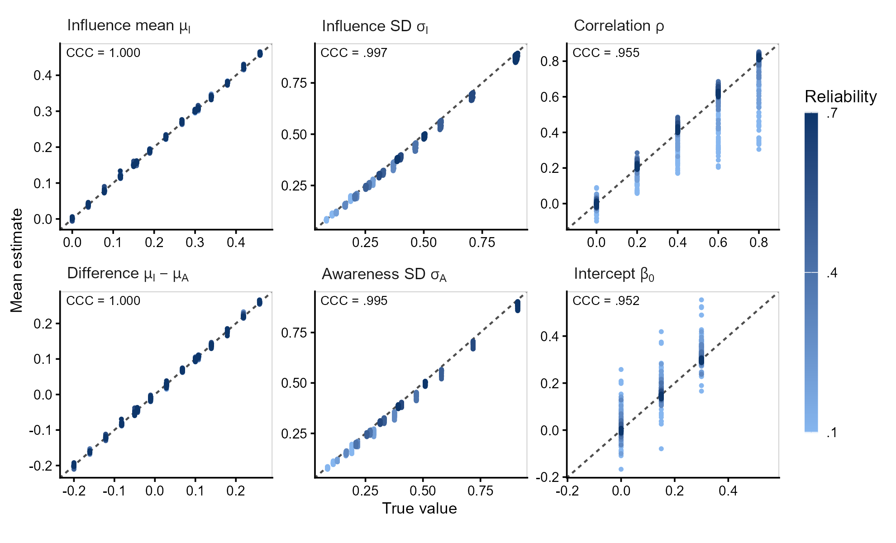
```

As shown in @tbl-sim1-ccc, the group-level dissociation was recovered
almost perfectly at every level of reliability, whereas recovery of the
correlation and intercept was poor at $R = .1$ (CCC =
`r fmt(s1_ccc_reliab$CCC[s1_ccc_reliab$parameter == "rho" & s1_ccc_reliab$reliab == .1], 2, FALSE)`
and
`r fmt(s1_ccc_reliab$CCC[s1_ccc_reliab$parameter == "intercept" & s1_ccc_reliab$reliab == .1], 2, FALSE)`,
respectively), but improved substantially at $R = .3$ (CCC $\geq$
`r fmt(min(s1_ccc_reliab$CCC[s1_ccc_reliab$reliab == .3]), 2, FALSE)`).
Low reliability also increased the frequency of boundary estimates (SDs
of zero or correlations of $\pm 1$), leaving fits untestable for H2 and
H3 (@tbl-sim1-inference). At $R = .1$,
`r sprintf("%.0f%%", 100 * s1_unt$untestable[s1_unt$reliab == .1])` of
fits were untestable, ranging from
`r sprintf("%.0f%%", 100 * s1_unt_N$untestable[s1_unt_N$N == 200])` at
$N = 200$ to
`r sprintf("%.0f%%", 100 * s1_unt_N$untestable[s1_unt_N$N == 30])` at
$N = 30$, compared with less than
`r sprintf("%.0f%%", ceiling(100 * s1_unt$untestable[s1_unt$reliab == .5]))`
at $R \geq .5$. Moreover, at extremely low reliability, correlations
were biased toward zero when their true values were high (bias =
`r tex(fmt(s1_rho_bias, 2, FALSE))` at $R = .1$ and $\rho = .8$),
whereas with $R \geq .3$ they were slightly overestimated on average (by
at most `r fmt(s1_rho_bias_max, 2, FALSE)` in any condition). The
intercept, in turn, was overestimated when the correlation was strong
and reliability extremely low (bias = `r fmt(s1_int_bias, 2, FALSE)` at
$R = .1$ and $\rho = .8$ when $\beta_0 = 0$, and
`r fmt(s1_int_bias_r2, 2, FALSE)` at $R = .2$), because the attenuated
slope inflates it.

```{r}
#| label: tbl-sim1-ccc
#| tbl-cap: "Recovery of the Parameters of the Three Hypotheses by
#|   Reliability in Simulation Study 1"
#| apa-note: >-
#|   Lin's concordance correlation coefficient (CCC) between true values
#|   and mean estimates across 1,000 replications, computed over 180
#|   conditions per reliability level. The intercept was computed over
#|   testable fits. See Figure S2 for scatterplots.
#| echo: false

# CCC of each hypothesis by reliability, with reliability in columns.
ccc_tbl <- s1_ccc_reliab |>
  mutate(parameter = factor(parameter, levels = c("diff", "rho", "intercept"),
                            labels = c("H1: $\\mu_I - \\mu_A$", "H2: $\\rho$",
                                       "H3: $\\beta_0$")),
         CCC = fmt(CCC, 3, FALSE)) |>
  arrange(parameter, reliab) |>
  pivot_wider(names_from = reliab, values_from = CCC)

# Generate LaTeX for the table.
tab <- kable(
  ccc_tbl, "latex", booktabs = TRUE, escape = FALSE,
  col.names = c("Hypothesis", fmt(sort(unique(s1_ccc_reliab$reliab)), 1, FALSE)),
  align = c("l", rep("c", 7)),
  linesep = ""
)

# Add the header of the reliability levels.
tab <- tab |>
  kableExtra::add_header_above(c(" " = 1, "Reliability ($R$)" = 7), escape = FALSE)

# Print the table, giving back the space that apaquarto removes.
asis_output(paste0(
  "\\vspace{20pt}{\\small\n", tab, "\n}\\vspace{16pt}"
))
```

Coverage and rejection rates are summarized in @tbl-sim1-inference.
Inferences on H1 were valid at every level of reliability: the coverage
of $\mu_I - \mu_A$ ranged from `r fmt(s1_diff_cov$min, 3, FALSE)` to
`r fmt(s1_diff_cov$max, 3, FALSE)` and met Bradley's criterion in
`r sprintf("%.0f%%", 100 * s1_diff_cov$bradley)` of conditions. For H2
and H3, results differed between low ($R \leq .3$) and moderate to high
reliability ($R \geq .4$). With $R \leq .3$,
`r sprintf("%.0f%%", 100 * s1_band["low", "unt"])` of fits were
untestable on average (up to
`r sprintf("%.0f%%", 100 * s1_band["low", "unt_max"])`), leaving only a
selected subset for inference. In this subset, CIs for H2 were
conservative in most conditions, but with $\rho = .8$ their coverage
fell below .925 in `r sprintf("%.0f%%", 100 * s1_rho_cov_lib)` of the
conditions, down to `r fmt(s1_rho_cov, 2, FALSE)`. Type I error for H2
was below .025 in
`r sprintf("%.0f%%", 100 * s1_band["low", "t1_rho_low"])` of null
conditions. Type I error for H3 met Bradley's criterion in only
`r sprintf("%.0f%%", 100 * s1_band["low", "t1_int_brad"])` of null
conditions: it was conservative in
`r sprintf("%.0f%%", 100 * s1_band["low", "t1_int_low"])` and exceeded
.075 in `r s1_t1_int$n_above` (maximum =
`r fmt(s1_t1_int$max, 2, FALSE)`), all with
$R \leq `r fmt(max(s1_liberal$reliab), 1, FALSE)`$ and
$\rho = `r fmt(unique(s1_liberal$rho), 1, FALSE)`$, where the intercept
was overestimated. With $R \geq .4$, only
`r sprintf("%.0f%%", 100 * s1_band["high", "unt"])` of fits were
untestable, Type I error for H2 never exceeded
`r fmt(s1_band["high", "t1_rho_max"], 3, FALSE)`, and Type I error for
H3 met Bradley's criterion in
`r sprintf("%.0f%%", 100 * s1_band["high", "t1_int_brad"])` of null
conditions (maximum = `r fmt(s1_band["high", "t1_int_max"], 3, FALSE)`).

```{r}
#| label: tbl-sim1-inference
#| tbl-cap: "Inference on the Three Hypotheses by Reliability in
#|   Simulation Study 1"
#| apa-note: >-
#|   Values are averaged across simulation factors (Type I error only
#|   when the tested parameter is zero). Untestable fits are boundary
#|   estimates for which H2 and H3 cannot be tested. Correlation bias
#|   includes boundary estimates, whereas intercept bias, coverage, and
#|   Type I error rates are computed over testable fits.
#| echo: false

# Average each measure by reliability.
s1_tbl <- s1 |>
  group_by(reliab) |>
  summarise(
    untestable = mean(untestable[parameter == "fit"]),
    bias_diff  = mean(bias[parameter == "diff"]),
    bias_rho   = mean(bias[parameter == "rho"]),
    bias_int   = mean(bias[parameter == "intercept"]),
    cov_diff   = mean(coverage[parameter == "diff"]),
    cov_rho    = mean(coverage[parameter == "rho"]),
    cov_int    = mean(coverage[parameter == "intercept"]),
    t1_rho     = mean(rejection[parameter == "rho" & rho == 0]),
    t1_int     = mean(rejection[parameter == "intercept" & intercept == 0])
  ) |>
  mutate(untestable = fmt(untestable, 2, FALSE),
         across(starts_with("bias"), \(x) tex(fmt(x, 3))),
         across(c(cov_diff, cov_rho, cov_int, t1_rho, t1_int), \(x) fmt(x, 3, FALSE)),
         reliab = fmt(reliab, 1, FALSE))

# Generate LaTeX for the table.
tab <- kable(
  s1_tbl, "latex", booktabs = TRUE, escape = FALSE,
  col.names = c("$R$", "Untestable",
                rep(c("$\\mu_I - \\mu_A$", "$\\rho$", "$\\beta_0$"), 2),
                "$\\rho$", "$\\beta_0$"),
  align = rep("c", 10),
  linesep = ""
)

# Add the headers of each measure.
tab <- tab |>
  kableExtra::add_header_above(c(" " = 2, "Bias" = 3, "Coverage" = 3, "Type I error" = 2))

# Print the table, giving back the space that apaquarto removes.
asis_output(paste0(
  "\\vspace{20pt}{\\small\n", tab, "\n}\\vspace{16pt}"
))
```

The power of H1 increased with effect size, sample size, and number of
trials, as expected for a test of a group-level mean (Figure S6 in the
Supplemental Material). We therefore focus on H2 and H3, whose power
depended more directly on reliability (@fig-sim1-power). Untestable fits
were counted as non-rejections, reflecting the power researchers can
expect in practice. Considering only testable fits yielded higher power
when boundary estimates were frequent (up to
`r fmt(max(s1_pow$power_testable - s1_pow$power), 2, FALSE)` higher;
Figure S8), but these constituted a selected subset of fits. With
$R \leq .3$, power for H2 never reached .80, even with $N = 200$
(maximum =
`r fmt(max(s1_pow$power[s1_pow$parameter == "rho" & s1_pow$reliab <= .3]), 2, FALSE)`),
and H3 reached .80 only for $\beta_0 = .30$, $R = .3$, and $N = 200$.
With $N = 200$ and $R \geq .5$, power was at least
`r fmt(min(s1_pow$power[s1_pow$parameter == "rho" & s1_pow$effect >= .4 & s1_pow$N == 200 & s1_pow$reliab >= .5]), 2, FALSE)`
for correlations of .4 or larger and
`r fmt(min(s1_pow$power[s1_pow$parameter == "intercept" & s1_pow$effect == .3 & s1_pow$N == 200 & s1_pow$reliab >= .5]), 2, FALSE)`
for $\beta_0 = .30$. Small correlations were difficult to detect: power
for $\rho = .2$ never exceeded
`r fmt(max(s1_pow$power[s1_pow$parameter == "rho" & s1_pow$effect == .2]), 2, FALSE)`.
Power for $\beta_0 = .15$ leveled off at
`r fmt(min(s1_pow$power[s1_pow$parameter == "intercept" & s1_pow$effect == .15 & s1_pow$N == 200 & s1_pow$reliab >= .5]), 2, FALSE)`
to
`r fmt(max(s1_pow$power[s1_pow$parameter == "intercept" & s1_pow$effect == .15 & s1_pow$N == 200 & s1_pow$reliab >= .5]), 2, FALSE)`
with $N = 200$ and $R \geq .5$, because $\beta_0$ was fixed while
$\sigma_I$ increased with $R$, so the same intercept was a smaller
effect relative to individual differences.

```{r}
#| label: fig-sim1-power
#| fig-cap: "Power by Reliability, Sample Size, and Effect Size in
#|   Simulation Study 1"
#| apa-note: >-
#|   Proportion of the 1,000 replications per condition in which H2 or
#|   H3 was rejected ($\alpha = .05$). Each H2 panel shows one nonzero
#|   true correlation, averaged over the three true intercepts, and each
#|   H3 panel one nonzero true intercept, averaged over the five true
#|   correlations; all cells are also averaged over $K$. Untestable fits
#|   were counted as non-rejections. Values of .80 or higher are in
#|   bold. Because $\sigma_I$ increased with $R$ at a fixed $K$, the
#|   same $\beta_0$ is a smaller effect at higher reliability.
#| out-width: "100%"
#| echo: false

# Include the figure made in "R scripts/Simulation study/uSDT_validation_analysis.R".
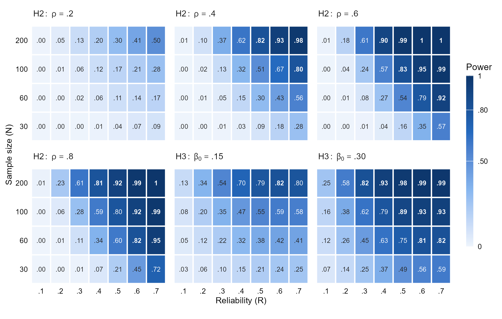
```

Overall, the multilevel SDT model showed good parameter recovery and
generally well-calibrated inferences across the simulated conditions. As
expected, low reliability made the estimation of the correlation and
intercept more difficult, leading to boundary estimates and reduced
statistical power.

### Simulation Study 2: Robustness

Only `r s2_failed` of the 648,000 fits returned estimation errors.
Boundary fits were less frequent than in Study 1, because the awareness
measure was more reliable, occurring in
`r sprintf("%.0f%%", 100 * s2_unt["Klauer", "mean"])` and
`r sprintf("%.0f%%", 100 * s2_unt["Goldstein", "mean"])` of fits under
the models of @Klauer1998Unbiased and @Goldstein2022Accurately,
respectively, mostly with $K = 10$, when the influence measure was least
reliable, and small samples. Under both generating models, the
correlation and intercept were recovered accurately (all CCCs $\geq$
`r fmt(min(s2_ccc$CCC), 3, FALSE)`). Coverage was close to .95 for the
intercept and conservative for the correlation with few trials,
approaching .95 as the number of trials, and thus the reliability of the
influence task, increased (from
`r fmt(s2_cov_K$coverage[s2_cov_K$DGM == "Klauer" & s2_cov_K$trials == 10], 3, FALSE)`
and
`r fmt(s2_cov_K$coverage[s2_cov_K$DGM == "Goldstein" & s2_cov_K$trials == 10], 3, FALSE)`
with $K = 10$ to
`r fmt(s2_cov_K$coverage[s2_cov_K$DGM == "Klauer" & s2_cov_K$trials == 50], 3, FALSE)`
and
`r fmt(s2_cov_K$coverage[s2_cov_K$DGM == "Goldstein" & s2_cov_K$trials == 50], 3, FALSE)`
with $K = 50$). Type I error rates remained close to the nominal level,
never exceeding `r fmt(max(s2_inf$t1_max), 3, FALSE)`
(@tbl-sim2-inference).

```{r}
#| label: tbl-sim2-inference
#| tbl-cap: "Inference on the Correlation and the Intercept by Trials in
#|   Simulation Study 2"
#| apa-note: >-
#|   Values are averaged across conditions (Type I error over null
#|   conditions only). $K$ = trials per condition. True values follow
#|   Equation 2; under Klauer et al. (1998), the true $\beta_0$ equals
#|   the manipulated intercept. Boundary fits are untestable for H2 and
#|   H3. Correlation bias includes these fits; intercept bias, coverage,
#|   and Type I error exclude them.
#| echo: false

# Average each measure by generating model and trials, as in the table of
# Study 1.
s2_tbl <- s2 |>
  group_by(DGM, trials) |>
  summarise(
    untestable = mean(untestable[parameter == "fit"]),
    bias_rho   = mean(bias[parameter == "rho"]),
    bias_int   = mean(bias[parameter == "intercept"]),
    cov_rho    = mean(coverage[parameter == "rho"]),
    cov_int    = mean(coverage[parameter == "intercept"]),
    t1_rho     = mean(rejection[parameter == "rho" & abs(truth) < 1e-10]),
    t1_int     = mean(rejection[parameter == "intercept" & abs(truth) < 1e-10]),
    .groups = "drop"
  ) |>
  arrange(factor(DGM, levels = c("Klauer", "Goldstein")), trials) |>
  mutate(untestable = fmt(untestable, 2, FALSE),
         across(starts_with("bias"), \(x) tex(fmt(x, 3))),
         across(c(cov_rho, cov_int, t1_rho, t1_int), \(x) fmt(x, 3, FALSE)))

# Generate LaTeX for the table, without the column of models.
tab <- kable(
  select(s2_tbl, -DGM), "latex", booktabs = TRUE, escape = FALSE,
  col.names = c("$K$", "Untestable", rep(c("$\\rho$", "$\\beta_0$"), 3)),
  align = rep("c", 8),
  linesep = ""
)

# Add the headers of each measure, and group the rows of each model.
tab <- tab |>
  kableExtra::add_header_above(c(" " = 2, "Bias" = 2, "Coverage" = 2, "Type I error" = 2)) |>
  kableExtra::pack_rows("Klauer et al. (1998)", 1, 3) |>
  kableExtra::pack_rows("Goldstein et al. (2022)", 4, 6)

# Print the table, giving back the space that apaquarto removes.
asis_output(paste0(
  "\\vspace{20pt}{\\small\n", tab, "\n}\\vspace{16pt}"
))
```

Under the model of @Klauer1998Unbiased, the multilevel SDT model
accurately recovered both the population correlation and intercept,
despite the violation of its assumed bivariate normal distribution, and
even though up to 80% of participants had a true awareness-task
sensitivity of exactly zero. Both parameters were also accurately
recovered under @Goldstein2022Accurately, although a complication arises
in interpreting the intercept. Goldstein et al. define the regression of
influence-task sensitivity on awareness accuracy, rather than
$d^\prime$. This means that the regression is estimating an intercept
closely related to that of Goldstein, but not exactly the same. When
awareness and the influence effect are related, our intercept is
slightly larger than the one manipulated in their model, even when the
latter is zero. In our simulations, the difference was at most
`r fmt(s2_gap$gap, 3)`, and when the manipulated intercept was zero, H3
was rejected in up to `r sprintf("%.0f%%", 100 * s2_fp_max$rejection)`
of the replications, with rejection rates above .075 in
`r sprintf("%.0f%%", 100 * mean(s2_fp$rejection > .075))` of these
conditions. The difference comes from participants with almost perfect
accuracy, which the model of Goldstein et al. allows. If the accuracy of
aware participants did not exceed .75 (i.e., a $d^\prime$ of
`r fmt(2 * qnorm(.75), 2)`), the intercept defined by Goldstein et
al. and the intercept estimated by our model would differ by at most
0.004. The Supplemental Material reports these results in detail and
explains where the difference comes from (Tables S10–S14 and Figures
S9–S11).

The multilevel SDT model thus provided generally robust inferences under
both generating models, even when the intercept defined by
@Goldstein2022Accurately did not exactly correspond to the one estimated
by our model. This makes it a promising approach even when the
population consists of distinct subpopulations of aware and unaware
participants.

# Empirical Illustrations

We now illustrate how the multilevel SDT model can be applied to
empirical data and compare its conclusions with those obtained using
conventional analyses. We fit the models with the `{uSDT}` R package
[@ReySaez2026uSDT], using both frequentist and Bayesian estimation in
the first two examples, and only Bayesian estimation in the last one,
whose original analyses were based on Bayes factors. All Bayesian models
were fitted using four chains with 2,000 warmup iterations and 25,000
post-warmup draws per chain. Model-specific prior distributions are
reported in the @apx-a. All code needed to reproduce the analyses is
publicly available at <https://github.com/RicardoReySaez/uSDT_pub> and
<https://doi.org/10.5281/zenodo.24019945>. To illustrate how 
straightforward the implementation is, @apx-b presents the few lines of
code used for the contextual-cuing example, including both frequentist 
and Bayesian estimation. The other two illustrations follow essentially 
the same workflow, requiring only minor changes to the data and, when 
needed, the priors.

```{r}
#| label: empirical-results
#| include: false

# Load the results saved by the scripts in "R scripts/Empirical illustrations".
gw <- read_results("greenwald2017_exp1c")
va <- read_results("vadillo2025_exp2")
we <- read_results("wentura2025_exp2a")

# Extract the Bayesian estimates and Bayes factors of each hypothesis.
hyps  <- c(H1 = "H1", H2 = "H2", H3 = "H3")
gw_b  <- lapply(hyps, \(h) test_row(gw$bayes, h))
gw_bf <- lapply(hyps, \(h) bf_row(gw$bf, h))
va_b  <- lapply(hyps, \(h) test_row(va$bayes, h))
va_bf <- lapply(hyps, \(h) bf_row(va$bf, h))
we_b  <- lapply(hyps, \(h) test_row(we$bayes, h))
we_bf <- lapply(hyps, \(h) bf_row(we$bf, h))

# Klauer (errors-in-variables) intercept of Greenwald and De Houwer (2017),
# with its 95% CI, as in the table of this example.
gw_eiv <- gw$eiv[gw$eiv$parameter == "intercept", ]
```

## Masked Conditioning

@Greenwald2017Unconscious conducted 20 experiments investigating whether
conditioning can occur without conscious awareness, including 14
experiments with masked conditioned stimuli (CSs) and 6 with visible
CSs. Across experiments, participants categorized either words as
"pleasant" or "unpleasant", or first names as "male" or "female". During
acquisition, each word or name (unconditioned stimulus, US) was preceded
by one of two four-consonant strings (CSs; e.g., "NPLW" or "DHJF"), each
consistently paired with one US category (e.g., "NPLW" with pleasant
words and "DHJF" with unpleasant words). In the subsequent conditioning
test (*influence task*), CS–US pairings were randomized and conditioning
was measured as $d^\prime$ (e.g., a "pleasant" response counted as a hit
when preceded by "NPLW" and as a false alarm when preceded by "DHJF",
regardless of whether the word itself was pleasant or unpleasant). In
the masked-CS experiments, a subsequent visibility test (*awareness
task*) required participants to identify which of the two consonant
strings had appeared on each trial, measuring awareness with $d^\prime$
as well. The data are publicly available at
[osf.io/ydeza](https://osf.io/ydeza).

For our illustration, we use Experiment 1c (S18), the last and largest
of their 14 unconscious conditioning experiments. CSs were presented for
75 ms following a forward mask, and a response window (333–467 ms after
US onset) encouraged rapid categorization. Of 386 participants, `r gw$n`
met the authors' inclusion criteria and completed 192 acquisition
trials, 96 conditioning test trials, and 144 visibility test trials. The
authors regressed conditioning on visibility, interpreting a positive
intercept as evidence of conditioning at zero visibility. To account for
measurement error in the visibility measure, they also applied the
errors-in-variables correction of @Klauer1998Unbiased, after which the
intercept remained statistically significant. The Klauer regression
yielded a positive intercept, `r fmt(gw_eiv$estimate)`, 95% CI
`r fmt_ci(gw_eiv$conf.low, gw_eiv$conf.high)`, and a slope close to zero.
Together with the finding that no participant showed perfect
awareness of the CS–US contingency, the authors interpreted these
results as evidence of unconscious conditioning.

We fitted the multilevel SDT model to the trial-level data from
Experiment 1c (S18), applying the original authors' exclusion
criteria.[^series1] We estimated the model using both frequentist and
Bayesian methods. Because the authors' conclusion rests on the
regression intercept, the Bayesian model used the latent regression
parameterization, with a weakly informative prior placed directly on its
intercept, $\mathcal{N}(0, 1)$, a uniform prior on the correlation, and
the default priors of `{uSDT}` on the remaining parameters (see @apx-a).
For comparison, we also applied the errors-in-variables correction of
@Klauer1998Unbiased, implemented in `{uSDT}`, to the $d^\prime$ scores
computed separately for each participant and task. The results are
presented in @tbl-greenwald.

[^series1]: Although we focus on Experiment 1c (S18) here, we also
    prepared the trial-level data and fitted the same models to the
    other 17 datasets from Series 1 of @Greenwald2017Unconscious. The
    code for reproducing these analyses is available in the
    `R scripts/Extra analysis` folder of the project repositories.

```{r}
#| label: tbl-greenwald
#| tbl-cap: "Reanalysis of Experiment 1c of Greenwald and De Houwer
#|   (2017)"
#| apa-note: >-
#|   EIV = errors-in-variables regression; $\Delta d^\prime$ = mean
#|   influence minus mean awareness sensitivity; $\rho$ = correlation
#|   between true sensitivities; $\beta_0$ = latent regression
#|   intercept. Intervals are 95% confidence intervals (EIV and maximum
#|   likelihood) or credible intervals (Bayesian). The maximum
#|   likelihood fit reached a boundary, preventing interval estimation
#|   for $\rho$ and $\beta_0$ ($\dagger$). The Bayesian fit used the
#|   latent regression parameterization, with a prior specified directly
#|   on $\beta_0$. BF$_{01}$ > 1 favors the null hypothesis. See
#|   Appendix A for model specifications and priors.
#| echo: false

# Select the results of each analysis.
eiv <- gw$eiv[gw$eiv$parameter == "intercept", ]
ml  <- do.call(rbind, lapply(hyps, \(h) test_row(gw$ml, h)))
by  <- do.call(rbind, gw_b)
bf  <- do.call(rbind, gw_bf)

# Mark the maximum likelihood estimates on the boundary, which have no CI.
boundary <- is.na(ml$conf.low)

# Format the cells of each column.
greenwald_tbl <- data.frame(
  hypothesis = c(
    "Group-level ($\\Delta d^\\prime$)",
    "Correlation ($\\rho$)",
    "Intercept ($\\beta_0$)"
  ),
  est_eiv = c(" ", " ", tex(fmt(eiv$estimate, 2, FALSE))),
  ci_eiv  = c(" ", " ", tex(fmt_ci(eiv$conf.low, eiv$conf.high, 2, FALSE))),
  est_ml  = ifelse(
    boundary,
    sprintf("$%s^{\\dagger}$", fmt(ml$estimate, 2, FALSE)),
    tex(fmt(ml$estimate, 2, FALSE))
  ),
  ci_ml   = ifelse(boundary, " ", tex(fmt_ci(ml$conf.low, ml$conf.high, 2, FALSE))),
  p_ml    = ifelse(boundary, " ", sprintf("$%s$", fmt_p(ml$p.value))),
  est_b   = tex(fmt(by$estimate, 2, FALSE)),
  ci_b    = tex(fmt_ci(by$conf.low, by$conf.high, 2, FALSE)),
  bf      = sprintf("$%s$", sapply(bf$BF01, fmt_bf))
)

# Generate LaTeX for the table.
tab <- kable(
  greenwald_tbl, "latex", booktabs = TRUE, escape = FALSE,
  col.names = c(
    "Hypothesis", "Estimate", "95\\% CI",
    "Estimate", "95\\% CI", "$p$",
    "Estimate", "95\\% CrI", "BF$_{01}$"
  ),
  align = c("l", rep("c", 8)),
  linesep = ""
)

# Add the headers of each approach.
tab <- tab |>
  kableExtra::add_header_above(c(" " = 3, "Maximum likelihood" = 3, "Bayesian" = 3)) |>
  kableExtra::add_header_above(c(" " = 1, "Klauer EIV" = 2, "Multilevel SDT model" = 6))

# Print the table, giving back the space that apaquarto removes.
asis_output(paste0(
  "\\vspace{20pt}{\\small\\setlength{\\tabcolsep}{3pt}\n", tab, "\n}\\vspace{16pt}"
))
```

```{r}
#| include: false

# Extract the reliabilities and the latent slope reported in the text.
gw_rel_d <- rel_row(gw$reliability, "Awareness")
gw_rel_i <- rel_row(gw$reliability, "Influence")
gw_slope <- gw$bayes[gw$bayes$term == "slope", ]
```

The awareness task was substantially more sensitive to the CS than the
influence task (mean $d^\prime$ = `r fmt(gw$mu_d["estimate", "direct"])`
vs.
`r fmt(gw$mu_d["estimate", "indirect"])`, corresponding to approximately
`r fmt_pc(gw$mu_d["estimate", "direct"])` vs.
`r fmt_pc(gw$mu_d["estimate", "indirect"])` correct classification of
individual trials; $\text{BF}_{10}$ = $`r fmt_bf(gw_bf$H1$BF10)`$). The
group-level analysis therefore showed the opposite of the expected
dissociation. This difference is illustrated in @fig-ROC-h1, which shows
the population ROC curves for the awareness and influence tasks.
Evidence concerning the correlation between true task sensitivities was
inconclusive ($\rho$ = $`r fmt(gw_b$H2$estimate, 2, FALSE)`$, 95% CrI
$`r fmt_ci(gw_b$H2$conf.low, gw_b$H2$conf.high, 2, FALSE)`$;
$\text{BF}_{01}$ = $`r fmt_bf(gw_bf$H2$BF01)`$). In contrast, the latent
intercept provided extreme evidence for conditioning at zero visibility
($d^\prime$ = `r fmt(gw_b$H3$estimate)`, 95% CrI
`r fmt_ci(gw_b$H3$conf.low, gw_b$H3$conf.high)`; $\text{BF}_{10}$ =
$`r fmt_bf(gw_bf$H3$BF10)`$), consistent with the original analyses and
the correction of @Klauer1998Unbiased.

```{r}
#| label: fig-ROC-h1
#| fig-cap: "Population ROC Curves for the Awareness and Influence
#|   Tasks"
#| apa-note: >-
#|    Curves represent population-level sensitivity under equal-variance
#|    SDT. Shaded areas indicate 95% Wald confidence bands, and points
#|    mark the estimated response criteria. AUC = area under the curve;
#|    $d^\prime$ = sensitivity. Figure generated using the `{uSDT}` R
#|    package.
#| out-width: "60%"
#| fig-align: left
#| echo: false

# Include the figure made in "R scripts/Empirical illustrations/2. greenwald2017_exp1c_analysis.R".
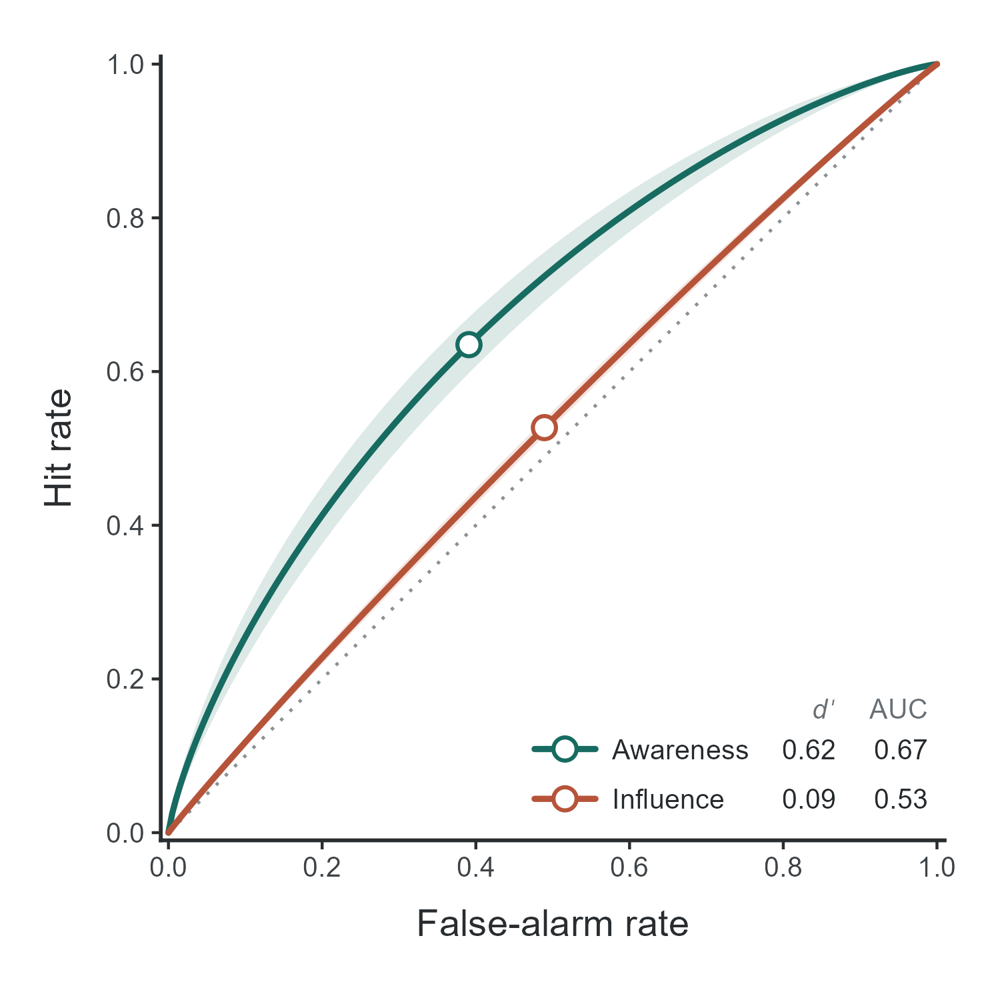
```

These results must be interpreted in light of the extremely low
reliability of the influence measure (reliability =
`r fmt(gw_rel_i$reliability, 2, FALSE)`, 95% CrI
`r fmt_ci(gw_rel_i$conf.low, gw_rel_i$conf.high, 2, FALSE)`, compared
with `r fmt(gw_rel_d$reliability, 2, FALSE)`, 95% CrI
`r fmt_ci(gw_rel_d$conf.low, gw_rel_d$conf.high, 2, FALSE)` for the
awareness measure). As illustrated in @fig-reg-gydh, although observed
influence sensitivities vary considerably across participants (top
panel), the multilevel model attributes nearly all this variability to
measurement error, shrinking individual estimates toward the group mean
(bottom panel). The estimated between-participant variance in true
influence-task sensitivity was so close to zero that we could not obtain
standard errors for the other hypotheses from the frequentist model.
With virtually no true variability in conditioning, its relationship
with CS visibility is difficult to evaluate, explaining why the
correlation between true sensitivities could not be reliably estimated.
Under these circumstances, the regression slope approaches zero
($`r fmt(gw_slope$estimate)`$) regardless of the true correlation, and
the intercept becomes nearly identical to the mean conditioning effect.
Although this produces strong evidence for a positive intercept,
interpreting it as evidence of conditioning without conscious awareness
is problematic, because the data cannot establish either the presence or
the absence of an association between conditioning and awareness.

```{r}
#| label: fig-reg-gydh
#| fig-cap: "Regression Model With Observed and Model-Estimated
#|   Sensitivities in Masked Conditioning"
#| apa-note: >-
#|    Gray circles show observed participant-level sensitivities, and
#|    green points show posterior mean estimates from the multilevel SDT
#|    model. Connecting segments illustrate shrinkage. Lines represent
#|    the observed regression (top) and the model-implied latent
#|    regression (bottom), with 95% confidence and credible bands,
#|    respectively. Open circles mark the intercepts. b₀ = intercept; b₁
#|    = slope. P-values in the bottom panel are two-sided posterior
#|    p-values. Figure generated using the `{uSDT}` R package.
#| out-width: "100%"
#| echo: false

# Include the figure made in "R scripts/Empirical illustrations/2. greenwald2017_exp1c_analysis.R".
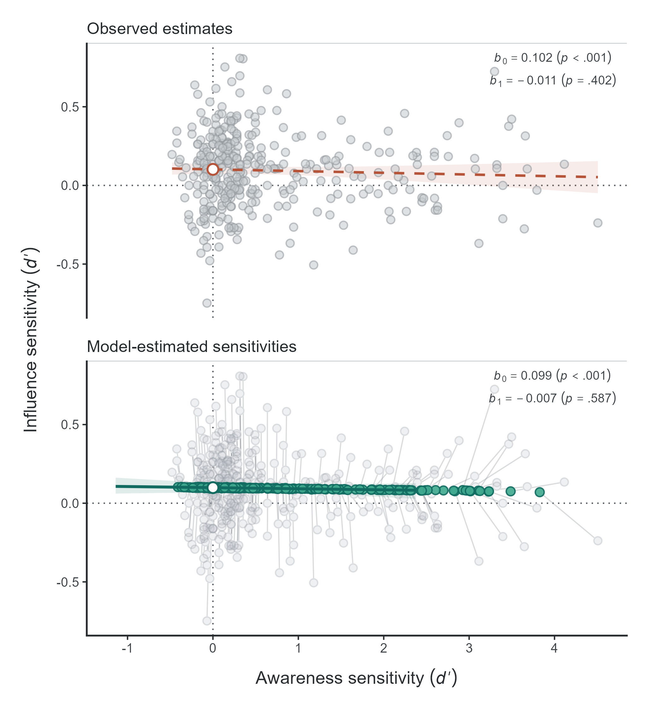
```

## Contextual Cuing of Visual Attention

@Vadillo2025ReliabilityMultiverse investigated how to improve the
reliability of contextual-cuing measures by manipulating several
experimental features (set size, color vs. grayscale, and
distractor–target similarity) and conducting a multiverse analysis of
different preprocessing decisions. In contextual-cuing paradigms,
participants search for a target (a rotated T) among distractors
(L-shaped), with some displays repeated across blocks (Old) and others
presented for the first time (New). Contextual cuing was measured as the
difference in RTs between Old and New displays (*influence task*), with
faster responses to Old displays indicating learning. After the search
task, participants completed an explicit recognition test (*awareness
task*), identifying Old and New displays using a six-point confidence
scale, allowing awareness to be assessed using both $d^\prime$ and
rating-based measures. For our illustration, we use Experiment 2 with a
Spanish sample ($N$ = `r va$n`), which included a relatively large
number of trials for contextual-cuing research. Each participant
completed 384 visual-search trials across 24 blocks (192 Old and 192
New), followed by 64 recognition trials (32 Old and 32 New), with
responses ranging from 1 ("sure New") to 6 ("sure Old"). The data are
publicly available at [osf.io/jp3gx](https://osf.io/jp3gx).

We fitted the multilevel SDT model to the trial-level data, following
the original authors' preprocessing procedures. We excluded incorrect
visual-search responses, RTs longer than 10 s, and RTs more than three
standard deviations from each participant's mean
(`r fmt(100 * va$excluded, 1)`% of trials). Following
@Meyen2024NoEvidence, we dichotomized the remaining RTs at each
participant's median, coding faster responses as "Old" responses (and
slower as "New" responses). We considered Old displays as signal trials
(and New displays as noise trials) to compute a $d^\prime$ as the
sensitivity of the influence measure. Recognition ratings were
dichotomized into New (1–3) and Old (4–6) responses, with Old displays
as signal trials. We fitted both frequentist and Bayesian models, using
the latent regression parameterization for the latter, with a
$\mathcal{N}(0, 1)$ prior on the intercept, a uniform prior on the
correlation, and the default `{uSDT}` priors for the remaining
parameters (see @apx-a). For comparison, we also applied the
conventional two-step approach, testing the three hypotheses using a
paired $t$ test, a Pearson correlation, and an ordinary least-squares
regression intercept, respectively. Results are presented in
@tbl-vadillo.

```{r}
#| label: tbl-vadillo
#| tbl-cap: "Reanalysis of Experiment 2 of Vadillo et al. (2025)"
#| apa-note: >-
#|   $\Delta d^\prime$ = mean influence minus mean awareness
#|   sensitivity; $\rho$ = correlation between true sensitivities
#|   (Pearson $r$ between observed sensitivities in the two-step
#|   approach); $\beta_0$ = regression intercept. Intervals are 95%
#|   confidence intervals (two-step and maximum likelihood) or credible
#|   intervals (Bayesian). The Bayesian fit used the latent regression
#|   parameterization, with a prior specified directly on $\beta_0$.
#|   BF$_{01}$ > 1 favors the null hypothesis. See Appendix A for model
#|   specifications and priors.
#| echo: false

# Select the results of each analysis.
ts <- va$two_step
ml <- do.call(rbind, lapply(hyps, \(h) test_row(va$ml, h)))
by <- do.call(rbind, va_b)
bf <- do.call(rbind, va_bf)

# Format the cells of each column.
vadillo_tbl <- data.frame(
  hypothesis = c(
    "Group-level ($\\Delta d^\\prime$)",
    "Correlation ($\\rho$)",
    "Intercept ($\\beta_0$)"
  ),
  est_ts = tex(fmt(ts$estimate, 2, FALSE)),
  ci_ts  = tex(fmt_ci(ts$conf.low, ts$conf.high, 2, FALSE)),
  p_ts   = sprintf("$%s$", fmt_p(ts$p.value)),
  est_ml = tex(fmt(ml$estimate, 2, FALSE)),
  ci_ml  = tex(fmt_ci(ml$conf.low, ml$conf.high, 2, FALSE)),
  p_ml   = sprintf("$%s$", fmt_p(ml$p.value)),
  est_b  = tex(fmt(by$estimate, 2, FALSE)),
  ci_b   = tex(fmt_ci(by$conf.low, by$conf.high, 2, FALSE)),
  bf     = sprintf("$%s$", sapply(bf$BF01, fmt_bf))
)

# Generate LaTeX for the table.
tab <- kable(
  vadillo_tbl, "latex", booktabs = TRUE, escape = FALSE,
  col.names = c(
    "Hypothesis", "Est.", "95\\% CI", "$p$",
    "Est.", "95\\% CI", "$p$",
    "Est.", "95\\% CrI", "BF$_{01}$"
  ),
  align = c("l", rep("c", 9)),
  linesep = ""
)

# Add the headers of each approach.
tab <- tab |>
  kableExtra::add_header_above(c(" " = 4, "Maximum likelihood" = 3, "Bayesian" = 3)) |>
  kableExtra::add_header_above(c(" " = 1, "Two-step approach" = 3, "Multilevel SDT model" = 6))

# Stretch the table to the text width, adding the extra space only between
# the hypothesis column and each block of three columns.
fill <- "@{\\hspace{\\tabcolsep}\\extracolsep{\\fill}\\hspace{\\tabcolsep}}"
stop <- "@{\\hspace{\\tabcolsep}\\extracolsep{0pt}\\hspace{\\tabcolsep}}"
spec <- paste0("l", fill, "c", stop, "cc", fill, "c", stop, "cc", fill, "c", stop, "cc")
tab  <- sub("\\begin{tabular}{lccccccccc}",
            paste0("\\begin{tabular*}{\\linewidth}{", spec, "}"), tab, fixed = TRUE)
tab  <- sub("\\end{tabular}", "\\end{tabular*}", tab, fixed = TRUE)

# Print the table, giving back the space that apaquarto removes.
asis_output(paste0(
  "\\vspace{20pt}{\\small\\setlength{\\tabcolsep}{3pt}\n", tab, "\n}\\vspace{16pt}"
))
```

```{r}
#| include: false

# Extract the reliabilities and the two-step results reported in the text.
va_rel_d <- rel_row(va$reliability, "Awareness")
va_rel_i <- rel_row(va$reliability, "Influence")
va_ts    <- split(va$two_step, va$two_step$hypothesis)
```

The original analyses found a contextual-cuing effect, with responses
`r fmt(va$cuing_ms[["estimate"]], 0)` ms faster for Old than New
displays, $t(`r va$cuing_ms[["df"]]`) = `r fmt(va$cuing_ms[["t"]])`$,
$p `r fmt_p(va$cuing_ms[["p.value"]], TRUE)`$. However, recognition was
also above chance ($d^\prime$ = `r fmt(va$recognition[["estimate"]])`,
$t(`r va$recognition[["df"]]`) = `r fmt(va$recognition[["t"]])`$,
$p `r fmt_p(va$recognition[["p.value"]], TRUE)`$). Although not analysed
in the original paper, the two-step analyses showed greater sensitivity
in the recognition than in the search task, but no significant
correlation between observed sensitivities ($r$ =
`r fmt(va_ts$H2$estimate, 2, FALSE)`, 95% CI
$`r fmt_ci(va_ts$H2$conf.low, va_ts$H2$conf.high, 2, FALSE)`$) and a
significantly positive regression intercept (`r fmt(va_ts$H3$estimate)`,
95% CI `r fmt_ci(va_ts$H3$conf.low, va_ts$H3$conf.high)`), the two
latter typically interpreted as evidence of contextual cuing without
awareness.

The multilevel SDT model supported only the first of these conclusions.
The awareness task was more sensitive than the influence task (mean
$d^\prime$ = `r fmt(va$mu_d["estimate", "direct"])` vs.
`r fmt(va$mu_d["estimate", "indirect"])`, corresponding to approximately
`r fmt_pc(va$mu_d["estimate", "direct"])` vs.
`r fmt_pc(va$mu_d["estimate", "indirect"])` correct classification of
individual trials; $\text{BF}_{10} = `r fmt_bf(va_bf$H1$BF10)`$), again
showing the opposite of the expected group-level dissociation. Evidence
concerning the correlation between true sensitivities was inconclusive
($\rho = `r fmt(va_b$H2$estimate, 2, FALSE)`$, 95% CrI
$`r fmt_ci(va_b$H2$conf.low, va_b$H2$conf.high, 2, FALSE)`$;
$\text{BF}_{01} = `r fmt_bf(va_bf$H2$BF01)`$). The latent intercept was
close to zero, with moderate evidence against contextual cuing at zero
awareness ($d^\prime$ = `r fmt(va_b$H3$estimate)`, 95% CrI
$`r fmt_ci(va_b$H3$conf.low, va_b$H3$conf.high)`$;
$\text{BF}_{01} = `r fmt_bf(va_bf$H3$BF01)`$).

The discrepancy with the two-step approach can be explained by the low
reliability of the awareness measure. With 64 recognition trials, its
reliability was `r fmt(va_rel_d$reliability, 2, FALSE)` (95% CrI
`r fmt_ci(va_rel_d$conf.low, va_rel_d$conf.high, 2, FALSE)`), compared
with the influence measure's reliability of
`r fmt(va_rel_i$reliability, 2, FALSE)` (95% CrI
`r fmt_ci(va_rel_i$conf.low, va_rel_i$conf.high, 2, FALSE)`). Much of
the observed variability in recognition therefore reflected measurement
error, which can attenuate the correlation and inflate the intercept
when ignored (@fig-reg-vadi). As in the previous example, low
reliability complicates the interpretation of a positive intercept as
evidence of unconscious processing.

```{r}
#| label: fig-reg-vadi
#| fig-cap: "Regression Model With Observed and Model-Estimated
#|   Sensitivities in Contextual Cuing"
#| apa-note: >-
#|    Gray circles show observed participant-level sensitivities, and
#|    green points show posterior mean estimates from the multilevel SDT
#|    model. Connecting segments illustrate shrinkage. Lines represent
#|    the observed regression (top) and the model-implied latent
#|    regression (bottom), with 95% confidence and credible bands,
#|    respectively. Open circles mark the intercepts. b₀ = intercept; b₁
#|    = slope. P-values in the bottom panel are two-sided posterior
#|    p-values. Figure generated using the `{uSDT}` R package.
#| out-width: "100%"
#| echo: false

# Include the figure made in "R scripts/Empirical illustrations/3. vadillo2025_exp2_analysis.R".
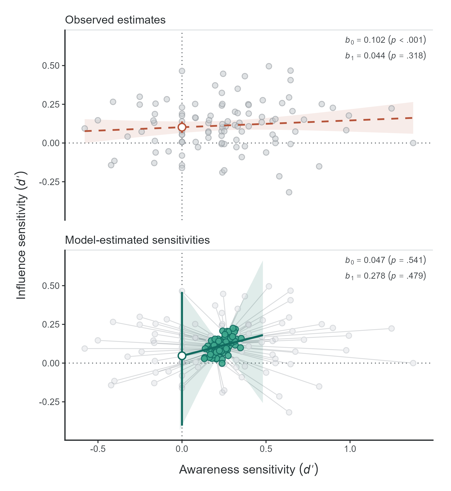
```

## Masked Affective Priming

@Wentura2025Affective investigated whether the processing of emotional
facial expressions requires awareness, revisiting the conclusions of
@Lahteenmaki2015Affective. For our illustration, we use their
preregistered Experiment 2a. In the *influence task*, a face expressing
anger or sadness (the prime) was presented for 40 ms between a forward
and a backward mask, followed by a visible target face that participants
categorized as "angry" or "sad" as quickly as possible. Affective
priming (*influence measure*) was computed as the RT difference between
congruent trials, in which prime and target expressed the same emotion,
and incongruent trials. In the subsequent *awareness task*, participants
categorized the emotion of the masked prime. Eighty-six participants
completed 360 trials per task, equally balanced between conditions. The
data are publicly available at [osf.io/9t4pk](https://osf.io/9t4pk).

The authors tested the group-level dissociation hypothesis separately
for each task. Responses were 6 ms faster on congruent than incongruent
trials, with strong evidence for a priming effect
($\text{BF}_{10} = 10.57$). In contrast, mean sensitivity in the
awareness task was very low, with only anecdotal evidence that it
differed from zero ($\text{BF}_{10} = 1.93$). They also found no
correlation between the priming effect and awareness sensitivity
($r(84) = -.03$, $\text{BF}_{01} = 7.20$). The intercept hypothesis was
not tested. Based on these findings, the authors concluded that masked
affective priming does not require awareness.

We fitted the multilevel SDT model to the trial-level data, following
the authors' preprocessing procedures, which excluded errors and RT
outliers (`r fmt(100 * we$excluded, 1)`% of trials). Following
@Meyen2022Advancing, we dichotomized RTs at each participant's median,
treating faster responses as "congruent" responses (and slower as
"incongruent" responses). We considered congruent trials as signal (and
incongruent trials as noise) to compute a $d^\prime$ as the sensitivity
of the influence measure. For the *awareness task*, sad primes were
treated as signal (and angry primes as noise). To mirror the original
Bayesian analyses, we fitted only the Bayesian model, using the authors'
priors for the mean task sensitivities and their correlation (see
@apx-a). Bayes factors were computed using the Savage–Dickey density
ratio for all three hypotheses and each task's mean sensitivity against
zero. Results are presented in @tbl-wentura.

```{r}
#| label: tbl-wentura
#| tbl-cap: "Reanalysis of Experiment 2a of Wentura et al. (2025)"
#| apa-note: >-
#|   Original results are from Wentura et al. (2025). We calculated 95%
#|   CIs from reported effect sizes (N = 86). Original BFs used JASP
#|   with a two-sided Cauchy prior (r = sqrt(2)/2). Cohen's $d_z$ is the
#|   mean within-participant effect divided by its SD. Multilevel
#|   estimates are posterior means with 95% CrIs; BFs use the
#|   Savage–Dickey ratio. $d'$ = mean sensitivity; $\rho$ = correlation
#|   between true sensitivities; $\beta_0$ = latent regression
#|   intercept. BF_01 > 1 favors the null.
#| echo: false

# Select the reported CIs and the posterior means of each task.
ci_o <- we$reported_ci
mu   <- we$mu_d

# Format the original results, as reported by the authors (BF01 = 1/BF10).
est_o <- c("$d_z = 0.34$", "$d_z = 0.27$", " ", "$r = -.03$", " ")
bf_o  <- c("0.09", "0.52", "", "7.20", "")
ci_o  <- c(
  fmt_ci(ci_o["priming", 1], ci_o["priming", 2]),
  fmt_ci(ci_o["direct", 1], ci_o["direct", 2]),
  "",
  tex(fmt_ci(ci_o["correlation", 1], ci_o["correlation", 2], 2, FALSE)),
  ""
)

# Format the results of the multilevel model.
est_m <- c(
  sprintf("$d^\\prime = %s$", fmt(mu["estimate", "influence"])),
  sprintf("$d^\\prime = %s$", fmt(mu["estimate", "awareness"])),
  sprintf("$\\Delta d^\\prime = %s$", fmt(we_b$H1$estimate)),
  sprintf("$\\rho = %s$", fmt(we_b$H2$estimate, 2, FALSE)),
  sprintf("$\\beta_0 = %s$", fmt(we_b$H3$estimate))
)
ci_m <- tex(c(
  fmt_ci(mu["2.5%", "influence"], mu["97.5%", "influence"]),
  fmt_ci(mu["2.5%", "awareness"], mu["97.5%", "awareness"]),
  fmt_ci(we_b$H1$conf.low, we_b$H1$conf.high),
  fmt_ci(we_b$H2$conf.low, we_b$H2$conf.high, 2, FALSE),
  fmt_ci(we_b$H3$conf.low, we_b$H3$conf.high)
))
bf_m <- c(mu["BF01", "influence"], mu["BF01", "awareness"],
          we_bf$H1$BF01, we_bf$H2$BF01, we_bf$H3$BF01)
bf_m <- sprintf("$%s$", sapply(bf_m, fmt_bf))

# Combine both analyses in one table.
wentura_tbl <- data.frame(
  hypothesis = c("Group-level", "dissociation", "", "Correlation", "Intercept"),
  test       = c("Influence vs. 0", "Awareness vs. 0", "Influence $-$ awareness",
                 "Across participants", "At zero awareness"),
  est_o, ci_o, bf_o, est_m, ci_m, bf_m
)

# Generate LaTeX for the table.
tab <- kable(
  wentura_tbl, "latex", booktabs = TRUE, escape = FALSE, valign = "",
  col.names = c(
    "Hypothesis", "Test",
    "Estimate", "95\\% CI", "BF$_{01}$",
    "Estimate", "95\\% CrI", "BF$_{01}$"
  ),
  align = c("l", "l", "l", "c", "r", "l", "c", "r"),
  linesep = ""
)

# Add the headers of each analysis.
tab <- tab |>
  kableExtra::add_header_above(c(" " = 2, "Original analysis" = 3, "Multilevel SDT model" = 3))

# Print the table, giving back the space that apaquarto removes.
asis_output(paste0(
  "\\vspace{20pt}{\\small\\setlength{\\tabcolsep}{4pt}\n", tab, "\n}\\vspace{16pt}"
))
```

```{r}
#| include: false

# Extract the reliabilities reported in the text.
we_rel_d <- rel_row(we$reliability, "Awareness")
we_rel_i <- rel_row(we$reliability, "Influence")

# Split the sensitivity analysis by prior scale, from narrowest to widest.
we_sens <- split(we$sensitivity, we$sensitivity$r)
we_sens <- we_sens[order(as.numeric(names(we_sens)))]
```

The multilevel SDT model did not support the original conclusions.
Testing each task separately reproduced the original pattern, with
strong evidence that influence sensitivity was above zero
($\text{BF}_{10} = `r fmt_bf(we$mu_d["BF10", "influence"])`$) but only
anecdotal evidence for awareness sensitivity
($\text{BF}_{10} = `r fmt_bf(we$mu_d["BF10", "awareness"])`$). However,
both measures were practically equally sensitive (mean $d^\prime$ =
`r fmt(we$mu_d["estimate", "awareness"])` vs.
`r fmt(we$mu_d["estimate", "influence"])`, corresponding to
approximately `r fmt_pc(we$mu_d["estimate", "awareness"])` correct
classification of individual trials in both tasks;
$\text{BF}_{01} = `r fmt_bf(we_bf$H1$BF01)`$). The group-level analysis
therefore provided strong evidence against a dissociation. Evidence
concerning the correlation between true sensitivities was inconclusive
($\rho = `r fmt(we_b$H2$estimate, 2, FALSE)`$, 95% CrI
$`r fmt_ci(we_b$H2$conf.low, we_b$H2$conf.high, 2, FALSE)`$;
$\text{BF}_{01} = `r fmt_bf(we_bf$H2$BF01)`$). The latent intercept was
positive but close to zero, with only anecdotal evidence for affective
priming at zero awareness ($d^\prime$ = `r fmt(we_b$H3$estimate)`, 95%
CrI $`r fmt_ci(we_b$H3$conf.low, we_b$H3$conf.high)`$;
$\text{BF}_{10} = `r fmt_bf(we_bf$H3$BF10)`$).

Although neither measure was as unreliable as in the previous examples,
both still showed limited reliability. The reliability of the awareness
task was `r fmt(we_rel_d$reliability, 2, FALSE)` (95% CrI
`r fmt_ci(we_rel_d$conf.low, we_rel_d$conf.high, 2, FALSE)`), compared
with reliability of the influence task of
`r fmt(we_rel_i$reliability, 2, FALSE)` (95% CrI
`r fmt_ci(we_rel_i$conf.low, we_rel_i$conf.high, 2, FALSE)`). The
estimated correlation between true sensitivities
($\rho = `r fmt(we_b$H2$estimate, 2, FALSE)`$) was more than twice the
observed correlation between participant-level estimates
($r = `r fmt(we$r_dprime[["estimate"]], 2, FALSE)`$), although evidence
concerning the true correlation remained inconclusive. Evidence against
a zero correlation remained inconclusive
($\text{BF}_{01} = `r fmt_bf(we_bf$H2$BF01)`$), but the posterior
probability that the true correlation was positive was 93.7%, with a
directional Bayes factor of 14.73 favoring a positive correlation over a
negative or zero correlation (@fig-sddrt-bf). The original null
correlation therefore cannot establish that affective priming is
independent of awareness. The results were also sensitive to the choice
of priors. With the wider priors used in the authors' sensitivity
analysis ($r = 1$ and $r = \sqrt{2}$), evidence for equal sensitivities
increased ($\text{BF}_{01}$ up to $`r fmt_bf(we_sens[[3]]$BF01[1])`$),
while evidence for a positive intercept decreased ($\text{BF}_{01}$ up
to $`r fmt_bf(we_sens[[3]]$BF01[3])`$). Overall, the reanalysis provides
no convincing evidence of unconscious affective priming.

```{r}
#| label: fig-sddrt-bf
#| fig-cap: "Prior and Posterior Distributions of the Latent Correlation
#|   Between True Awareness and Influence Sensitivities"
#| apa-note: >-
#|    The left panel shows the prior (dashed) and posterior (solid)
#|    densities of the latent correlation $\rho$, with the vertical
#|    dotted line marking the null value $\rho = 0$. The ratio of the
#|    prior and posterior densities at this point yields the
#|    Savage–Dickey Bayes factor for the point-null hypothesis. The
#|    right panel shows the same posterior distribution for the
#|    directional hypothesis $\rho > 0$; the shaded area represents the
#|    posterior probability that the true correlation is positive. The
#|    qualitative evidence labels (e.g., anecdotal, moderate, strong)
#|    follow the classification adapted from @Jeffreys1961Theory by
#|    @LeeWagenmakers2013Bayesian. Figure generated using the `{uSDT}` R
#|    package.
#| out-width: "100%"
#| echo: false

# Include the figure made in "R scripts/Empirical illustrations/4. wentura2025_exp2a_analysis.R".
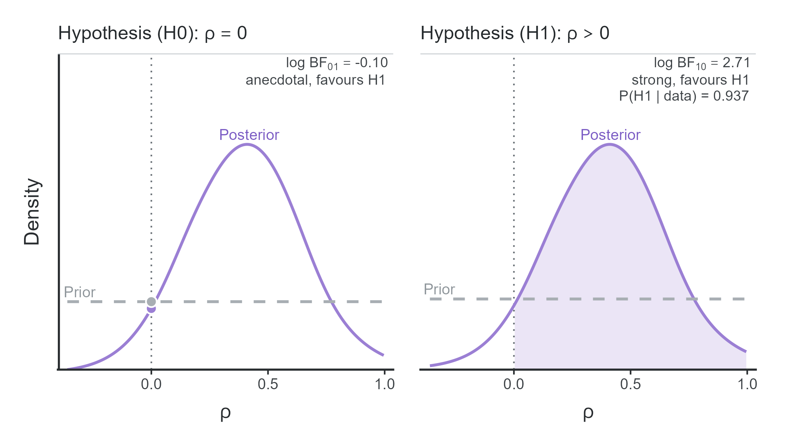
```

# Discussion

Research on unconscious processing has traditionally relied on three
types of evidence: group-level dissociations between influence and
awareness measures, their correlation across individuals, and the
intercept of their regression. These hypotheses are often tested using
separate analyses that overlook methodological challenges: differences
in statistical power and measurement scales, measurement error, and the
failure to distinguish absence of evidence from evidence of absence.
Together, these challenges can artificially inflate the apparent
evidence for unconscious processing. Although several methods have been
proposed to address each of these challenges in isolation, researchers
must identify, understand, and implement the appropriate methods for
each challenge, which can be highly demanding. In this work, we have
introduced a multilevel SDT model that simultaneously addresses these
challenges and allows all three hypotheses to be tested in a single
step, using just one R function. By jointly analyzing trial-level
responses from influence and awareness tasks, the model accounts for
uncertainty in individual sensitivities and estimates the population
parameters needed to evaluate each hypothesis. To facilitate its use in
applied research, we have implemented the models in the R package
`{uSDT}`, available on CRAN [@ReySaez2026uSDT]. The package provides
both frequentist and Bayesian implementations, allowing researchers to
fit these models with minimal effort.

## Reliability and Validity

Although multilevel models account for measurement error, they cannot
compensate for too low reliability. When one or both tasks are highly
unreliable (e.g., reliabilities below .30), the data may simply contain
too little information to estimate the relationship between true
sensitivities with sufficient precision. This problem cannot be solved
by statistical modeling alone, but the multilevel SDT model can at least
alert researchers to the substantial uncertainty surrounding these
estimates. Nevertheless, researchers should prioritize improving task
reliability through experimental design, for example, by increasing the
number of trials or optimizing task procedures to obtain more precise
measures of individual differences [e.g., @Siegelman2017Measuring;
@Whitehead2020Reliability; @Vadillo2025ReliabilityMultiverse;
@FrancoMartinez2026Replicating].

Reliability alone, however, does not guarantee that our inferences are
valid. For instance, even when measurement error is minimized and a
proper sensitivity comparison is computed, inferences about unconscious
processing still depend on whether the awareness task adequately
measures conscious awareness [e.g., @GimenezFernandez2020Probabilistic;
@Schmidt2024Theory; @FrancoMartinez2026Replicating;
@FrancoMartinez2026Choose]. Beyond measurement validity, our model does
not currently accommodate alternative criteria for inferring unconscious
processing, such as the double-dissociation criterion proposed by
@Schmidt2006Criteria. Nevertheless, note that the proposed framework
could be readily extended to test this criterion with an appropriate
experimental design, simply by framing H1 to test for an interaction.
But in any case, while statistical modeling can help to mitigate
methodological issues and improve inferences in unconscious processing
research, these models cannot, by themselves, ensure the validity of the
measures on which those inferences rely.

Relatedly, another consideration concerns how influence and awareness
are assessed. Consider, for example, a masked priming experiment in
which participants respond to targets preceded by briefly presented
primes. The influence of the primes can be assessed through their
effects on RTs, whereas awareness can be measured either on the very
same trials, by asking participants to report how clearly they perceived
each prime (online), or in a separate detection or discrimination task
[ofline, see @jimenez2025consciousness]. In the former case, both
responses may depend on correlated perceptual evidence, introducing
dependencies at the trial level [@decarlo2003source;
@rausch2021modelling]. Like other approaches that estimate the
relationship between influence and awareness across participants
[@Klauer1998Unbiased; @Goldstein2022Accurately.], our model does not
explicitly account for these dependencies. Whether and to what extent
ignoring these dependencies affects the inferences drawn from such
models remains to be assessed properly by future research.

A further limitation concerns the generalizability of correlations
between influence and awareness *tasks*. These correlations are
inherently task-specific and cannot be directly interpreted as
correlations between influence and awareness *constructs*. This has been
referred to as "task impurity" [@Miyake2000Unity], that is, no task can
be a perfectly pure measure of a latent construct. With only one
influence and one awareness task, we cannot aim to determine whether
their relationship might generalize across different measures of the
same construct. A promising alternative is to collect multiple awareness
and influence measures and analyze them using generalized hierarchical
factor models [@ReySaez2026; @Rouder2026Random; @Stevenson2024Efficient;
@Stevenson2024Joint; @Stevenson2025Using]. These models adapt
exploratory and confirmatory factor analysis to experimental settings,
allowing researchers to model awareness and influence as latent factors
underlying their respective measures and estimate the correlation
between them. Their main advantage is that they do so by modeling
trial-level responses within a hierarchical framework, as in our
multilevel SDT model, but allowing for task-specific likelihoods (e.g.,
Bernoulli for binary responses or ex-Gaussian for response times).
Moreover, combining multiple tasks can improve the precision of
estimates of true correlations between task effects by leveraging the
information each task shares with the others [@Mehrvarz2025Estimating;
@ReySaez2026]. This approach would allow researchers to move beyond
task-specific associations and examine whether awareness and influence
performance share common underlying processes across different
paradigms.

## Conclusion

Claims that information can be processed without conscious awareness
have important implications for theories of human cognition. Yet such
claims have often relied on inconsistent statistical evidence, small
samples, few awareness trials, unreliable measures, and tests not
suitable for evidence of absence. Extraordinary claims require
extraordinary evidence [@Sagan1979Broca], and we have shown that
nonsignificant awareness effects, weak correlations, and significant
regression intercepts can have much more ordinary methodological
explanations, such as insufficient statistical power, differences in
measurement scales, and measurement error. Clearly, the multilevel SDT
model (like any statistical model) cannot compensate for insufficient
data or invalid measures, but it provides a robust model-based approach
to assessing the strength of evidence for and against unconscious
processing while accounting for measurement error and differences in
scale. We hope this framework, and its accessible implementation in the
`{uSDT}` package, will encourage researchers to revisit established
findings and design more informative studies capable of providing the
robust evidence that claims of unconscious processing require.

\newpage

# References

::: {#refs}
:::

# Model Specification and Prior Distributions {#apx-a}

\raggedbottom

All models share the likelihood in @eq-03 and @eq-04.
$\boldsymbol{d}^\prime_i$ and $\boldsymbol{c}_i$ contain the
sensitivities and response criteria of participant $i$ in the awareness
($A$) and influence ($I$) tasks.
$\boldsymbol{\mu}_d = (\mu_A, \mu_I)^\top$ and
$\boldsymbol{\mu}_c = (\mu_{cA}, \mu_{cI})^\top$ are their population
means; $\boldsymbol{\sigma}_d = (\sigma_A, \sigma_I)^\top$ and
$\boldsymbol{\sigma}_c = (\sigma_{cA}, \sigma_{cI})^\top$ their
between-participant SDs; $\mathbf{R}_d$ and $\mathbf{R}_c$ their
correlation matrices, with $\rho$ the correlation between true
sensitivities; and $\mathbf{S}_d$ and $\mathbf{S}_c$ the resulting
covariance matrices. $\beta_0$ is the latent regression intercept
(@eq-02). When RTs are split at the median, the influence-task criterion
is fixed at zero ($c_{iI} = 0$).
$\mathrm{Student}\text{-}t^{+}(\nu, 0, s)$ is a Student-$t$ distribution
with $\nu$ degrees of freedom and scale $s$, truncated at zero, and
$\mathrm{LKJcorr}(1)$ is a uniform prior on correlation matrices.

$$
\begin{array}{|c|c|}
\hline
\rule{0pt}{2.6ex} \textbf{Model} & \textbf{Common priors} \\[2pt]
\hline
\begin{aligned}
\rule{0pt}{2.6ex} y_{ij\ell} &\sim \mathrm{Bernoulli}(\pi_{ij\ell}) \\
\Phi^{-1}(\pi_{ij\ell}) &= d^\prime_{ij} \cdot x_{ij\ell} - c_{ij} \\
\boldsymbol{d}^\prime_i &\sim \mathrm{MVNormal}(\boldsymbol{\mu}_d, \mathbf{S}_d) \\
\mathbf{S}_d &= \mathrm{diag}(\boldsymbol{\sigma}_d) \, \mathbf{R}_d \, \mathrm{diag}(\boldsymbol{\sigma}_d)
\end{aligned}
&
\begin{aligned}
\rule{0pt}{2.6ex} \sigma_A, \sigma_I &\sim \mathrm{Student}\text{-}t^{+}(4, 0, 0.5) \\
\mathbf{R}_d &\sim \mathrm{LKJcorr}(1) \\
\mu_{cA} &\sim \mathrm{Normal}(0, 0.5) \\
\sigma_{cA} &\sim \mathrm{Student}\text{-}t^{+}(4, 0, 0.5)
\end{aligned}
\\[4pt]
\hline
\end{array}
$$

$$
\begin{array}{|c|c|c|}
\hline
\rule{0pt}{2.6ex} \textbf{Masked conditioning} & \textbf{Contextual cuing} & \textbf{Affective priming} \\[2pt]
\hline
\begin{aligned}
\rule{0pt}{2.6ex} \boldsymbol{c}_i &\sim \mathrm{MVNormal}(\boldsymbol{\mu}_c, \mathbf{S}_c) \\
\mathbf{S}_c &= \mathrm{diag}(\boldsymbol{\sigma}_c) \, \mathbf{R}_c \, \mathrm{diag}(\boldsymbol{\sigma}_c) \\
\mu_I &= \beta_0 + \rho \, \mu_A \, \sigma_I / \sigma_A \\
\mu_A, \beta_0 &\sim \mathrm{Normal}(0, 1) \\
\mu_{cI} &\sim \mathrm{Normal}(0, 0.5) \\
\sigma_{cI} &\sim \mathrm{Student}\text{-}t^{+}(4, 0, 0.5) \\
\mathbf{R}_c &\sim \mathrm{LKJcorr}(1)
\end{aligned}
&
\begin{aligned}
\rule{0pt}{2.6ex} c_{iA} &\sim \mathrm{Normal}(\mu_{cA}, \sigma_{cA}) \\
c_{iI} &= 0 \\
\mu_I &= \beta_0 + \rho \, \mu_A \, \sigma_I / \sigma_A \\
\mu_A, \beta_0 &\sim \mathrm{Normal}(0, 1) \\
\vphantom{\sigma_{cI}^{+}} & \\
\vphantom{\sigma_{cI}^{+}} & \\
\vphantom{\sigma_{cI}^{+}} &
\end{aligned}
&
\begin{aligned}
\rule{0pt}{2.6ex} c_{iA} &\sim \mathrm{Normal}(\mu_{cA}, \sigma_{cA}) \\
c_{iI} &= 0 \\
\mu_A &\sim \mathrm{Cauchy}(0, `r fmt(we$prior_scale[["awareness"]], 3)`) \\
\mu_I &\sim \mathrm{Cauchy}(0, `r fmt(we$prior_scale[["influence"]], 3)`) \\
\vphantom{\sigma_{cI}^{+}} & \\
\vphantom{\sigma_{cI}^{+}} & \\
\vphantom{\sigma_{cI}^{+}} &
\end{aligned}
\\[4pt]
\hline
\end{array}
$$

# Fitting the Multilevel SDT Model With `{uSDT}` {#apx-b}

The code below fits the models of the contextual-cuing study of
@Vadillo2025ReliabilityMultiverse, whose trial-level data are included
in `{uSDT}`. The package takes the data of each task, one row per trial,
and only needs to know which columns identify the participant, the
condition, and the response. RTs are split at each participant's median
internally [@Meyen2022Advancing].

```{=latex}
\footnotesize
```

```r
library(uSDT)
# Trial-level data of both tasks, one row per trial
# Awareness measure                 # Influence measure
data(vadillo_awareness)             data(vadillo_cuing)
#>   subj condition judged.old      #>   subj condition       rt
#> 1 2001       old          0      #> 1 2001       new 1305.352
#> 2 2001       old          1      #> 2 2001       old 4027.887
#> 3 2001       new          1      #> 3 2001       old 2484.210

# Both tasks in one object, with Old displays as signal trials
d <- usdt_data_tasks(
  awareness        = vadillo_awareness,
  influence        = vadillo_cuing,
  subject_col      = "subj",
  condition_col    = "condition",
  condition_levels = c(signal = "old", noise = "new"),
  response_col     = list(awareness = "judged.old", influence = "rt"),
  response_levels  = list(awareness = c(signal = 1, noise = 0),
                          influence = c(signal = "faster", noise = "slower")),
  dichotomize      = list(awareness = FALSE, influence = TRUE))

# Fit the frequentist hierarchical SDT model and check results
fit <- hsdt(d); summary(fit)                   

# Other utilities
usdt_reliability(fit)            # Reliability estimates per task and participant
plot(fit, type = "roc")          # Our figure 8 in main text
plot(fit, type = "regression")   # Our figures 9 and 10 in main text

# Bayesian model: set prior distributions (if not, default priors used)
priors <- usdt_priors(intercept = "normal(0, 1)", cor_dprime = "lkj(1)")

# Fit the Bayesian hierarchical SDT model and check results
fit_b  <- hsdt(d, estimation = "bayesian", priors = priors, latent = "regression")
summary(fit_b)

# Bayes factors and plots for the same hypotheses as the frequentist model
usdt_bf(fit_b)
# Bayes factors and plot type as in Figure 11
usdt_bf(fit_b, hypothesis = c("rho = 0", "rho > 0"))
```

```{=latex}
\normalsize
```
