```{r}
#| label: supplement-results
#| include: false

# Load the functions that format the results, ccc() and
# robustness_parameters().
source("../R scripts/R functions/manuscript_results.R")
source("../R scripts/R functions/simulation_functions.R")
suppressPackageStartupMessages({
  library(knitr)
  library(dplyr)
  library(tidyr)
})

# Load the results saved by the scripts in "R scripts/Simulation study", with
# one row per condition and parameter, and one column per measure.
s1 <- readRDS("../Results/Simulation studies/Processed/validation_results_longdata.rds") |>
  pivot_wider(names_from = measure, values_from = value)
s2 <- readRDS("../Results/Simulation studies/Processed/robustness_results_longdata.rds") |>
  pivot_wider(names_from = measure, values_from = value)

# Load the tables saved by the same scripts (LaTeX cells and effect sizes).
load("../Results/Simulation studies/Processed/validation_ANOVA_tables.rdata")
load("../Results/Simulation studies/Processed/validation_emmeans_tables.rdata")
load("../Results/Simulation studies/Processed/robustness_ANOVA_tables.rdata")
load("../Results/Simulation studies/Processed/robustness_emmeans_tables.rdata")
load("../Results/Simulation studies/Processed/robustness_summary_table.rdata")
load("../Results/Simulation studies/Processed/robustness_reliability.rdata")

# Percentage, and omega-squared of one predictor on one measure of a
# meta-model table, for the text.
pct <- function(x, digits = 0) sprintf(paste0("%.", digits, "f%%"), 100 * x)
w2  <- function(tab, predictor, measure) {
  fmt(tab[tab$Predictor == predictor, measure], 2, FALSE)
}

# Study 1: boundary fits per condition.
s1_fit <- filter(s1, parameter == "fit")

# Study 1: means, group-level difference, and SDs over conditions.
s1_means <- s1 |>
  filter(parameter %in% c("mu_dD", "mu_dI", "mu_cD", "diff")) |>
  summarise(bias = max(abs(bias)), cov_min = min(coverage), cov_max = max(coverage),
            liberal = mean(coverage < .925), msrse_min = min(MSRSE), msrse_max = max(MSRSE))
s1_sds <- s1 |>
  filter(parameter %in% c("sd_dD", "sd_dI")) |>
  summarise(rel_bias = min(rel_bias), .by = parameter) |>
  tibble::deframe()
s1_sd_cov <- s1 |>
  filter(parameter %in% c("sd_dD", "sd_dI")) |>
  summarise(coverage = mean(coverage), msrse = median(MSRSE), .by = reliab)

# Study 1: mean and median bias of the intercept and slope (testable fits).
s1_h3 <- s1 |>
  filter(parameter %in% c("intercept", "slope")) |>
  summarise(b_min = min(bias), b_max = max(bias), m_min = min(median_bias),
            m_max = max(median_bias), .by = parameter) |>
  tibble::column_to_rownames("parameter")

# Study 1: rejection rate of H1 when the true difference is closest to zero.
s1_h1_null <- s1 |>
  filter(parameter == "diff", abs(truth) < .02) |>
  summarise(truth = mean(truth), min = min(rejection), max = max(rejection), n = n())

# Study 1: power of H1 by true difference, sample size, and trials (averaged
# over reliability, as in the figure), and its range over reliability; share
# of the conditions with a difference of at least .05 in which power was at
# least as high with 50 as with 10 trials, and lower with reliability .7 than
# .1;
# and observed variance of awareness-task sensitivity (true plus sampling
# variance, true SD squared divided by reliability) with 10 trials.
s1_h1_pow <- s1 |>
  filter(parameter == "diff") |>
  summarise(power = mean(rejection_all),
            range = max(rejection_all) - min(rejection_all),
            .by = c(intercept, rho, N, trials))
s1_h1_cells <- s1 |>
  filter(parameter == "diff", abs(truth) >= .05) |>
  select(intercept, rho, N, trials, reliab, rejection_all)
s1_h1_K <- s1_h1_cells |>
  filter(trials %in% c(10, 50)) |>
  pivot_wider(names_from = trials, values_from = rejection_all, names_prefix = "K") |>
  summarise(share = mean(K50 >= K10)) |>
  pull(share)
s1_h1_R <- s1_h1_cells |>
  filter(reliab %in% c(.1, .7)) |>
  pivot_wider(names_from = reliab, values_from = rejection_all, names_prefix = "R") |>
  summarise(share = mean(R0.7 < R0.1)) |>
  pull(share)
s1_obs_var <- s1 |>
  filter(parameter == "sd_dD", trials == 10) |>
  summarise(var = mean(truth^2 / reliab), .by = reliab)

# Study 1: power of H2 and H3 over the testable fits and over all
# replications, by effect size, sample size, and reliability.
s1_pow <- s1 |>
  filter((parameter == "rho" & rho > 0) | (parameter == "intercept" & intercept > 0)) |>
  mutate(effect = ifelse(parameter == "rho", rho, intercept)) |>
  summarise(testable = mean(rejection), all = mean(rejection_all),
            .by = c(parameter, effect, N, reliab))

# Study 1: Type I error rates of H2 and H3 over the testable fits.
s1_t1_rho <- s1 |>
  filter(parameter == "rho", rho == 0) |>
  summarise(value = mean(rejection), .by = c(N, reliab))
s1_t1_int <- s1 |>
  filter(parameter == "intercept", intercept == 0)

# Study 2: failed and untestable fits per generating model.
s2_fit <- s2 |>
  filter(parameter == "fit") |>
  summarise(failed = sum(failed) * 1000, mean = mean(untestable),
            max = max(untestable),
            k10 = mean(untestable[trials == 10]), k50 = mean(untestable[trials == 50]),
            .by = DGM) |>
  tibble::column_to_rownames("DGM")

# Study 2: gap between the hsdt intercept and alpha, and rejection rate of H3
# when alpha = 0, in Goldstein's model.
s2_fp <- s2 |>
  filter(DGM == "Goldstein", parameter == "alpha", intercept == 0)
s2_fp_max <- s2_fp[which.max(s2_fp$rejection), ]
s2_alpha_cov <- min(s2$coverage[s2$DGM == "Goldstein" & s2$parameter == "alpha"])

# Study 2: reliability of the observed sensitivities by model, unaware
# proportion, and trials; reliability of the influence task by trials; and
# largest difference from the nominal reliability in the conditions of Study 1.
s2_rel <- reliab_rob |>
  summarise(awareness = mean(reliab_D), influence = mean(reliab_I),
            .by = c(DGM, prop_unaware, trials))
s2_rel_I <- reliab_rob |>
  summarise(influence = mean(reliab_I), range = max(reliab_I) - min(reliab_I),
            .by = trials) |>
  arrange(trials)
s2_rel_check <- max(abs(c(reliab_check$reliab_D, reliab_check$reliab_I) -
                          reliab_check$reliab))

# Math minus signs in the cells of the marginal means.
marginal_means_re_latex[-(1:2)]  <- lapply(marginal_means_re_latex[-(1:2)], tex)
marginal_means_hyp_latex[-(1:2)] <- lapply(marginal_means_hyp_latex[-(1:2)], tex)
marginal_means_K_latex[-(1:2)]   <- lapply(marginal_means_K_latex[-(1:2)], tex)
marginal_means_G_latex[-(1:2)]   <- lapply(marginal_means_G_latex[-(1:2)], tex)
scorecard_latex$Bias <- tex(scorecard_latex$Bias)
```
# SM1: Performance Measures in the Simulation Study

For each condition, let $\theta$ be the true parameter value and
$\hat\theta_r$ and $\widehat{\mathrm{SE}}_r$ its estimate and SE in
replication $r = 1, \ldots, R_u$, where $R_u$ is the number of
replications in which the parameter was evaluated. We computed bias
and root mean squared error (RMSE),
$$
\text{Bias} = \frac{1}{R_u}\sum_{r=1}^{R_u}\hat\theta_r - \theta,
\qquad
\text{RMSE} = \sqrt{\frac{1}{R_u}\sum_{r=1}^{R_u}
(\hat\theta_r - \theta)^2},
$$ {#eq-s-bias}
and relative bias (bias divided by $\theta$) for SDs, whose true
values are always positive. The empirical coverage rate (ECR) was
the proportion of 95% CIs containing $\theta$, among replications
with a CI. We assessed SEs using the mean squared relative SE
[MSRSE, @Chalmers2020Writing], the mean squared estimated SE divided
by the variance of estimates across replications. A value of 1
indicates that SEs reflect sampling variability, whereas values
above 1 indicate overestimation. For each hypothesis, the rejection
rate among testable replications ($p < .05$) estimated Type I error
when $\theta = 0$ and power otherwise. We also computed the rate
across all replications, treating untestable fits as non-rejections,
to estimate the probability of concluding in favor of the hypothesis.

A fit was untestable when `{uSDT}` could not compute SEs for the
correlation and intercept due to a singular estimated random-effects
covariance matrix. Means, the group-level difference, SDs, and
covariance were evaluated whenever estimated, as was the correlation,
including estimates at $\pm 1$. The intercept and slope were
evaluated only in testable fits because their estimates become
extremely unstable when $\sigma_A$ approaches zero. Some estimates
remained extreme even in testable fits, so we also report median
bias (median estimate minus the true value).

To summarize agreement across conditions, we computed Lin's
concordance correlation coefficient [CCC, @Lin1989Concordance]
between true values ($x$) and mean estimates ($y$),
$$
\text{CCC} =
\frac{2\,s_{xy}}{s_x^2 + s_y^2 + (\bar{x} - \bar{y})^2}
= r \cdot C_b,
\qquad
C_b = \frac{2}{v + 1/v + u^2},
$$ {#eq-s-ccc}
where $s_x^2$, $s_y^2$, and $s_{xy}$ are variances and covariance
computed using the number of conditions as divisor, $r$ is the
Pearson correlation, $v = s_x / s_y$ is a scale shift, and
$u = (\bar{x} - \bar{y}) / \sqrt{s_x s_y}$ is a location shift.
The CCC combines precision ($r$) and accuracy ($C_b$), reaching 1
only when all points lie on the identity line. Because it depends
on the range of true values, we use it only to summarize figures.

With 1,000 replications, the Monte Carlo SE of a proportion $p$ is
$\sqrt{p(1 - p) / 1{,}000}$, approximately .007 at $p = .05$ or
$p = .95$. Rates based on fewer testable replications have larger
Monte Carlo errors. We assessed coverage and Type I error against
Bradley's liberal criterion [@Bradley1978Robustness], [.925, .975]
and [.025, .075], respectively.

To assess the influence of design factors on each measure, we fitted
ANOVA meta-models [@Skrondal2000Design] with the measure as the
dependent variable and design factors as predictors. In Study 1,
models included all five factors and interactions up to fourth order,
leaving the fifth-order interaction as residual. In Study 2, models
were fitted separately for each generating model, with interactions
up to third order because the 324 conditions per model provided few
residual degrees of freedom for higher-order terms. We report the
non-partial omega-squared,
$$
\omega^2 =
\frac{SS_{\text{effect}} -
df_{\text{effect}} \cdot MS_{\text{residual}}}
{SS_{\text{total}} + MS_{\text{residual}}},
$$ {#eq-s-omega}
which quantifies the proportion of across-condition variation
explained by each effect. Because each measure was averaged over
1,000 replications, residual variation mainly reflected Monte Carlo
error, causing partial effect sizes (computed relative to this
residual) to approach 1 for most effects. We interpret $\omega^2$
values of .01, .06, and .14 as small, medium, and large
[@Cohen1992Power], and report effects with $\omega^2 \geq .06$ in
at least one measure. However, a large $\omega^2$ can be practically
negligible when the measure varies little across conditions.
Meta-models should therefore be interpreted alongside marginal means.

\clearpage

# SM2: Simulation Study 1 (Validation)

## True Values

The true SDs depend on reliability ($R$) and the number of trials
per condition ($K$). For a participant with sensitivity $d$ and
criterion $c$, the expected hit and false-alarm rates are
$\text{HR} = \Phi(\eta_S)$ and $\text{FAR} = \Phi(\eta_N)$, where
$\eta_S = d^\prime/2 - c$ and $\eta_N = -d^\prime/2 - c$.
Let $Z_{\text{HR}} = \Phi^{-1}(\widehat{\text{HR}})$ and
$Z_{\text{FAR}} = \Phi^{-1}(\widehat{\text{FAR}})$ be the
probit-transformed observed rates. With $K_S$ signal and $K_N$
noise trials, their sampling variances are approximately
$$
\mathbb{V}(Z_{\text{HR}}) \approx
\frac{\text{HR} \cdot (1 - \text{HR})}
{K_S \cdot \phi(\eta_S)^2}
\qquad\text{and}\qquad
\mathbb{V}(Z_{\text{FAR}}) \approx
\frac{\text{FAR} \cdot (1 - \text{FAR})}
{K_N \cdot \phi(\eta_N)^2},
$$ {#eq-s-var-z}
where $\phi$ is the standard normal density function
[@Gourevitch1967Significance, p. 31; see also @Suero2017Methods].
When the criterion is estimated, as in the awareness task,
sensitivity is estimated as the difference between the two
transformed rates. Because these are independent, its sampling
variance is the sum of their variances,
$$
\hat{d} = Z_{\text{HR}} - Z_{\text{FAR}},
\qquad
\mathbb{V}(\hat{d}) \approx
\mathbb{V}(Z_{\text{HR}}) + \mathbb{V}(Z_{\text{FAR}}).
$$

When the criterion is fixed at zero, as in the influence task after dichotomization,
$\eta_S = d/2$ and $\eta_N = -d/2$. Each rate then provides an
independent estimate of sensitivity, $\hat{d}_S = 2 \cdot Z_{\text{HR}}$ 
and $\hat{d}_N = -2 \cdot Z_{\text{FAR}}$, with sampling variances of
$\mathbb{V}(\hat{d}_S) \approx 4 \cdot \mathbb{V}(Z_{\text{HR}})$ and 
$\mathbb{V}(\hat{d}_N) \approx 4 \cdot \mathbb{V}(Z_{\text{FAR}})$.
Asymptotically, the maximum likelihood estimate of $d$ and its
sampling variance are
$$
\hat{d} \approx
\frac{
\hat{d}_S / \mathbb{V}(\hat{d}_S) +
\hat{d}_N / \mathbb{V}(\hat{d}_N)
}{
1 / \mathbb{V}(\hat{d}_S) +
1 / \mathbb{V}(\hat{d}_N)
}\qquad\text{and}\qquad
\mathbb{V}(\hat{d}) \approx
\frac{4}{
1 / \mathbb{V}(Z_{\text{HR}}) +
1 / \mathbb{V}(Z_{\text{FAR}})
}.
$$

The reliability of the observed sensitivities is then
$$
R = \frac{\sigma^2}{
\sigma^2 + \mathbb{E}[\mathbb{V}(\hat{d})]
},
$$ {#eq-s-reliability}
where the expectation is over the population distribution of true
sensitivities and criteria. For each condition, we numerically solved
@eq-s-reliability for $\sigma_A$ and $\sigma_I$. Because sampling
variance depends on sensitivity, and $\mu_I$ depends on $\sigma_I$
through the intercept (Equation 2 in the main text), we iterated
$\sigma_I$ and $\mu_I$ until convergence. @tbl-s-true-sds reports
the resulting SDs. For a given reliability, more trials imply
smaller true SDs because measurement error decreases.

Given $\sigma_A$, $\sigma_I$, $\rho$, and $\beta_0$, we computed
the slope and influence-task mean as
$$
\beta_1 = \rho \cdot \frac{\sigma_I}{\sigma_A},
\qquad
\mu_I = \beta_0 + \beta_1 \cdot \mu_A.
$$
The residual SD of true influence-task sensitivity was
$\sigma_I \cdot \sqrt{1 - \rho^2}$.

```{r}
#| label: tbl-s-true-sds
#| tbl-cap: "True Standard Deviations of Sensitivities in Simulation Study 1"
#| apa-note: >-
#|   $R$ = reliability of the observed sensitivities; $K$ = trials per
#|   condition in each task. $\sigma_I$ is averaged over $\rho$ and
#|   $\beta_0$, which change it by less than .02.
#| echo: false

# True SDs by reliability and trials.
sds_tbl <- s1 |>
  filter(parameter %in% c("sd_dD", "sd_dI")) |>
  summarise(truth = mean(truth), .by = c(parameter, reliab, trials)) |>
  pivot_wider(names_from = c(parameter, trials), values_from = truth) |>
  mutate(reliab = fmt(reliab, 1, FALSE), across(-reliab, \(x) fmt(x, 2)))

# Generate LaTeX for the table.
tab <- kable(
  sds_tbl, "latex", booktabs = TRUE, escape = FALSE,
  col.names = c("$R$", rep(c("$K = 10$", "$K = 30$", "$K = 50$"), 2)),
  align = rep("c", 7), linesep = ""
)

# Add the headers of each SD.
tab <- tab |>
  kableExtra::add_header_above(c(" " = 1, "$\\\\sigma_A$" = 3, "$\\\\sigma_I$" = 3),
                               escape = FALSE)

# Print the table, giving back the space that apaquarto removes.
asis_output(paste0("\\vspace{20pt}{\\small\n", tab, "\n}\\vspace{16pt}"))
```

\clearpage

## Convergence and Boundary Fits

Of the 1,260,000 fits, only `r sum(s1_fit$failed) * 1000` failed
with an estimation error. Across conditions, an average of
`r pct(mean(s1_fit$singular))` of fits were singular (maximum
`r pct(max(s1_fit$singular))`), and
`r pct(mean(s1_fit$untestable))` were untestable for H2 and H3
(maximum `r pct(max(s1_fit$untestable))`). All singular fits were
untestable, but another
`r pct(mean(s1_fit$untestable - s1_fit$singular))` were untestable
despite being nonsingular.
The most common boundary estimates were correlations of $\pm 1$
(average `r pct(mean(s1_fit$one_rho))`; maximum
`r pct(max(s1_fit$one_rho))`), followed by $\sigma_A = 0$
(average `r pct(mean(s1_fit$zero_sd_dD))`; maximum
`r pct(max(s1_fit$zero_sd_dD))`) and $\sigma_I = 0$
(average `r pct(mean(s1_fit$zero_sd_dI))`; maximum
`r pct(max(s1_fit$zero_sd_dI))`). The SD of the awareness-task
criterion was almost never estimated at zero
(`r pct(mean(s1_fit$zero_sd_cD), 1)`).

@fig-s-boundary shows how the proportion of untestable fits varied
with reliability, sample size, and true correlation. The ANOVA
meta-models showed that reliability explained most of the variation
across conditions
($\omega^2$ = `r w2(ANOVA_es_re, "reliab", "UNT")`), followed by
sample size ($\omega^2$ = `r w2(ANOVA_es_re, "N", "UNT")`) and true
correlation ($\omega^2$ = `r w2(ANOVA_es_re, "rho", "UNT")`;
@tbl-s-anova-sds). Untestable fits were more frequent with stronger
correlations because their estimates were more likely to reach
$\pm 1$. At $\rho = .8$, they remained frequent even with moderate
reliability.

```{r}
#| label: fig-s-boundary
#| fig-cap: "Untestable Fits by Reliability, Sample Size, and True Correlation in Simulation Study 1"
#| apa-note: >-
#|   Proportion of fits without SEs for the correlation and the
#|   intercept, averaged over trials per condition and true intercepts.
#| out-width: "100%"
#| echo: false

# Include the figure made in "R scripts/Simulation study/uSDT_validation_analysis.R".
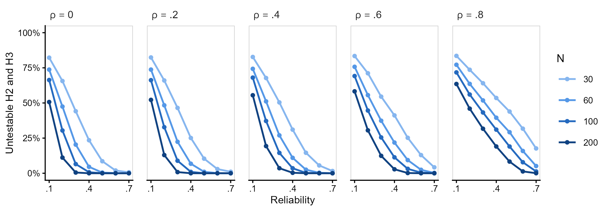
```

\clearpage

## Recovery of All Parameters

@tbl-s-recovery summarizes parameter recovery. The means of both
tasks, the mean awareness-task criterion, and the group-level
difference showed negligible bias (absolute bias below
`r fmt(ceiling(1000 * s1_means$bias) / 1000, 3, FALSE)` in every
condition), coverage between
`r fmt(s1_means$cov_min, 3, FALSE)` and
`r fmt(s1_means$cov_max, 3, FALSE)`, and MSRSE between
`r fmt(s1_means$msrse_min, 2)` and
`r fmt(s1_means$msrse_max, 2)`. The SDs of true sensitivities
were slightly underestimated, as is typical of maximum likelihood
estimates of variance components. At low reliability, relative
bias reached `r tex(pct(s1_sds[["sd_dD"]]))` for $\sigma_A$ and
`r tex(pct(s1_sds[["sd_dI"]]))` for $\sigma_I$ (see the section
on random-effect SDs).

The intercept and slope showed the largest mean biases, ranging
from `r tex(fmt(s1_h3["intercept", "b_min"], 2))` to
`r fmt(s1_h3["intercept", "b_max"], 2)` for $\beta_0$ and from
`r tex(fmt(s1_h3["slope", "b_min"], 2))` to
`r fmt(s1_h3["slope", "b_max"], 2)` for $\beta_1$. However, their
median biases were much smaller, ranging from
`r tex(fmt(s1_h3["intercept", "m_min"], 2))` to
`r fmt(s1_h3["intercept", "m_max"], 2)` and from
`r tex(fmt(s1_h3["slope", "m_min"], 2))` to
`r fmt(s1_h3["slope", "m_max"], 2)`, respectively. Thus, most
mean bias came from a few extreme estimates at low reliability,
when $\sigma_A$, which appears in the denominator of the slope,
was estimated near zero. A few extreme SEs also inflated the
MSRSE of the correlation, intercept, and slope in these
conditions, making coverage a better indicator of CI calibration.
@fig-s-reliability-hyp shows the recovery of the parameters of
all three hypotheses, including the slope, at four reliability
levels.

```{r}
#| label: tbl-s-recovery
#| tbl-cap: "Recovery of All Parameters in Simulation Study 1"
#| apa-note: >-
#|   Mean [minimum, maximum] over the 1,260 conditions for bias and ECR,
#|   [minimum, maximum] for RMSE, and median [first quartile, third
#|   quartile] for MSRSE, which took extreme values in a few conditions
#|   with very low reliability. ECR = empirical coverage rate of the 95%
#|   CIs; MSRSE = mean squared relative SE. $\mu_{cA}$ and
#|   $\sigma_{cA}$ are the mean and SD of the awareness-task criterion. The
#|   intercept and the slope were evaluated over testable fits.
#| echo: false

# Parameters in the order of the table.
pars_tbl <- c(mu_dD = "$\\mu_A$", mu_dI = "$\\mu_I$", mu_cD = "$\\mu_{cA}$",
              sd_dD = "$\\sigma_A$", sd_dI = "$\\sigma_I$", sd_cD = "$\\sigma_{cA}$",
              cov_d = "$\\sigma_{AI}$", diff = "$\\mu_I - \\mu_A$",
              rho = "$\\rho$", intercept = "$\\beta_0$", slope = "$\\beta_1$")

# Summarize each parameter.
rec_tbl <- s1 |>
  filter(parameter %in% names(pars_tbl)) |>
  summarise(
    bias  = sprintf("%s [%s, %s]", fmt(mean(bias), 3), fmt(min(bias), 3), fmt(max(bias), 3)),
    rmse  = sprintf("[%s, %s]", fmt(min(RMSE), 3), fmt(max(RMSE), 3)),
    ecr   = sprintf("%s [%s, %s]", fmt(mean(coverage), 3, FALSE),
                    fmt(min(coverage), 3, FALSE), fmt(max(coverage), 3, FALSE)),
    msrse = sprintf("%s [%s, %s]", fmt(median(MSRSE), 2), fmt(quantile(MSRSE, .25), 2),
                    fmt(quantile(MSRSE, .75), 2)),
    .by = parameter
  ) |>
  arrange(factor(parameter, levels = names(pars_tbl))) |>
  mutate(parameter = pars_tbl[parameter], bias = tex(bias))

# Generate LaTeX for the table.
tab <- kable(
  rec_tbl, "latex", booktabs = TRUE, escape = FALSE,
  col.names = c("Parameter", "Bias", "RMSE", "ECR", "MSRSE"),
  align = c("l", "c", "c", "c", "c"), linesep = ""
)

# Print the table, giving back the space that apaquarto removes.
asis_output(paste0("\\vspace{20pt}{\\small\n", tab, "\n}\\vspace{16pt}"))
```

```{r}
#| label: fig-s-reliability-hyp
#| fig-cap: "Recovery of the Parameters of the Three Hypotheses by Reliability in Simulation Study 1"
#| apa-note: >-
#|   Each point is one condition, showing the mean estimate across 1,000
#|   replications against the true value, for four of the seven
#|   reliability levels ($R$). Dashed lines indicate perfect recovery.
#|   CCC = Lin's concordance correlation coefficient within each panel.
#|   The intercept and the slope were evaluated over testable fits.
#| out-width: "100%"
#| echo: false

# Include the figure made in "R scripts/Simulation study/uSDT_validation_analysis.R".
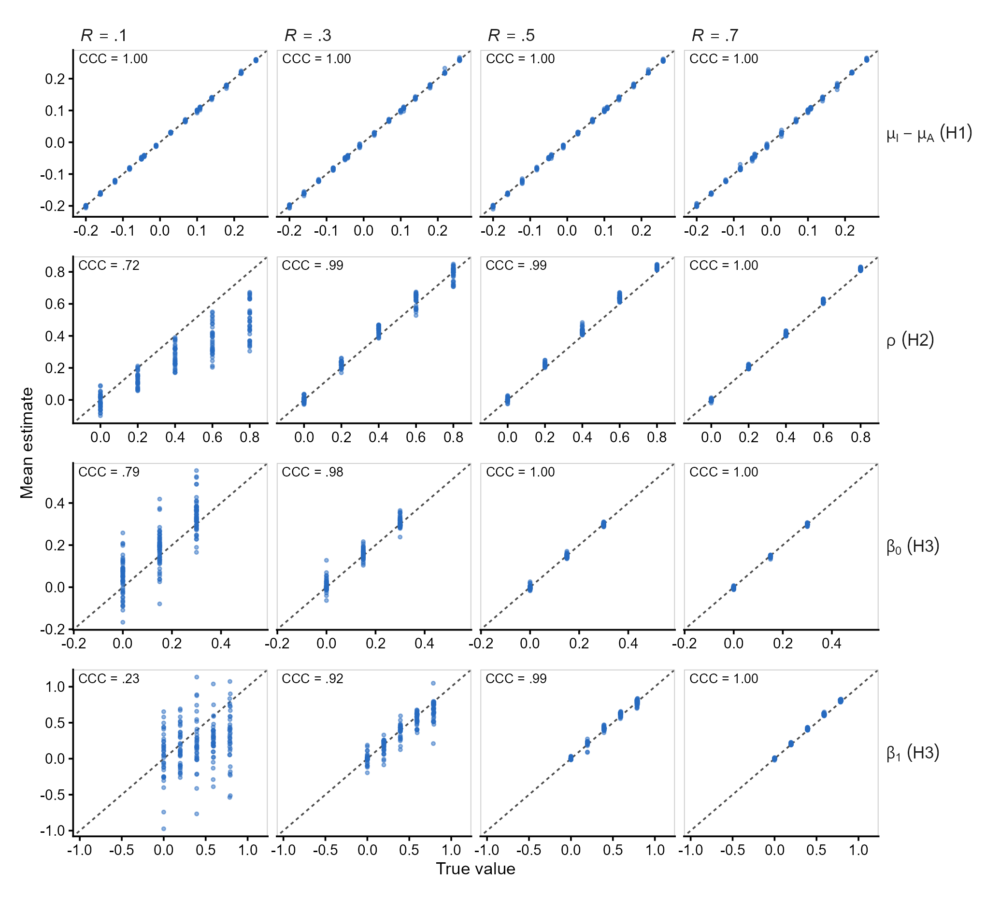
```

\clearpage

## Meta-Models

@tbl-s-anova-sds and @tbl-s-anova-hyp report the ANOVA meta-model
effect sizes, while @tbl-s-emmeans-sds and @tbl-s-emmeans-hyp report
the corresponding marginal means.

Reliability was the main determinant of bias and coverage. For the
SDs of true sensitivities, relative bias depended on reliability
($\omega^2$ = `r w2(ANOVA_es_re, "reliab", "RB_D")` for $\sigma_A$
and `r w2(ANOVA_es_re, "reliab", "RB_I")` for $\sigma_I$) and its
interaction with sample size ($\omega^2$ =
`r w2(ANOVA_es_re, "N:reliab", "RB_D")` and
`r w2(ANOVA_es_re, "N:reliab", "RB_I")`). Larger samples reduced
bias, except at very low reliability, when many SD estimates were
zero. Coverage depended almost entirely on reliability
($\omega^2$ = `r w2(ANOVA_es_re, "reliab", "ECR_D")` and
`r w2(ANOVA_es_re, "reliab", "ECR_I")`), whereas RMSE depended on
trials ($\omega^2$ = `r w2(ANOVA_es_re, "trials", "RMSE_D")` and
`r w2(ANOVA_es_re, "trials", "RMSE_I")`) and sample size
($\omega^2$ = `r w2(ANOVA_es_re, "N", "RMSE_D")` and
`r w2(ANOVA_es_re, "N", "RMSE_I")`). Thus, at fixed reliability,
trials affected precision but not bias or coverage.

The group-level difference showed no effects on bias (all
$\omega^2 < .02$), indicating unbiased estimates across the
design. Its RMSE depended on trials and sample size
($\omega^2$ = `r w2(ANOVA_es_hyp, "trials", "RMSE_H1")` and
`r w2(ANOVA_es_hyp, "N", "RMSE_H1")`). Reliability had a large
effect on coverage ($\omega^2$ =
`r w2(ANOVA_es_hyp, "reliab", "ECR_H1")`), but this was
practically negligible, as marginal coverage ranged only from
.942 to .953 (@tbl-s-emmeans-hyp).

For the correlation, bias depended on reliability
($\omega^2$ = `r w2(ANOVA_es_hyp, "reliab", "B_H2")`) and its
interaction with the true correlation ($\omega^2$ =
`r w2(ANOVA_es_hyp, "reliab:rho", "B_H2")`). RMSE depended on
reliability ($\omega^2$ =
`r w2(ANOVA_es_hyp, "reliab", "RMSE_H2")`) and sample size
($\omega^2$ = `r w2(ANOVA_es_hyp, "N", "RMSE_H2")`). Coverage
depended on the true correlation ($\omega^2$ =
`r w2(ANOVA_es_hyp, "rho", "ECR_H2")`) and its interaction with
reliability ($\omega^2$ =
`r w2(ANOVA_es_hyp, "reliab:rho", "ECR_H2")`). At low
reliability, CIs were conservative for weak correlations and
liberal for strong correlations.

The intercept showed a similar pattern, with smaller effects
on bias (reliability: $\omega^2$ =
`r w2(ANOVA_es_hyp, "reliab", "B_H3")`; reliability by
correlation: $\omega^2$ =
`r w2(ANOVA_es_hyp, "reliab:rho", "B_H3")`) and similar effects
on coverage (reliability by correlation: $\omega^2$ =
`r w2(ANOVA_es_hyp, "reliab:rho", "ECR_H3")`; reliability:
$\omega^2$ = `r w2(ANOVA_es_hyp, "reliab", "ECR_H3")`;
correlation: $\omega^2$ =
`r w2(ANOVA_es_hyp, "rho", "ECR_H3")`).

```{r}
#| label: tbl-s-anova-sds
#| tbl-cap: "Effect Sizes of the Meta-Models for the Random-Effect Standard Deviations and Boundary Fits in Simulation Study 1"
#| apa-note: >-
#|   Non-partial $\omega^2$. $N$ = sample size; $K$ = trials per
#|   condition; $R$ = reliability; $\rho$ = true correlation; $\beta_0$ =
#|   true intercept. RB = relative bias; RMSE = root mean squared error;
#|   ECR = empirical coverage rate of the 95% CIs; UNT = untestable fits
#|   for H2 and H3. Effects with $\omega^2 < .06$ in every measure are
#|   omitted, and values of at least .14 are in bold.
#| echo: false

# Generate LaTeX for the table.
tab <- kable(
  ANOVA_tbl_re, "latex", booktabs = TRUE, escape = FALSE,
  col.names = c("Predictor", "RB", "RMSE", "ECR", "RB", "RMSE", "ECR", "UNT"),
  align = c("l", rep("c", 7)), linesep = ""
)

# Add the headers of each parameter.
tab <- tab |>
  kableExtra::add_header_above(c(" " = 1, "$\\\\sigma_A$" = 3, "$\\\\sigma_I$" = 3,
                                 "Boundary" = 1), escape = FALSE)

# Print the table, giving back the space that apaquarto removes.
asis_output(paste0("\\vspace{20pt}{\\small\n", tab, "\n}\\vspace{16pt}"))
```

```{r}
#| label: tbl-s-anova-hyp
#| tbl-cap: "Effect Sizes of the Meta-Models for the Three Hypotheses in Simulation Study 1"
#| apa-note: >-
#|   Non-partial $\omega^2$. $N$ = sample size; $K$ = trials per
#|   condition; $R$ = reliability; $\rho$ = true correlation; $\beta_0$ =
#|   true intercept. RMSE = root mean squared error; ECR = empirical
#|   coverage rate of the 95% CIs. Effects with $\omega^2 < .06$ in every
#|   measure are omitted, and values of at least .14 are in bold.
#| echo: false

# Generate LaTeX for the table.
tab <- kable(
  ANOVA_tbl_hyp, "latex", booktabs = TRUE, escape = FALSE,
  col.names = c("Predictor", rep(c("Bias", "RMSE", "ECR"), 3)),
  align = c("l", rep("c", 9)), linesep = ""
)

# Add the headers of each hypothesis.
tab <- tab |>
  kableExtra::add_header_above(c(" " = 1, "H1: $\\\\mu_I - \\\\mu_A$" = 3,
                                 "H2: $\\\\rho$" = 3, "H3: $\\\\beta_0$" = 3),
                               escape = FALSE)

# Print the table, giving back the space that apaquarto removes.
asis_output(paste0("\\vspace{20pt}{\\small\n", tab, "\n}\\vspace{16pt}"))
```

```{r}
#| label: tbl-s-emmeans-sds
#| tbl-cap: "Marginal Means for the Random-Effect Standard Deviations and Boundary Fits in Simulation Study 1"
#| apa-note: >-
#|   Means over the remaining factors. RB = relative bias; RMSE = root
#|   mean squared error; ECR = empirical coverage rate of the 95% CIs;
#|   UNT = untestable fits for H2 and H3. Relative biases of at least
#|   10% and coverages outside [.925, .975] are in bold.
#| echo: false

# Generate LaTeX for the table, without the column of factor names.
tab <- kable(
  marginal_means_re_latex[, -1], "latex", booktabs = TRUE, escape = FALSE,
  col.names = c("Level", "RB", "RMSE", "ECR", "RB", "RMSE", "ECR", "UNT"),
  align = c("l", rep("c", 7)), linesep = ""
)

# Add the headers of each parameter, and group the levels of each factor.
tab <- tab |>
  kableExtra::add_header_above(c(" " = 1, "$\\\\sigma_A$" = 3, "$\\\\sigma_I$" = 3,
                                 "Boundary" = 1), escape = FALSE) |>
  kableExtra::pack_rows(
    index = table(marginal_means_re_latex$Factor_Name)[unique(marginal_means_re_latex$Factor_Name)],
    escape = FALSE)

# Print the table, giving back the space that apaquarto removes.
asis_output(paste0("\\vspace{20pt}{\\small\n", tab, "\n}\\vspace{16pt}"))
```

```{r}
#| label: tbl-s-emmeans-hyp
#| tbl-cap: "Marginal Means for the Three Hypotheses in Simulation Study 1"
#| apa-note: >-
#|   Means over the remaining factors. RMSE = root mean squared error;
#|   ECR = empirical coverage rate of the 95% CIs. Coverages outside
#|   [.925, .975] are in bold.
#| echo: false

# Generate LaTeX for the table, without the column of factor names.
tab <- kable(
  marginal_means_hyp_latex[, -1], "latex", booktabs = TRUE, escape = FALSE,
  col.names = c("Level", rep(c("Bias", "RMSE", "ECR"), 3)),
  align = c("l", rep("c", 9)), linesep = ""
)

# Add the headers of each hypothesis, and group the levels of each factor.
tab <- tab |>
  kableExtra::add_header_above(c(" " = 1, "H1: $\\\\mu_I - \\\\mu_A$" = 3,
                                 "H2: $\\\\rho$" = 3, "H3: $\\\\beta_0$" = 3),
                               escape = FALSE) |>
  kableExtra::pack_rows(
    index = table(marginal_means_hyp_latex$Factor_Name)[unique(marginal_means_hyp_latex$Factor_Name)],
    escape = FALSE)

# Print the table, giving back the space that apaquarto removes.
asis_output(paste0("\\vspace{20pt}{\\small\n", tab, "\n}\\vspace{16pt}"))
```

\clearpage

## Random-Effect Standard Deviations

@fig-s-sds shows the relative bias and coverage of the SDs by
reliability and sample size. Both SDs were underestimated, by less
than 5% when reliability was at least .4 and $N \geq 100$, but by
up to 13% on average at low reliability.

At reliability of .1, many estimates were at or near zero, reducing
mean coverage to
`r fmt(s1_sd_cov$coverage[s1_sd_cov$reliab == .1], 2, FALSE)`,
because Wald CIs on the log scale cannot cover the true value when
estimates approach zero. For the same reason, SEs overestimated
sampling variability (median MSRSE =
`r fmt(median(s1_sd_cov$msrse[s1_sd_cov$reliab == .1]), 2)`).
At reliability of .4 or higher, MSRSE was close to 1 (median values
from `r fmt(min(s1_sd_cov$msrse[s1_sd_cov$reliab >= .4]), 2)` to
`r fmt(max(s1_sd_cov$msrse[s1_sd_cov$reliab >= .4]), 2)`).

```{r}
#| label: fig-s-sds
#| fig-cap: "Relative Bias and Coverage of the Random-Effect Standard Deviations in Simulation Study 1"
#| apa-note: >-
#|   Means over trials per condition, true correlations, and true
#|   intercepts. The gray band in the coverage panels shows Bradley's
#|   liberal criterion, [.925, .975].
#| out-width: "80%"
#| echo: false

# Include the figure made in "R scripts/Simulation study/uSDT_validation_analysis.R".
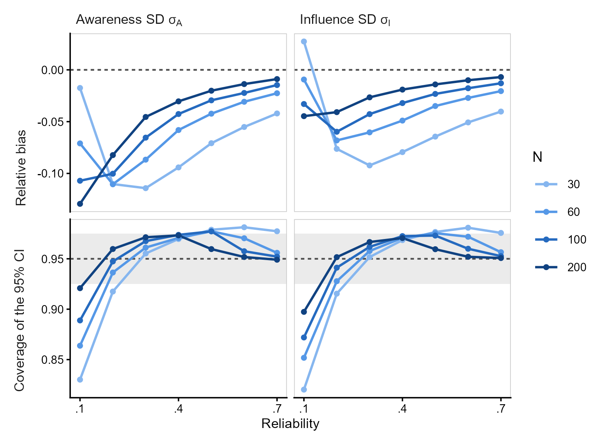
```

## Correlation

@fig-s-rho shows correlation bias and coverage by true correlation,
reliability, and sample size. Estimates were unbiased when the true
correlation was zero. At low reliability, strong correlations were
underestimated because estimates were highly variable but bounded
at $\pm 1$. At moderate reliability, they were slightly
overestimated (by .02 to .06), with bias disappearing as reliability
increased. At low reliability, 95% CIs were conservative for weak
correlations, with coverage close to 1. Coverage fell below .925
only at $\rho = .8$ and reliability of .3 or lower.

Because CIs and tests of H2 were available only for testable fits,
inferences were based on a subset of replications selected according
to their estimates. @tbl-s-rho-selection compares correlation bias
across all fits and testable fits. At very low reliability, boundary
fits often had correlations of $\pm 1$, so excluding them increased
the underestimation of strong correlations. With $R = .1$ and
$\rho = .8$, bias changed from
`r tex(fmt(mean(s1$bias[s1$parameter == "rho" & s1$reliab == .1 & s1$rho == .8]), 2, FALSE))`
to
`r tex(fmt(mean(s1$bias_testable[s1$parameter == "rho" & s1$reliab == .1 & s1$rho == .8]), 2, FALSE))`.
At reliability of .5 or higher, both biases were close to zero.

```{r}
#| label: fig-s-rho
#| fig-cap: "Bias and Coverage of the Correlation by True Correlation in Simulation Study 1"
#| apa-note: >-
#|   Means over trials per condition and true intercepts. Bias was
#|   computed over all fits with an estimate, and coverage over testable
#|   fits. The gray band in the coverage panels shows Bradley's liberal
#|   criterion, [.925, .975].
#| out-width: "100%"
#| echo: false

# Include the figure made in "R scripts/Simulation study/uSDT_validation_analysis.R".
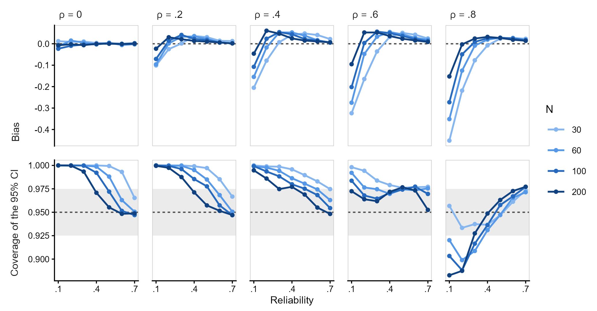
```

```{r}
#| label: tbl-s-rho-selection
#| tbl-cap: "Bias of the Correlation Over All Fits and Over Testable Fits in Simulation Study 1"
#| apa-note: >-
#|   Means over sample sizes, trials per condition, and true intercepts.
#|   All = every fit with an estimate, including estimates at $\pm 1$;
#|   Testable = fits with SEs for the correlation. The correlation was
#|   unbiased under both definitions when $\rho = 0$.
#| echo: false

# Mean bias by reliability and true correlation, over all and testable fits.
sel_tbl <- s1 |>
  filter(parameter == "rho", rho > 0) |>
  summarise(all = mean(bias), testable = mean(bias_testable), .by = c(reliab, rho)) |>
  pivot_wider(names_from = rho, values_from = c(all, testable)) |>
  select(reliab, all_0.2, testable_0.2, all_0.4, testable_0.4,
         all_0.6, testable_0.6, all_0.8, testable_0.8) |>
  mutate(reliab = fmt(reliab, 1, FALSE), across(-reliab, \(x) tex(fmt(x, 2, FALSE))))

# Generate LaTeX for the table.
tab <- kable(
  sel_tbl, "latex", booktabs = TRUE, escape = FALSE,
  col.names = c("$R$", rep(c("All", "Testable"), 4)),
  align = rep("c", 9), linesep = ""
)

# Add the headers of each true correlation.
tab <- tab |>
  kableExtra::add_header_above(c(" " = 1, "$\\\\rho = .2$" = 2, "$\\\\rho = .4$" = 2,
                                 "$\\\\rho = .6$" = 2, "$\\\\rho = .8$" = 2),
                               escape = FALSE)

# Print the table, giving back the space that apaquarto removes.
asis_output(paste0("\\vspace{20pt}{\\small\n", tab, "\n}\\vspace{16pt}"))
```

## Hypothesis Tests

@fig-s-h1 shows H1 rejection rates against the true group-level
difference. Although no condition had a difference of exactly zero,
in the `r s1_h1_null$n` conditions closest to zero
(`r tex(fmt(s1_h1_null$truth, 3, FALSE))`), rejection rates ranged
from `r fmt(s1_h1_null$min, 3, FALSE)` to
`r fmt(s1_h1_null$max, 3, FALSE)`, close to the nominal .05.

@fig-s-h1-power shows H1 power for the 15 true differences by sample
size and number of trials, averaged over reliability. Power increased
with the size of the difference, sample size, and trials. For example,
with a difference of $-.20$ and $N = 100$, power increased from
`r pct(s1_h1_pow$power[s1_h1_pow$intercept == 0 & s1_h1_pow$rho == 0 & s1_h1_pow$N == 100 & s1_h1_pow$trials == 10])`
with 10 trials to
`r pct(s1_h1_pow$power[s1_h1_pow$intercept == 0 & s1_h1_pow$rho == 0 & s1_h1_pow$N == 100 & s1_h1_pow$trials == 50])`
with 50 trials. Because each difference corresponds to a combination
of intercept and correlation, power also increased with correlation,
which reduces the variance of the difference between sensitivities.
Thus, a difference of .108 ($\rho = .8$) was detected more often than
one of .100 ($\rho = 0$).

The figure shows trials rather than reliability because they affected
H1 differently in our design. At a fixed number of trials, the
sampling variance of $d^\prime$ is fixed, so higher reliability
requires larger true SDs (@tbl-s-true-sds). Consequently, the
variance of observed sensitivities (true plus sampling variance)
increased with reliability. With 10 trials, the awareness-task
variance increased from
`r fmt(s1_obs_var$var[s1_obs_var$reliab == .1], 2)` at $R = .1$ to
`r fmt(s1_obs_var$var[s1_obs_var$reliab == .7], 2)` at $R = .7$.
Larger individual differences increase the variability of the
group-level mean. Thus, at fixed trials, H1 power was lower with
$R = .7$ than with $R = .1$ in `r pct(s1_h1_R)` of conditions with
a difference of at least .05. Across reliability levels, power
varied by `r fmt(mean(s1_h1_pow$range), 2, FALSE)` on average
(maximum `r fmt(max(s1_h1_pow$range), 2, FALSE)`).

In contrast, more trials reduce sampling variance without changing
the true SDs. Power was at least as high with 50 as with 10 trials in
`r if (s1_h1_K == 1) "all" else pct(s1_h1_K)` of these conditions.
Thus, H1 power depends on the variance of the observed difference,
not reliability itself. For H2 and H3, which concern individual
differences, power increased with reliability (Figure 2 of the
main text).

@fig-s-h2h3 compares H2 and H3 rejection rates over testable fits
and all replications. The Type I error rate of H2 was close to .05
with reliability of at least .4 and $N \geq 100$, but conservative
otherwise, falling below .01 with $N = 30$ and reliability of .4
or lower. For H3, it was close to .05 except in the nine conditions
with reliability of .2 or lower and $\rho = .8$ described in the
main text. Power increased with sample size, reliability, and effect
size. At low reliability, the gap between the two lines in each
panel shows that most power loss came from untestable fits. At
$R = .1$, researchers would rarely be able to test H2 or H3,
regardless of sample size.

```{r}
#| label: fig-s-h1
#| fig-cap: "Rejection Rate of H1 by True Difference in Simulation Study 1"
#| apa-note: >-
#|   Each point is one condition. The dashed line shows the nominal .05
#|   level. H1 was always testable.
#| out-width: "100%"
#| echo: false

# Include the figure made in "R scripts/Simulation study/uSDT_validation_analysis.R".
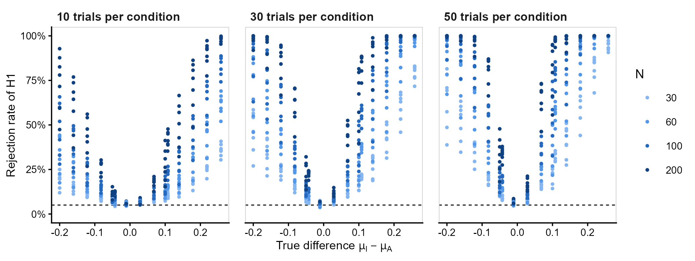
```

```{r}
#| label: fig-s-h1-power
#| fig-cap: "Power of H1 by Trials, Sample Size, and True Difference in Simulation Study 1"
#| apa-note: >-
#|   Proportion of the 1,000 replications per condition in which H1 was
#|   rejected at $\alpha = .05$, averaged over the seven reliability
#|   levels, with which power decreased slightly for a fixed number of
#|   trials (see text). Each panel shows one of the 15 true group-level
#|   differences, ordered by absolute value; the first one, closest to
#|   zero, shows a rate close to the Type I error rate. Values of .80 or
#|   more are in bold. H1 was always testable.
#| out-width: "100%"
#| echo: false

# Include the figure made in "R scripts/Simulation study/uSDT_validation_analysis.R".
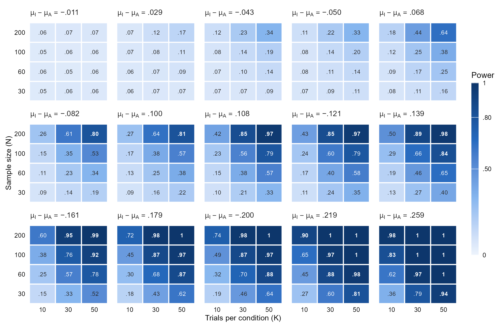
```

```{r}
#| label: fig-s-h2h3
#| fig-cap: "Rejection Rates of H2 and H3 in Simulation Study 1"
#| apa-note: >-
#|   Means over trials per condition and the true value of the other
#|   parameter. Solid lines show rejection rates over testable fits, and
#|   dashed lines over all replications, counting untestable fits as
#|   non-rejections. Panels with $\rho = 0$ and $\beta_0 = 0$ show Type I
#|   error rates; the gray line marks .05.
#| out-width: "100%"
#| echo: false

# Include the figure made in "R scripts/Simulation study/uSDT_validation_analysis.R".
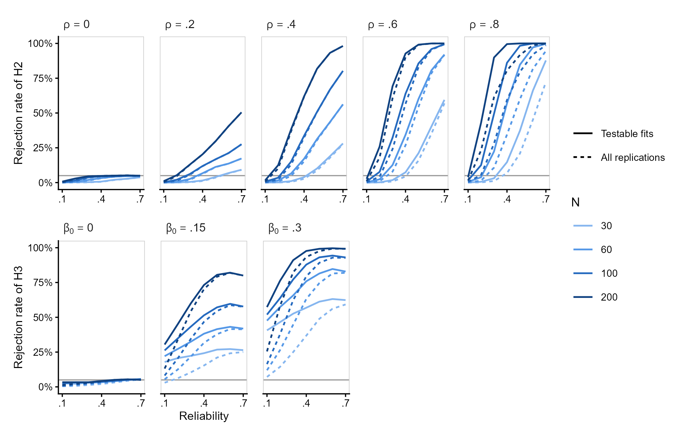
```

Figure 2 of the main text shows power counting untestable fits as
non-rejections, which is the probability that a researcher concludes in
favor of the hypothesis when planning a study under each condition.
@fig-s-power-testable shows power over testable fits only. For
correlations up to .6 with $R \geq .4$, both versions differed by at
most
`r fmt(max(with(s1_pow, (testable - all)[parameter == "rho" & effect <= .6 & reliab >= .4])), 2, FALSE)`.
Power over testable fits was much higher where boundary fits were
frequent: for $\rho = .8$, for which many estimates lay at $+1$ (up to
`r fmt(max(with(s1_pow, (testable - all)[parameter == "rho" & effect == .8])), 2, FALSE)`
higher), and for H3 with $R \leq .3$ (up to
`r fmt(max(with(s1_pow, (testable - all)[parameter == "intercept" & reliab <= .3])), 2, FALSE)`
higher). These values are conditional on obtaining a testable fit, which
a researcher cannot guarantee, and with low reliability testable fits
are a selected subset, the same in which the Type I error rate of H3
exceeded .075 in some conditions. We therefore report power over all
replications in the main text.

```{r}
#| label: fig-s-power-testable
#| fig-cap: "Power Over Testable Fits by Reliability, Sample Size, and Effect Size in Simulation Study 1"
#| apa-note: >-
#|   Proportion of testable fits in which H2 or H3 was rejected at
#|   $\alpha = .05$. Each H2 panel shows one nonzero true correlation,
#|   averaged over the three true intercepts, and each H3 panel one
#|   nonzero true intercept, averaged over the five true correlations;
#|   all cells are also averaged over trials per condition. Values of .80
#|   or more are in bold. Figure 2 of the main text shows the same power
#|   counting untestable fits as non-rejections.
#| out-width: "100%"
#| echo: false

# Include the figure made in "R scripts/Simulation study/uSDT_validation_analysis.R".
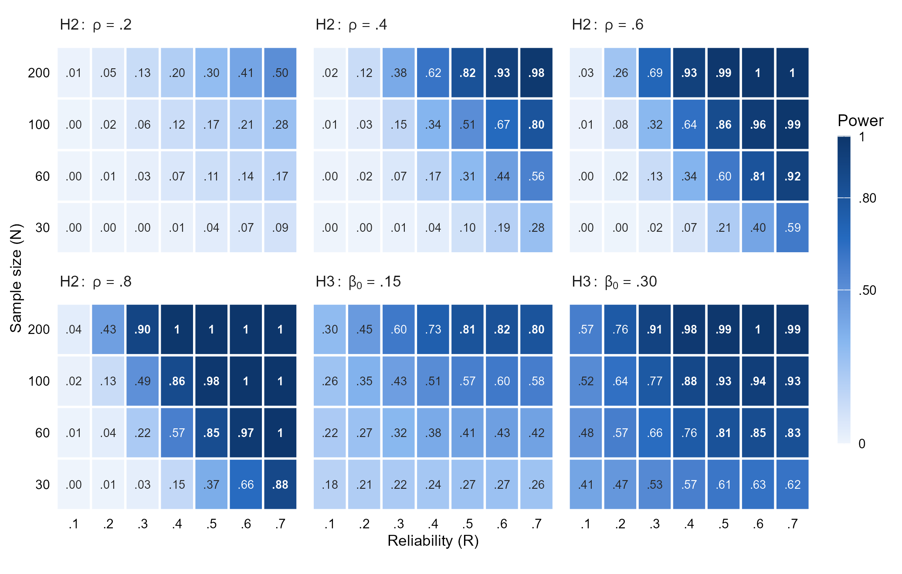
```

\clearpage

# SM3: Simulation Study 2 (Robustness)

## Data-Generating Models and Population Values

This simulation examined the robustness of the multilevel SDT model
when the true sensitivities do not follow a bivariate normal
distribution. We generated trial-level data under two alternative
population models, adapted from @Klauer1998Unbiased and
@Goldstein2022Accurately. Both models allow a proportion of
participants to have zero awareness sensitivity, but differ in how
awareness sensitivities are distributed and how they relate to
influence-task sensitivity.

**Klauer et al. (1998).** True awareness-task sensitivity follows a
normal distribution censored at zero:
$$
d'_{iA} = \max(0,M_i), \qquad M_i \sim \mathrm{Normal}(\mu = m,\sigma = s).
$${#eq-sim2-01}

Thus, participants whose latent values are negative have zero
awareness sensitivity, while the remaining participants have positive
sensitivities. We fixed $s=2$ and chose $m$ to obtain the desired
population proportion of unaware participants,
$\pi_0=\Phi(-m/s)$. True influence-task sensitivity was generated as
$$
d'_{iI}=\alpha+\beta \cdot d^\prime_{iA}+\varepsilon_i,
$${#eq-sim2-02}
where $\varepsilon_i$ is independent normally distributed residual
variation. This residual was added to @Klauer1998Unbiased['s] original specification to
allow correlations between true sensitivities smaller than one.
Because the relationship is linear in $d'_{iA}$, $\alpha$ represents
the expected influence-task sensitivity when awareness sensitivity
is zero.

**Goldstein et al. (2022).** True awareness-task accuracy,
$\theta_i$, follows a mixture distribution. A proportion $\pi_0$ of
participants has chance-level accuracy ($\theta_i=.5$), while the
remaining participants have accuracies drawn uniformly between .5
and 1. Assuming an unbiased observer in a standard SDT model,
these accuracies correspond to sensitivities
$$
d'_{iA}=2\cdot\Phi^{-1}(\theta_i).
$${#eq-sim2-03}

In contrast to the Klauer model, true influence-task sensitivity
was generated as a linear function of awareness accuracy above
chance ($\theta_i$), not sensitivity ($d^\prime_i$):
$$
d'_{iI}=\alpha+\beta\cdot(\theta_i-.5)+\varepsilon_i.
$${#eq-sim2-04}

Consequently, $\alpha$ again represents the expected influence-task
sensitivity of unaware participants, but the relationship is not
linear when awareness is expressed as $d^\prime_{iA}$.

**Trial-level data.** In both models, awareness-task responses were
generated using a standard probit SDT model, with individual
response criteria drawn from $\mathcal{N}(0,.3^2)$. For the Klauer
model, influence-task responses were also binary. For the Goldstein
model, we generated normally distributed RTs with unit
within-condition SD and a standardized difference between conditions
of $d'_{iI}$. These RTs were dichotomized at each participant's
median, following @Meyen2022Advancing, before fitting the multilevel
SDT model. In both models, we fixed the population SD of
influence-task sensitivity at $\sigma_I=.3$ and selected $\beta$
and the residual SD to obtain the desired correlation $\rho$
between influence-task sensitivity and its generating predictor.

**Population values.** The multilevel SDT model describes the 
joint distribution of true sensitivities using their means, SDs,
and correlation. We calculated these population values under 
each generating model to evaluate parameter recovery, focusing 
particularly on the correlation and regression intercept. The 
latter is defined as
$$
\beta_0=\mu_I-
\frac{\operatorname{Cov}(d'_{iA},d'_{iI})}
{\mathbb{V}(d'_{iA})}\cdot\mu_A,
$$ {#eq-s-projection}
which defines the intercept of the best linear prediction of
$d'_{iI}$ from $d'_{iA}$.

Under the Klauer model, the relationship between true sensitivities is linear, so the population regression intercept equals the generating intercept, $\beta_0=\alpha$, and the correlation between true sensitivities equals $\rho$.

Under the Goldstein model, however, influence-task sensitivity is linear in awareness accuracy rather than in $d'$ (@eq-sim2-04). Recall that awareness can be expressed either as accuracy above chance, $\theta_i-.5$, or as SDT sensitivity. Under the equal-variance SDT model with an unbiased response criterion, accuracy is given by $\theta_i=\Phi(d^\prime_{iA}/2)$, so solving for $d^\prime_{iA}$ gives $d^\prime_{iA}=2\cdot\Phi^{-1}(\theta_i)$ (@eq-sim2-03). Although these two measures represent awareness on different scales, their relationship is nonlinear. To determine the corresponding population intercept and correlation on the $d'$ scale, we need to calculate their means, variances, and covariance.

For simplicity, let $X=d^\prime_{iA}$ and $U=\theta_i-.5$. Under the Goldstein model, their expected values are
$$
\begin{aligned}
\mathbb{E}(X)
&= p\cdot\mathbb{E}(X\mid\mathrm{aware})
+(1-p)\cdot\mathbb{E}(X\mid\mathrm{unaware}),\\
\mathbb{E}(U)
&= p\cdot\mathbb{E}(U\mid\mathrm{aware})
+(1-p)\cdot\mathbb{E}(U\mid\mathrm{unaware}).
\end{aligned}
$$ {#eq-s-means-mixture}

Notice, however, that both awareness sensitivity and accuracy above chance are exactly zero for unaware participants. Therefore, @eq-s-means-mixture simplifies to
$$
\mathbb{E}(X) = p\cdot\mathbb{E}(X\mid\mathrm{aware})\qquad\text{and}\qquad
\mathbb{E}(U) = p\cdot\mathbb{E}(U\mid\mathrm{aware}).
$$ {#eq-s-means-aware}

For aware participants, $U$ follows a uniform distribution between 0 and .5. Its expected value and variance are therefore
$$
\begin{aligned}
\mathbb{E}(U\mid\mathrm{aware}) &= \frac{a + b}{2}=\frac{0 + 0.5}{2} = \frac{1}{4},\\
\mathbb{V}(U\mid\mathrm{aware}) &= \frac{\left(b - a\right)^2}{12}=\frac{\left(0.5 - 0\right)^2}{12} = \frac{1}{48}.
\end{aligned}
$$ {#eq-s-moments-u}

For aware participants, $X$ follows a half-normal distribution with scale parameter 2, corresponding to a normal distribution with mean 0 and SD 2 truncated below at zero. The expected value and variance of a lower-truncated normal distribution are [@greene2011, p.836]:
$$
\mathbb{E}(X\mid\mathrm{aware})
=\mu_X+\sigma_X\cdot\lambda(\tau),\qquad\text{and}\qquad
\mathbb{V}(X\mid\mathrm{aware})
=\sigma_X^2\cdot[1-\delta(\tau)],
$$ {#eq-s-truncnorm}
where $\tau=-\mu_X/\sigma_X$,
$$
\lambda(\tau)=\frac{\phi(\tau)}{1-\Phi(\tau)}, \qquad\text{and}\qquad \delta(\tau)=\lambda(\tau)\cdot\left[\lambda(\tau)-\tau\right].
$$ {#eq-s-lambda-delta}
Here, $\phi$ and $\Phi$ are the probability density function and cumulative distribution function of the standard normal distribution, respectively.
In our case, $\mu_X=0$, $\sigma_X=2$, and $\tau=0$, so @eq-s-truncnorm gives
$$
\mathbb{E}(X\mid\mathrm{aware})
=2\cdot\sqrt{\frac{2}{\pi}},\qquad\text{and}\qquad
\mathbb{V}(X\mid\mathrm{aware})
=4\cdot\left(1-\frac{2}{\pi}\right).
$$ {#eq-s-moments-x}

To obtain the population means and variances, we account for the proportion $p$ of aware participants. As shown in @eq-s-means-aware, the population means are obtained by multiplying the conditional means (@eq-s-moments-u and @eq-s-moments-x) by $p$:
$$
\mathbb{E}(X) = p\cdot2\cdot\sqrt{\frac{2}{\pi}}\qquad\text{and}\qquad
\mathbb{E}(U) = p\cdot\frac{1}{4}.
$$ {#eq-s-means}

The population variances can then be obtained using the identity $\mathbb{V}(Y)=\mathbb{E}(Y^2)-[\mathbb{E}(Y)]^2$. Since both variables are zero for unaware participants, their second moments are
$$
\mathbb{E}(X^2)=p\cdot\mathbb{E}(X^2\mid\mathrm{aware}),\qquad\text{and}\qquad
\mathbb{E}(U^2)=p\cdot\mathbb{E}(U^2\mid\mathrm{aware}).
$$ {#eq-s-second-moments}

Using $\mathbb{E}(Y^2\mid\mathrm{aware})=\mathbb{V}(Y\mid\mathrm{aware})+[\mathbb{E}(Y\mid\mathrm{aware})]^2$ and the conditional moments in @eq-s-moments-u and @eq-s-moments-x, we obtain
$$
\begin{aligned}
\mathbb{E}(X^2\mid\mathrm{aware})
&=4\cdot\left(1-\frac{2}{\pi}\right)
+\left(2\cdot\sqrt{\frac{2}{\pi}}\right)^2=4,\\
\mathbb{E}(U^2\mid\mathrm{aware})
&=\frac{1}{48}+\left(\frac14\right)^2
=\frac{1}{12}.
\end{aligned}
$$ {#eq-s-second-moments-aware}

Therefore, combining @eq-s-means, @eq-s-second-moments, and @eq-s-second-moments-aware, the population variances are
$$
\begin{aligned}
\mathbb{V}(X)
&=4\cdot  p-\left(2\cdot p\cdot \sqrt{\frac{2}{\pi}}\right)^2
=4\cdot p\cdot \left(1-\frac{2\cdot p}{\pi}\right),\\
\mathbb{V}(U)
&=\frac{p}{12}-\left(\frac{p}{4}\right)^2
=\frac{p\cdot  (4-3\cdot p)}{48}.
\end{aligned}
$$ {#eq-s-variances}

To obtain the population intercept and correlation, we also need the covariance between $X$ and $U$, which is defined as
$$
\operatorname{Cov}(X,U)=\mathbb{E}(X\cdot U)-\mathbb{E}(X)\cdot\mathbb{E}(U).
$$ {#eq-s-cov-def}

Since we already know the population means (@eq-s-means), we only need to calculate $\mathbb{E}(X\cdot U)$. As both variables are zero for unaware participants, this simplifies to
$$
\mathbb{E}(X\cdot U)=p\cdot\mathbb{E}(X\cdot U\mid\mathrm{aware}).
$$ {#eq-s-exu}

For aware participants, $X=2\cdot|Z|$ and $U=\Phi(|Z|)-.5$, where $Z$ is a standard normal variable. Since the density of $|Z|$ is $2\cdot\phi(z)$ for $z\geq0$, their expected product is
$$
\begin{aligned}
\mathbb{E}(X\cdot U\mid\mathrm{aware})
&=4\int_0^\infty z\cdot[\Phi(z)-.5]\cdot\phi(z)\,dz\\
&=4\int_0^\infty\phi(z)^2\,dz\\
&=\frac{1}{\sqrt{\pi}},
\end{aligned}
$$ {#eq-s-exu-aware}
where the second equality follows from integration by parts, using $\phi'(z)=-z\cdot\phi(z)$. Therefore, substituting the population means (@eq-s-means) and the expected product (@eq-s-exu and @eq-s-exu-aware) into @eq-s-cov-def gives
$$
\begin{aligned}
\operatorname{Cov}(X,U)
&=\frac{p}{\sqrt{\pi}}
-\left(2p\sqrt{\frac{2}{\pi}}\right)\cdot\frac{p}{4}\\
&=\frac{p}{\sqrt{\pi}}\cdot
\left(1-\frac{p}{\sqrt{2}}\right).
\end{aligned}
$$ {#eq-s-cov}

We can now use these population moments (@eq-s-means, @eq-s-variances, and @eq-s-cov) to derive the regression intercept. Recall that, under the Goldstein model, influence-task sensitivity is generated as $d'_{iI}=\alpha+\beta\cdot U+\varepsilon_i$ (@eq-sim2-04), where $\varepsilon_i$ is independent of $X$ and $U$ and has mean zero. Therefore, $\mu_I=\alpha+\beta\cdot\mathbb{E}(U)$ and $\operatorname{Cov}(X,d^\prime_{iI})=\beta\cdot\operatorname{Cov}(X,U)$. Substituting these expressions into @eq-s-projection gives
$$
\begin{aligned}
\beta_0-\alpha
&=\beta\cdot\left[
\mathbb{E}(U)-
\frac{\operatorname{Cov}(X,U)}{\mathbb{V}(X)}
\cdot\mathbb{E}(X)
\right]\\
&=\beta\cdot\left[
\frac{p}{4}-
\frac{p\cdot(1-p/\sqrt{2})/\sqrt{\pi}}
{4\cdot p\cdot(1-2\cdot p/\pi)}
\cdot2\cdot p\cdot\sqrt{\frac{2}{\pi}}
\right]\\
&=\beta\cdot
\frac{p\cdot(\pi-2\cdot\sqrt{2})}{4\cdot(\pi-2\cdot p)}.
\end{aligned}
$$ {#eq-s-kappa}

Because $\pi>2\cdot\sqrt{2}$ and $0<p\leq1$, the difference $\beta_0-\alpha$ is positive whenever $\beta>0$. Thus, although $\alpha$ represents the expected influence-task sensitivity of unaware participants, $\beta_0$ is the intercept of the best linear approximation to the relationship expressed on the $d'$ scale.

Finally, we derive the correlation between true sensitivities. The generating correlation $\rho$ is defined between $U$ and $d^\prime_{iI}$, whereas the multilevel SDT model describes the correlation between $X$ and $d^\prime_{iI}$. Since the residuals are independent of both awareness measures,
$$
\begin{aligned}
\rho_d
&=\frac{\operatorname{Cov}(X,d^\prime_{iI})}
{\sqrt{\mathbb{V}(X)}\cdot\sigma_I}\\
&=\frac{\beta\cdot\operatorname{Cov}(X,U)}
{\sqrt{\mathbb{V}(X)}\cdot\sigma_I}\\
&=\underbrace{\frac{\beta\cdot\sqrt{\mathbb{V}(U)}}
{\sigma_I}}_{\rho}
\cdot
\underbrace{\frac{\operatorname{Cov}(X,U)}
{\sqrt{\mathbb{V}(X)\cdot\mathbb{V}(U)}}}_{\operatorname{Cor}(X,U)}\\
&=\rho\cdot
\frac{\sqrt{12/\pi}\cdot(1-p/\sqrt{2})}
{\sqrt{(1-2\cdot p/\pi)\cdot(4-3\cdot p)}}.
\end{aligned}
$$ {#eq-s-rho}

Thus, the correlation between true sensitivities differs from the generating correlation because awareness accuracy and sensitivity are related nonlinearly.
We therefore distinguished the generating intercept $\alpha$
from the population linear-projection intercept $\beta_0$ when
evaluating the results. The resulting population values are
reported in @tbl-s-true-robust.

```{r}
#| label: tbl-s-true-robust
#| tbl-cap: "Population Values Under the Generating Models of Simulation Study 2"
#| apa-note: >-
#|   $\pi_0$ = proportion of unaware participants; $\mu_A$ and $\sigma_A$ =
#|   mean and SD of true awareness-task sensitivity; $\rho_d$ = correlation
#|   between true sensitivities; $\beta_0 - \alpha$ = difference between
#|   the intercept of the multilevel model and the intercept of the
#|   generating model. Values for a generating correlation $\rho$ of .2,
#|   .4, or .6, with $\sigma_I = 0.3$; they do not depend on $\alpha$.
#| echo: false

# Population values of each model, unaware proportion and correlation.
grid <- expand.grid(rho = c(.2, .4, .6), prop_unaware = c(.2, .5, .8),
                    DGM = c("Klauer", "Goldstein"), stringsAsFactors = FALSE)
true_tbl <- cbind(grid, t(mapply(robustness_parameters, DGM = grid$DGM,
                                 prop_unaware = grid$prop_unaware, rho = grid$rho,
                                 MoreArgs = list(intercept = 0, sd_dI = .3)))) |>
  mutate(gap = intercept_hsdt) |>
  select(DGM, prop_unaware, rho, mu_dD, sd_dD, cor_d, gap) |>
  pivot_wider(names_from = rho, values_from = c(cor_d, gap)) |>
  mutate(prop_unaware = fmt(prop_unaware, 1, FALSE),
         across(c(mu_dD, sd_dD), \(x) fmt(x, 2)),
         across(starts_with("cor_d"), \(x) fmt(x, 3, FALSE)),
         across(starts_with("gap"), \(x) fmt(x, 3)))

# Generate LaTeX for the table, without the column of models.
tab <- kable(
  select(true_tbl, -DGM), "latex", booktabs = TRUE, escape = FALSE,
  col.names = c("$\\pi_0$", "$\\mu_A$", "$\\sigma_A$",
                "$\\rho = .2$", "$\\rho = .4$", "$\\rho = .6$",
                "$\\rho = .2$", "$\\rho = .4$", "$\\rho = .6$"),
  align = rep("c", 9), linesep = ""
)

# Add the headers of each quantity, and group the rows of each model.
tab <- tab |>
  kableExtra::add_header_above(c(" " = 3, "$\\\\rho_d$" = 3, "$\\\\beta_0 - \\\\alpha$" = 3),
                               escape = FALSE) |>
  kableExtra::pack_rows("Klauer et al. (1998)", 1, 3) |>
  kableExtra::pack_rows("Goldstein et al. (2022)", 4, 6)

# Print the table, giving back the space that apaquarto removes.
asis_output(paste0("\\vspace{20pt}{\\small\n", tab, "\n}\\vspace{16pt}"))
```

## Reliability of the Observed Sensitivities

Reliability was not a design factor in Study 2. The SDs of true
sensitivities were fixed by each model ($\sigma_I = 0.3$, and
$\sigma_A$ as in @tbl-s-true-robust), so the reliability of the
observed sensitivities depended on the number of trials and, in the
awareness task, on the proportion of unaware participants.
@eq-s-reliability cannot be applied to the awareness task, because its
expected sampling variance is infinite: for near-perfect participants,
the sampling variance of $\hat{d}^\prime$ grows faster than the density
of $d^\prime_{iA}$ decreases. We therefore computed reliability as the
squared correlation between true and observed sensitivities in 100,000
participants simulated as in each condition, with observed sensitivities
computed with the log-linear correction [@Hautus1995Corrections] and,
in the model of Goldstein et al., after the median split of the RTs. In
the conditions of Study 1, this measure differed from the nominal
reliability by at most `r fmt(s2_rel_check, 3, FALSE)`.

@tbl-s-reliab-robust shows the results. The reliability of the influence
task depended only on the number of trials
(`r fmt(s2_rel_I$influence[1], 2, FALSE)`,
`r fmt(s2_rel_I$influence[2], 2, FALSE)`, and
`r fmt(s2_rel_I$influence[3], 2, FALSE)` with 10, 30, and 50 trials,
varying by at most `r fmt(max(s2_rel_I$range), 2, FALSE)` across
models, unaware proportions, correlations, and intercepts), comparable
to reliabilities of .2, .5, and .6 in Study 1. The awareness task was more
reliable (`r fmt(min(s2_rel$awareness), 2, FALSE)` to
`r fmt(max(s2_rel$awareness), 2, FALSE)`), because true awareness-task
sensitivities were much more variable than influence-task sensitivities,
and it was least reliable with 80% of unaware participants, when
$\sigma_A$ was smallest. Unlike Study 1, in which both tasks had the
same reliability, Study 2 thus combined a reliable awareness task with an
influence task of low to moderate reliability.

```{r}
#| label: tbl-s-reliab-robust
#| tbl-cap: "Reliability of the Observed Sensitivities in Simulation Study 2"
#| apa-note: >-
#|   Squared correlation between true and observed sensitivities in
#|   100,000 simulated participants per condition, averaged over the
#|   generating correlations and intercepts. $\pi_0$ = proportion of
#|   unaware participants; $K$ = trials per condition and task.
#| echo: false

# Reliability by model, unaware proportion, and trials.
rel_tbl <- s2_rel |>
  select(DGM, prop_unaware, trials, awareness, influence) |>
  pivot_wider(names_from = trials, values_from = c(awareness, influence)) |>
  arrange(factor(DGM, levels = c("Klauer", "Goldstein")), prop_unaware) |>
  mutate(prop_unaware = fmt(prop_unaware, 1, FALSE),
         across(-c(DGM, prop_unaware), \(x) fmt(x, 2, FALSE)))

# Generate LaTeX for the table, without the column of models.
tab <- kable(
  select(rel_tbl, -DGM), "latex", booktabs = TRUE, escape = FALSE,
  col.names = c("$\\pi_0$", rep(c("$K = 10$", "$K = 30$", "$K = 50$"), 2)),
  align = rep("c", 7), linesep = ""
)

# Add the headers of each task, and group the rows of each model.
tab <- tab |>
  kableExtra::add_header_above(c(" " = 1, "Awareness task" = 3, "Influence task" = 3)) |>
  kableExtra::pack_rows("Klauer et al. (1998)", 1, 3) |>
  kableExtra::pack_rows("Goldstein et al. (2022)", 4, 6)

# Print the table, giving back the space that apaquarto removes.
asis_output(paste0("\\vspace{20pt}{\\small\n", tab, "\n}\\vspace{16pt}"))
```

## Convergence and Boundary Fits

All models converged except `r s2_fit["Klauer", "failed"]` fits under
the model of Klauer et al. and `r s2_fit["Goldstein", "failed"]` under
the model of Goldstein et al. (out of 324,000 each). Untestable fits
were less frequent than in Study 1
(`r pct(s2_fit["Klauer", "mean"])` and
`r pct(s2_fit["Goldstein", "mean"])` on average, with maxima of
`r pct(s2_fit["Klauer", "max"])` and `r pct(s2_fit["Goldstein", "max"])`),
because the awareness task was more reliable in both models
(@tbl-s-reliab-robust). As
@fig-s-boundary-robust shows, they occurred mostly with 10 trials per
condition, when the influence task was least reliable
(`r pct(s2_fit["Klauer", "k10"])` and `r pct(s2_fit["Goldstein", "k10"])`
on average, compared with `r pct(s2_fit["Klauer", "k50"], 1)` and
`r pct(s2_fit["Goldstein", "k50"], 1)` with 50 trials), and with 30
participants. They were somewhat more frequent with 80% of unaware
participants, when the awareness task was least variable.

```{r}
#| label: fig-s-boundary-robust
#| fig-cap: "Untestable Fits by Trials, Sample Size, and Proportion of Unaware Participants in Simulation Study 2"
#| apa-note: >-
#|   Proportion of fits without SEs for the correlation and the
#|   intercept, averaged over generating correlations and intercepts.
#| out-width: "90%"
#| echo: false

# Include the figure made in "R scripts/Simulation study/uSDT_robustness_analysis.R".
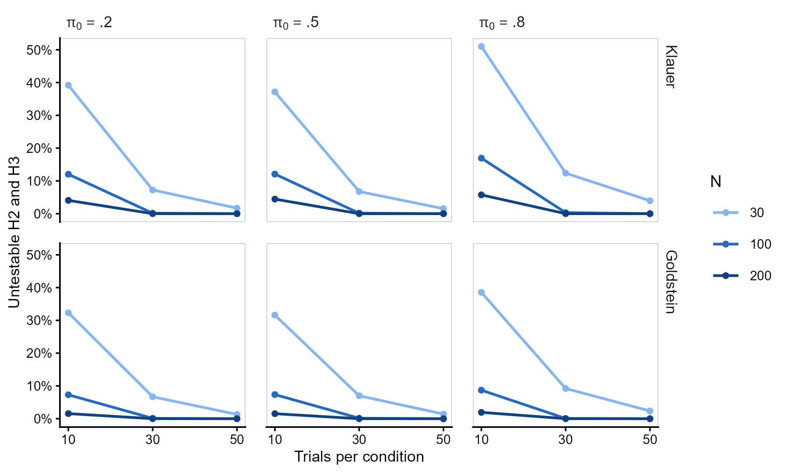
```

## Recovery and Inference

@tbl-s-robust summarizes bias, coverage, and rejection rates under the
null hypothesis for the correlation and the intercept, and
@fig-s-robust-bias shows bias and coverage by trials and sample size.
The correlation was slightly overestimated with few trials, and its
intervals were conservative with 30 participants or 10 trials; its Type
I error rate never exceeded .08 and was conservative in 14% of the null
conditions. The intercept of the multilevel model was recovered with
little bias, its coverage was close to .95, and its Type I error rate
was within Bradley's criterion in nearly every null condition. Against
the generating intercept $\alpha$, the estimates of Goldstein's model
were positively biased, coverage fell to
`r fmt(s2_alpha_cov, 3, FALSE)` in the worst condition, and the
rejection rate when $\alpha = 0$ exceeded .075 in 13% of the null
conditions (see the last section).

```{r}
#| label: tbl-s-robust
#| tbl-cap: "Bias, Coverage, and Rejection Rates Under the Null Hypothesis in Simulation Study 2"
#| apa-note: >-
#|   Mean [minimum, maximum] over conditions for bias and ECR, and mean
#|   [maximum] over the null conditions for the rejection rate over
#|   testable fits. The liberal and conservative columns are the
#|   percentages of conditions outside Bradley's liberal criterion.
#|   $\beta_0$ = intercept of the multilevel model; $\alpha$ = intercept
#|   of the generating model (equal to $\beta_0$ in the model of Klauer et
#|   al.). ECR = empirical coverage rate of the 95% CIs.
#| echo: false

# Generate LaTeX for the table, without the column of models.
tab <- kable(
  scorecard_latex[, -1], "latex", booktabs = TRUE, escape = FALSE,
  col.names = c("Target", "Bias", "Mean [range]", "Liberal", "Conservative",
                "Mean [max]", "Liberal", "Conservative"),
  align = c("l", rep("c", 7)), linesep = ""
)

# Add the headers of each measure, and group the rows of each model.
tab <- tab |>
  kableExtra::add_header_above(c(" " = 2, "ECR" = 3, "Rejection under H0" = 3)) |>
  kableExtra::pack_rows("Klauer et al. (1998)", 1, 3) |>
  kableExtra::pack_rows("Goldstein et al. (2022)", 4, 6)

# Print the table, giving back the space that apaquarto removes.
asis_output(paste0("\\vspace{20pt}{\\scriptsize\\setlength{\\tabcolsep}{3pt}\n",
                   tab, "\n}\\vspace{16pt}"))
```

```{r}
#| label: fig-s-robust-bias
#| fig-cap: "Bias and Coverage of the Correlation and the Intercept by Trials and Sample Size in Simulation Study 2"
#| apa-note: >-
#|   Means over the proportion of unaware participants and the generating
#|   correlations and intercepts. $\beta_0$ = intercept of the multilevel
#|   model; $\alpha$ = intercept of the generating model. The gray band in
#|   the coverage panels shows Bradley's liberal criterion, [.925, .975].
#| out-width: "100%"
#| echo: false

# Include the figure made in "R scripts/Simulation study/uSDT_robustness_analysis.R".
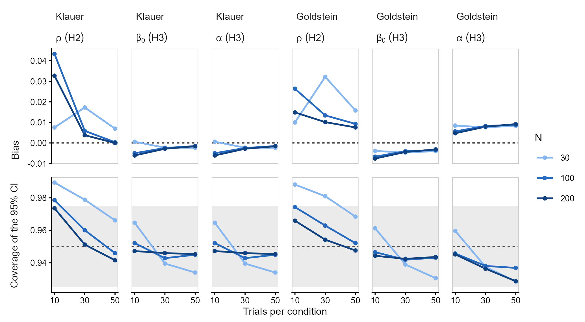
```

## Meta-Models

@tbl-s-anova-klauer and @tbl-s-anova-goldstein report the meta-models of
each generating model, and @tbl-s-emmeans-klauer and
@tbl-s-emmeans-goldstein the marginal means. In both models, the RMSE of
both parameters depended on sample size and trials, and the proportion
of untestable fits on trials, sample size, and their interaction
($\omega^2$ =
`r w2(ANOVA_es_K, "trials", "UNT")`, `r w2(ANOVA_es_K, "N", "UNT")`, and
`r w2(ANOVA_es_K, "N:trials", "UNT")` under the model of Klauer et al.;
`r w2(ANOVA_es_G, "trials", "UNT")`, `r w2(ANOVA_es_G, "N", "UNT")`, and
`r w2(ANOVA_es_G, "N:trials", "UNT")` under the model of Goldstein et
al.). The coverage of the correlation depended on sample size and
trials, because its intervals were conservative with few participants
or few trials. Its bias depended on the number of trials under the
model of Klauer et al.
($\omega^2$ = `r w2(ANOVA_es_K, "trials", "B_H2")`) and on the
generating correlation under the model of Goldstein et al.
($\omega^2$ = `r w2(ANOVA_es_G, "rho", "B_H2")`), but remained small in
absolute terms (@tbl-s-robust). The bias of the intercept depended on
the generating correlation
($\omega^2$ = `r w2(ANOVA_es_K, "rho", "B_H3")` and
`r w2(ANOVA_es_G, "rho", "B_H3")`): the stronger the correlation, the
more the intercept was underestimated, by at most .03. Its coverage
decreased slightly with more trials and larger samples (trials:
$\omega^2$ = `r w2(ANOVA_es_K, "trials", "ECR_H3")` and
`r w2(ANOVA_es_G, "trials", "ECR_H3")`), as this small bias became
larger relative to the SEs.

```{r}
#| label: tbl-s-anova-klauer
#| tbl-cap: "Effect Sizes of the Meta-Models Under the Model of Klauer et al. (1998) in Simulation Study 2"
#| apa-note: >-
#|   Non-partial $\omega^2$. $N$ = sample size; $K$ = trials per
#|   condition; $\pi_0$ = proportion of unaware participants; $\rho$ =
#|   generating correlation; $\alpha$ = generating intercept. H3 is
#|   evaluated against the intercept of the multilevel model, $\beta_0$.
#|   RMSE = root mean squared error; ECR = empirical coverage rate of the
#|   95% CIs; UNT = untestable fits for H2 and H3. Effects with
#|   $\omega^2 < .06$ in every measure are omitted, and values of at
#|   least .14 are in bold.
#| echo: false

# Generate LaTeX for the table.
tab <- kable(
  ANOVA_tbl_K, "latex", booktabs = TRUE, escape = FALSE,
  col.names = c("Predictor", rep(c("Bias", "RMSE", "ECR"), 2), "UNT"),
  align = c("l", rep("c", 7)), linesep = ""
)

# Add the headers of each hypothesis.
tab <- tab |>
  kableExtra::add_header_above(c(" " = 1, "H2: $\\\\rho$" = 3, "H3: $\\\\beta_0$" = 3,
                                 "Boundary" = 1), escape = FALSE)

# Print the table, giving back the space that apaquarto removes.
asis_output(paste0("\\vspace{20pt}{\\small\n", tab, "\n}\\vspace{16pt}"))
```

```{r}
#| label: tbl-s-anova-goldstein
#| tbl-cap: "Effect Sizes of the Meta-Models Under the Model of Goldstein et al. (2022) in Simulation Study 2"
#| apa-note: >-
#|   Non-partial $\omega^2$. Abbreviations as in the previous table. H3 is
#|   evaluated against the intercept of the multilevel model, $\beta_0$.
#|   Effects with $\omega^2 < .06$ in every measure are omitted, and
#|   values of at least .14 are in bold.
#| echo: false

# Generate LaTeX for the table.
tab <- kable(
  ANOVA_tbl_G, "latex", booktabs = TRUE, escape = FALSE,
  col.names = c("Predictor", rep(c("Bias", "RMSE", "ECR"), 2), "UNT"),
  align = c("l", rep("c", 7)), linesep = ""
)

# Add the headers of each hypothesis.
tab <- tab |>
  kableExtra::add_header_above(c(" " = 1, "H2: $\\\\rho$" = 3, "H3: $\\\\beta_0$" = 3,
                                 "Boundary" = 1), escape = FALSE)

# Print the table, giving back the space that apaquarto removes.
asis_output(paste0("\\vspace{20pt}{\\small\n", tab, "\n}\\vspace{16pt}"))
```

```{r}
#| label: tbl-s-emmeans-klauer
#| tbl-cap: "Marginal Means Under the Model of Klauer et al. (1998) in Simulation Study 2"
#| apa-note: >-
#|   Means over the remaining factors. H3 is evaluated against the
#|   intercept of the multilevel model, $\beta_0$. RMSE = root mean
#|   squared error; ECR = empirical coverage rate of the 95% CIs; UNT =
#|   untestable fits for H2 and H3. Coverages outside [.925, .975] are in
#|   bold.
#| echo: false

# Generate LaTeX for the table, without the column of factor names.
tab <- kable(
  marginal_means_K_latex[, -1], "latex", booktabs = TRUE, escape = FALSE,
  col.names = c("Level", rep(c("Bias", "RMSE", "ECR"), 2), "UNT"),
  align = c("l", rep("c", 7)), linesep = ""
)

# Add the headers of each hypothesis, and group the levels of each factor.
tab <- tab |>
  kableExtra::add_header_above(c(" " = 1, "H2: $\\\\rho$" = 3, "H3: $\\\\beta_0$" = 3,
                                 "Boundary" = 1), escape = FALSE) |>
  kableExtra::pack_rows(
    index = table(marginal_means_K_latex$Factor_Name)[unique(marginal_means_K_latex$Factor_Name)],
    escape = FALSE)

# Print the table, giving back the space that apaquarto removes.
asis_output(paste0("\\vspace{20pt}{\\small\n", tab, "\n}\\vspace{16pt}"))
```

```{r}
#| label: tbl-s-emmeans-goldstein
#| tbl-cap: "Marginal Means Under the Model of Goldstein et al. (2022) in Simulation Study 2"
#| apa-note: >-
#|   Means over the remaining factors. Abbreviations as in the previous
#|   table. Coverages outside [.925, .975] are in bold.
#| echo: false

# Generate LaTeX for the table, without the column of factor names.
tab <- kable(
  marginal_means_G_latex[, -1], "latex", booktabs = TRUE, escape = FALSE,
  col.names = c("Level", rep(c("Bias", "RMSE", "ECR"), 2), "UNT"),
  align = c("l", rep("c", 7)), linesep = ""
)

# Add the headers of each hypothesis, and group the levels of each factor.
tab <- tab |>
  kableExtra::add_header_above(c(" " = 1, "H2: $\\\\rho$" = 3, "H3: $\\\\beta_0$" = 3,
                                 "Boundary" = 1), escape = FALSE) |>
  kableExtra::pack_rows(
    index = table(marginal_means_G_latex$Factor_Name)[unique(marginal_means_G_latex$Factor_Name)],
    escape = FALSE)

# Print the table, giving back the space that apaquarto removes.
asis_output(paste0("\\vspace{20pt}{\\small\n", tab, "\n}\\vspace{16pt}"))
```

## Intercept of the Generating Model

@fig-s-alpha shows the rejection rate of H3 when the generating
intercept is zero ($\alpha = 0$). Under the model of Klauer et al., the
intercept of the multilevel model equals $\alpha$, and the rejection
rate stayed close to .05 in every condition. Under the model of
Goldstein et al., the intercept of the multilevel model exceeds $\alpha$
by $\beta \cdot \kappa(p)$ (@eq-s-kappa), so H3 tests a hypothesis that
is false whenever the generating correlation is positive. The
consequence was negligible with few aware participants or weak
correlations, but with 80% of aware participants ($\pi_0 = .2$) and a
generating correlation of .6, the rejection rate grew with the sample
size and the number of trials, reaching
`r pct(s2_fp_max$rejection)` with $N = `r s2_fp_max$N`$ and
$K = `r s2_fp_max$trials`$. This rejection rate is not an error of the
estimator, which recovered $\beta_0$ accurately, but a consequence of
the definition of the intercept as the best linear predictor. It would
increase further with larger samples, because the estimate converges to
$\beta_0$, not to $\alpha$, and the same would happen with any method
that relies on a linear regression of influence-task sensitivity on
awareness-task $d^\prime$.

```{r}
#| label: fig-s-alpha
#| fig-cap: "Rejection Rate of H3 When the Intercept of the Generating Model Is Zero in Simulation Study 2"
#| apa-note: >-
#|   Rejection rates over testable fits in the conditions with
#|   $\alpha = 0$, averaged over trials per condition. The gray band
#|   shows Bradley's liberal criterion, [.025, .075], and the dashed line
#|   the nominal .05.
#| out-width: "90%"
#| echo: false

# Include the figure made in "R scripts/Simulation study/uSDT_robustness_analysis.R".
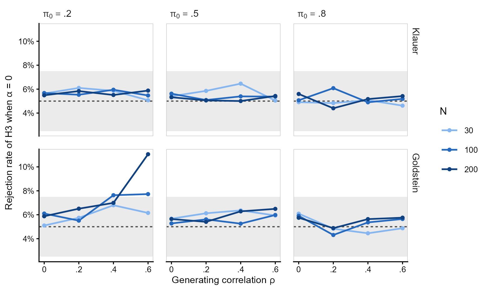
```

\clearpage

# References

::: {#refs}
:::
